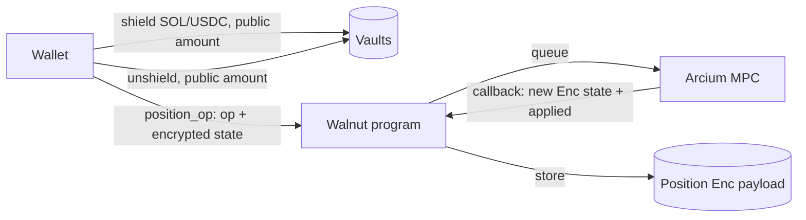

# Design Document

## Overview

Walnut-Diffn adds one circuit, `position_op`, and one queue/callback/abandon instruction set to the existing Walnut program. It follows the proven Task 5 shield/unshield pattern exactly: the queue instruction reads the stored `Enc<Shared, PositionSecret>`, locks the Position, creates an Operation Intent, and queues the circuit; the callback verifies the output, stores the new encrypted payload, and releases the Lock.

Everything else is reused: Market, vaults, `initialize_position`, `shield`, `unshield`, `buildUnwrapWsolTransaction`, the derived output nonce scheme (`state/nonce.rs`), the Viewing Key SDK, and the devnet demo infrastructure (`packages/sdk/demo`).

## Architecture

### Circuit `position_op`

Inputs: `state: Enc<Shared, PositionSecret>`, `owner: Shared` (derived output nonce, as in `unshield`), public `op: u8`, public `amount: u64`, public `price: u64` (USDC base units per 1 SOL), public `ltv_bps: u64`.
Outputs: `(Enc<Shared, PositionSecret>, bool applied, u8 op_echo, u64 amount_echo)`.

PositionSecret field use (no layout change): `free_sol`, `free_usdc`, `collateral_sol`, `supply_shares_usdc` (unused), `debt_shares_usdc` used as plain debt in USDC base units.

Rules, all in `u128` with multiplication by public values and comparisons only:

| op | Applies when | Effect |
|---|---|---|
| 0 add collateral | `amount <= free_sol` | `free_sol -= amount; collateral_sol += amount` |
| 1 withdraw collateral | `amount <= collateral_sol` and `debt * 1e9 * 10_000 <= (collateral_sol - amount) * price * ltv_bps` | `collateral_sol -= amount; free_sol += amount` |
| 2 borrow | `(debt + amount) * 1e9 * 10_000 <= collateral_sol * price * ltv_bps` and `free_usdc + amount <= u64::MAX` | `debt += amount; free_usdc += amount` |
| 3 repay | `amount <= free_usdc` and `amount <= debt` | `free_usdc -= amount; debt -= amount` |

A refusal returns the input state unchanged. The output is always resealed to the owner with the derived unique nonce. Collateral is in lamports (9 decimals) and debt in USDC base units (6 decimals); the factor `1e9` converts lamports to SOL, and price is already in USDC base units, so no secret division exists.

### Program

- `init_position_op_comp_def`, `position_op(computation_offset, sequence, op, amount, price)`, `position_op_callback`, `abandon_position_op`.
- `ltv_bps` comes from the Asset State's existing `RiskParams.ltv_bps` (launch default 5,000).
- The Intent input commitment binds op, amount, price, ltv, stored nonce, ciphertexts and derived nonce input, like `unshield`. Callback: `Applied` stores the payload and bumps the Position generation; `Zero` releases the Lock; unauthenticated output reverts; abandon after Lock expiry.
- Account structs box large accounts and use `#[account(mut, seeds = [&SIGN_PDA_SEED], bump)]` for the sign PDA to stay inside the SBF stack frame.
- New `OperationKind::PositionOp` (next free tag), mapped to no pause category.

### SDK and demo

- `packages/sdk/src/position-op.ts`: op enum, client-side mirror of the rules (`applyPositionOp`), and an instruction builder.
- `packages/sdk/demo/loan-demo.ts` + `demo:loan` script, reusing `balance-demo.ts` state and helpers. It sets a 600,000 compute-unit limit on queue transactions and calls `process.exit(0)`.

## Components and Interfaces

- `encrypted-ixs`: circuit `position_op(state: Enc<Shared, PositionSecret>, owner: Shared, op: u8, amount: u64, price: u64, ltv_bps: u64) -> (Enc<Shared, PositionSecret>, bool, u8, u64)`.
- `programs/walnut`: `init_position_op_comp_def`, `position_op(computation_offset: u64, sequence: u64, op: u8, amount: u64, price: u64)`, `position_op_callback`, `abandon_position_op`; events `PositionOpQueued`, `PositionOpApplied`, `PositionOpRejected`, `PositionOpAbandoned`.
- `packages/sdk`: `PositionOp` enum, `applyPositionOp(state, op, amount, price, ltvBps)`, `buildPositionOpInstruction(...)`.
- `packages/sdk/demo/loan-demo.ts`: the end-to-end devnet demo.

## Data Models

No new accounts. The existing `Position` account and its 176-byte encrypted payload are reused; `debt_shares_usdc` holds plain debt in USDC base units for this demo. The Operation Intent PDA, operation counter and derived output nonce are reused unchanged.

## Correctness Properties

- A refused operation leaves all five balances unchanged.
- Borrow never makes `debt * 1e13 > collateral * price * ltv_bps`.
- Withdraw collateral never leaves the Position over the LTV limit.
- Repay never makes free USDC or debt negative.
- Collateral and free SOL sum is preserved by ops 0 and 1; free USDC minus debt is preserved by ops 2 and 3.
## Error Handling

A refused operation is a normal `Zero` outcome with an unchanged Position. Transaction or MPC failures leave the Intent queued; `abandon_position_op` releases the Lock after expiry.

## Testing Strategy

- Rust unit tests of a plain-Rust mirror of the circuit rules (all four ops, boundary at the LTV limit, overflow edges) and of the commitment and callback wiring, reusing existing helpers.
- SDK unit test that `applyPositionOp` matches the Rust vectors.
- The devnet demo is the end-to-end test. Final check: build, fmt, clippy, unit tests, typecheck, lint.

## Known demo shortcuts (not production)

The price is caller-supplied, there is no interest, no Pool cash accounting, no liquidity check before unshield (the vault transfer fails if lenders have not shielded enough), and no liquidation. Amount and op are public arguments to the circuit; balances, collateral and debt are private.