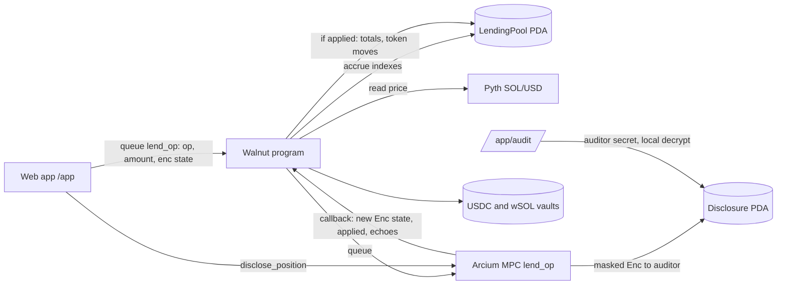

# Design Document

## Overview

Walnut-Lend extends the working devnet loan product (`walnut-diffn`) into a lending market. Per-position balances stay encrypted in `Enc<Shared, PositionSecret>`. Operation amounts, the pool totals and the interest indexes are public. Division never touches a secret: the Program computes every share amount, seize amount and index publicly, and the circuit only multiplies and compares.

Two new circuits are added, because each circuit upload costs about 2 to 3.5 SOL:

- `lend_op`: one circuit for all position-mutating lending ops (add or withdraw collateral, borrow, repay, supply, withdraw supply, health check, liquidate). It replaces `position_op`.
- `disclose_position`: re-seals a field-masked copy of the Position to an auditor key.

`rotate_position_key` already exists and is only registered on devnet and exposed in the App. Existing Positions need no migration: their `debt_shares_usdc` holds plain USDC debt, which equals shares at Borrow_Index 1.0 (`1e9` in the 9-decimal index scale).

The baseline is `.kiro/specs/walnut-diffn/design.md`, `docs/DEVNET_LOAN_DEMO.md` and the code named there. Program id, cluster 456 and branch `v2` are unchanged.

## Architecture



Flow of every lending queue instruction:

1. Check pause category and caps (public).
2. Accrue interest in `LendingPool` (Requirement 4.1).
3. Validate the Pyth price when the op is price-sensitive.
4. Compute shares, seize and bounds publicly; check available liquidity.
5. Lock the Position, create the Operation Intent (inputs commitment binds op, amount, shares, index, price, ltv, thresholds, stored nonce, ciphertexts, output-nonce input), and queue `lend_op`.
6. Callback verifies the output, then on `applied` stores the payload, bumps the generation, updates pool totals and moves tokens; on refusal it releases the Lock (and, for liquidation, refunds the Liquidator). Abandon after Lock expiry works as for `position_op`.

Why public totals leak nothing new: every total changes only by a public operation amount that is already visible on chain (token transfers into or out of the vault). Totals are updated only when the circuit applied the op, and the apply bit is already visible as the callback's result. Per-position shares, collateral, debt and free balances are never in a public account. The Unhealthy_Flag is the one added bit, and only on a health check or liquidation the caller requested.

### Circuit `lend_op`

Signature (Arcis):

```rust
pub fn lend_op(
    state: Enc<Shared, PositionSecret>,
    owner: Shared,              // derived unique output nonce, as in unshield/position_op
    op: u64, amount: u64, shares: u64,
    borrow_index_1e9: u64, price: u64,   // price = USDC base units per 1 SOL
    ltv_bps: u64, liq_threshold_bps: u64, position_debt_cap: u64,
) -> (Enc<Shared, PositionSecret>, bool, u64, u64, u64) // state, applied, op, amount, shares echoes
```

Ops: 0 add collateral, 1 withdraw collateral, 2 borrow, 3 repay, 4 supply, 5 withdraw supply, 6 health check, 7 liquidate. `shares` is the public share amount the Program computed from `amount` (mint for borrow, burn for repay and liquidate, supply shares minted or burned). For op 7, `amount` carries the seize lamports and `shares` the debt burn; the Program echo check ties them to the repay amount (see Components).

Scaled value comparison. With `debt_value = debt_shares * index_1e9` (USDC base units times 1e9) and `coll_value = collateral_lamports * price` (USDC base units times 1e9, because lamports are 1e-9 SOL), the two sides have the same scale. This is equivalent to the `* 1e13` and `* 1e9` form in the draft decisions, with the common `1e9` factor cancelled, so the products are smaller:

| Product | Bound | Max |
|---|---|---|
| `debt_shares * index_1e9 * 10_000` | shares ≤ 1e12 (position debt cap in base units, index ≥ 1e9), index ≤ 1e10 | 1e26 |
| `collateral * price * bps` | collateral ≤ 1e15 lamports (per-asset cap), price ≤ 1e10, bps ≤ 1e4 | 1e29 |
| `(debt_shares + mint) * index_1e9` vs `position_debt_cap * 1e9` | as above | 1e22 |

All fit `u128` (3.4e38) with margin. The Program enforces the bounds: the SOL cap rejects collateral above 1e15 lamports, `price` is clamped to 1e10, and the index is capped at 1e10.

Rules (a refusal returns the input state unchanged, resealed to `owner`):

| op | Applies when | Effect |
|---|---|---|
| 0 add collateral | `amount <= free_sol` | `free_sol -= amount; collateral += amount` |
| 1 withdraw collateral | `amount <= collateral` and `debt_shares*index*1e4 <= (collateral-amount)*price*ltv_bps` | `collateral -= amount; free_sol += amount` |
| 2 borrow | `(debt_shares+shares)*index*1e4 <= collateral*price*ltv_bps` and `(debt_shares+shares)*index <= position_debt_cap*1e9` and `free_usdc+amount` fits u64 | `debt_shares += shares; free_usdc += amount` |
| 3 repay | `shares <= debt_shares` and `amount <= free_usdc` | `debt_shares -= shares; free_usdc -= amount` |
| 4 supply | `amount <= free_usdc` and supply shares fit u64 | `free_usdc -= amount; supply_shares += shares` |
| 5 withdraw supply | `shares <= supply_shares` and `free_usdc+amount` fits u64 | `supply_shares -= shares; free_usdc += amount` |
| 6 health check | never changes state | `applied = unhealthy` where unhealthy iff `debt_shares*index*1e4 > collateral*price*liq_threshold_bps` |
| 7 liquidate | unhealthy and `shares <= debt_shares` and (`shares*2 <= debt_shares` or `shares == debt_shares`) and `amount <= collateral` | `collateral -= amount; debt_shares -= shares` |

Public share maths in the Program (`math/lend.rs`, `WAD = 1e9` index scale):

- borrow: `mint = ceil(amount * 1e9 / borrow_index)`.
- repay: `burn = floor(amount * 1e9 / borrow_index)`. A full repay passes `amount = ceil(debt_shares * index / 1e9)`. For `index >= 1e9`, `floor(ceil(s*i/1e9)*1e9/i) == s`: let `a = ceil(s*i/1e9)`, so `s <= a*1e9/i < s + 1e9/i <= s + 1`, hence the floor is `s`.
- supply: `shares = floor(amount * 1e9 / supply_index)`. Withdraw supply: `burn = ceil(amount * 1e9 / supply_index)`. Rounding favours the pool in both directions.
- liquidate: `burn = floor(repay * 1e9 / borrow_index)`; `seize = floor(repay * 1e9 * (10_000 + bonus_bps) / (price * 10_000))` lamports, using the conservative low-bound price.

Weight target is at most about 1.5e9 CU against `position_op` at 5.3e8: eight branches share one set of selects and a handful of `u128` multiplications. The measured value from `arcium build` is recorded in the task that adds the circuit; if it exceeds the target, ops 4 and 5 can move to a separate small circuit.

### Circuit `disclose_position`

```rust
pub fn disclose_position(
    state: Enc<Shared, PositionSecret>,
    auditor: Shared,       // auditor x25519 key + a nonce derived from the intent
    mask: u64,             // public: bit0 free_sol, bit1 free_usdc, bit2 collateral, bit3 supply_shares, bit4 debt_shares
) -> Enc<Shared, PositionSecret>   // unselected fields are zero
```

The Position is not changed and not locked. The Disclosure records the Position generation it was taken at. The mask is public (which fields are shared is not secret); values are visible only to the holder of the auditor secret.

### Public pool accounting

`LendingPool` holds public totals. At every lending queue the Program computes `dt = now - last_accrual_ts`, then:

- `debt_value = total_debt_shares * borrow_index / 1e9`; `supply_value = total_supply_shares * supply_index / 1e9`.
- `utilization_bps = min(10_000, debt_value * 10_000 / supply_value)` (0 when `supply_value` is 0).
- `rate_bps = borrow_rate_bps(&rates, utilization_bps)` from `math/rate.rs` (the kinked model), converted with `rate_per_second_wad`.
- `borrow_index' = project_index(borrow_index, last_accrual_ts, now, rate_per_second)`.
- `interest = debt_value' - debt_value`. `reserves += interest * reserve_factor_bps / 10_000`. `supply_index' = supply_index * (1 + interest * (10_000 - reserve_factor_bps) / 10_000 / supply_value)`.

Totals change in the callback only when the op applied: borrow adds `shares` to `total_debt_shares`; repay and liquidate subtract; supply and withdraw supply adjust `total_supply_shares`. Borrow and withdraw-supply check liquidity at queue time: `amount <= vault_usdc_balance - reserves` for borrow and withdraw supply. Because the callback may apply after other operations, the callback transfer re-checks the vault and fails (Intent stays queued, then abandoned) instead of overdrawing.

Seed liquidity: the admin init sets `total_supply_shares = vault_usdc_balance` at `supply_index = 1e9` (about 10,020 USDC), owned by the protocol, so borrows work at once.

## Components and Interfaces

### Program (`programs/walnut`)

New and changed pieces:

- `state/lending_pool.rs`: `LendingPool` account and `accrue(&mut self, now, rates, reserve_factor_bps)`.
- `math/lend.rs`: share maths (borrow mint, repay burn, supply shares, seize), plain-Rust mirror `lend_op_rules` of the circuit, and bound checks.
- `state/lend_op.rs`: request, report and settlement (shaped like `state/position_op.rs`), replacing `position_op` as the Position mutation path.
- `instructions/lend_op.rs`: queue, callback, abandon.
- `instructions/lending_pool.rs`: `init_lending_pool` (admin, idempotent).
- `instructions/disclose.rs`: `disclose_position`, `disclose_position_callback`.
- `OperationKind::LendOp` and `OperationKind::Disclose` (next free tags). Pause category per op: supply, borrow, add collateral and liquidation are blocked while paused; repay, withdraw supply, withdraw collateral and unshield are allowed (Requirement 2). Health check is never paused.

Instructions:

| Instruction | Signer | Notes |
|---|---|---|
| `init_lending_pool_comp_defs` (`init_lend_op_comp_def`, `init_disclose_position_comp_def`, `init_rotate_position_key_comp_def`) | admin | one-time registration |
| `init_lending_pool(max_price_age_seconds, oracle, feed_id)` | admin | idempotent; creates `LendingPool` if missing; seeds totals from the vault balance; sets oracle account, feed id and max price age |
| `lend_op(computation_offset, sequence, op, amount)` | owner for ops 0 to 5 | price account passed for ops 1, 2, 6 and 7 |
| `liquidate(computation_offset, sequence, repay_amount)` | Liquidator | target Position and Liquidator accounts; permissionless |
| `check_health(computation_offset, sequence)` | anyone | queues op 6, emits `HealthChecked { position, unhealthy }` |
| `lend_op_callback`, `abandon_lend_op` | callback, anyone | liquidation refund on abandon |
| `disclose_position(computation_offset, auditor_pubkey, mask)` | owner | |
| `disclose_position_callback` | callback | writes the Disclosure PDA |
| `rotate_position_key` | owner | existing; only registered |

The caller-supplied `price` argument is removed (Requirement 1.6).

Price. Each price-sensitive queue takes the Pyth `PriceUpdateV2` account. The Program checks `account == pool.oracle`, runs `validate_price` (`oracle/mod.rs`) with `PriceUse::Collateral`, using `price - conf` and `max_price_age_seconds` from the pool (24 h on devnet, since devnet Pyth can be stale), and normalizes to USDC base units per SOL (`price * 10^(expo + 6)`, with the existing `normalize_price`). A rejection returns an error before the Position is locked, so the Position is unchanged (Requirement 1.5).

Pause and caps. Pause categories come from `market/pause.rs` (`ensure_not_paused`, `ensure_action_allowed`). Supply checks `total_supply_value + amount <= caps.supply_cap_usdc`. Borrow checks `total_debt_value + amount <= caps.total_debt_cap_usdc` publicly and passes `caps.position_debt_cap_usdc` into the circuit as `position_debt_cap`. Add collateral and shield check the per-asset cap, which also bounds collateral to the 1e15 lamport product limit.

Liquidation. The Liquidator pays `repay_amount` USDC into the vault at queue time. The target Position is locked and resealed under its own stored Viewing Key (so the owner can decrypt). One callback handles both outcomes. Its custom accounts stay inside the SBF stack limit by boxing accounts and passing the liquidator accounts through `remaining_accounts` (liquidator USDC account, liquidator wSOL account, token program), whose addresses are bound in the Intent account commitment. On `applied`, the callback sends `seize` wSOL from the wSOL vault to the liquidator and updates totals. On a refusal (healthy, burn above debt, close factor, or seize above collateral), the callback refunds the USDC and releases the Lock. `abandon_lend_op` refunds the Liquidator after Lock expiry. The close factor is `burn*2 <= debt_shares` or a full close, and an `unhealthy` health check is repeated inside the same circuit run, so a stale prior check cannot be used.

### SDK (`packages/sdk`)

- `src/lend-op.ts`: `LendOp` enum, `applyLendOp(state, op, amount, shares, ctx)` mirror of the rules, share helpers, `buildLendOpInstruction`, `buildLiquidateInstruction`, `buildCheckHealthInstruction`.
- `src/lending-pool.ts`: `fetchLendingPool`, `projectIndexes(pool, now)`, `supplyApyBps`, `borrowAprBps`, `utilizationBps`, `accruedDebt(shares, index)`, `accruedSupply(shares, index)`.
- `src/disclosure.ts`: `buildDiscloseInstruction`, `decryptDisclosure(disclosure, auditorSecret)`.
- `src/pyth.ts` and `oracle.ts` (existing): used to pick the price account.
- `demo/lend-e2e.ts`: the devnet end-to-end run.

### Web (`web/`)

Routes:

- `/`: Landing_Page ported from `d:\solana\walnut` (`components/landing/*`, `app/page.tsx`: hero, problem, solution, features, how-it-works, security, metrics strip, CTA, footer, page loader, scroll progress, magic bento), same layout and design, with copy rewritten for Solana and Arcium MPC. No FHE wording. Every "launch app" CTA links to `/app`.
- `/app`: the existing app moved under `web/app/app/`; navigation, links and redirects updated.
- `/app/audit`: auditor view.

App additions (existing flows kept): Supply and Withdraw supply cards; APR and APY from the on-chain indexes and utilization; live accrued interest (decrypted shares times the public index, refreshed); Health check; Liquidations panel (enter borrower address, check health, liquidate with a USDC amount); Rotate Viewing Key (generate new key, submit `rotate_position_key`, decrypt with the new key to confirm balances, then replace the stored key; on failure keep the old key and show an error); Disclose to auditor (auditor public key plus field checkboxes). `/app/audit` takes the auditor secret locally and shows decrypted fields. No text about reduced scope, demo limits or test-only status.

## Data Models

```rust
#[account]
pub struct LendingPool {
    pub market: Pubkey,
    pub bump: u8,
    pub oracle: Pubkey,              // Pyth SOL/USD price account
    pub feed_id: [u8; 32],
    pub max_price_age_seconds: u32,  // devnet: 86_400
    pub total_supply_shares: u128,
    pub total_debt_shares: u128,
    pub supply_index_1e9: u128,      // starts 1e9
    pub borrow_index_1e9: u128,      // starts 1e9
    pub last_accrual_ts: i64,
    pub reserves_usdc: u64,
    pub reserved: [u8; 64],
}
// PDA: ["lending_pool", market]

#[account]
pub struct Disclosure {
    pub position: Pubkey,
    pub owner: Pubkey,
    pub auditor: Pubkey,             // auditor x25519 public key
    pub mask: u8,                    // bit per field, unselected = zero
    pub nonce: u128,
    pub ciphertexts: [[u8; 32]; 5],  // free_sol, free_usdc, collateral, supply_shares, debt_shares
    pub position_generation: u64,
    pub slot: u64,
    pub bump: u8,
}
// PDA: ["disclosure", position, auditor]; a new disclosure to the same auditor overwrites it
```

The Max-age is kept on `LendingPool` (the Market account layout is not changed). `Market`, `AssetState` (risk, rates, caps, pauses), `Position` and the Operation Intent are reused. `OperationKind` gains `LendOp` and `Disclose`. Existing `Position.debt_shares_usdc` is reinterpreted as shares.

Public quantities: USDC base units (6 decimals), lamports (9), indexes `1e9`, basis points, price in USDC base units per SOL.

## Correctness Properties

*A property is a characteristic or behavior that should hold true across all valid executions of a system, a formal statement about what the system should do. Properties serve as the bridge between human-readable specifications and machine-verifiable correctness guarantees.*

### Property 1: Refusal leaves the Position unchanged

For any Position state and any lending op (0 to 5, 7) whose applicability condition is false, the output state equals the input state, `applied` is false, and no pool total or token balance changes.

**Validates: Requirements 3.3, 5.5, 5.6, 2.2**

### Property 2: Borrow and withdraw respect the loan-to-value limit

For any Position state, price, index and op in {borrow, withdraw collateral}, if the op applies then `debt_shares * index * 1e4 <= collateral * price * ltv_bps` holds on the resulting state, and for borrow the resulting debt value does not exceed the position debt cap.

**Validates: Requirements 1.1, 4.6, 9.4**

### Property 3: Full repay clears debt exactly

For any `debt_shares s >= 0` and any `index >= 1e9`, repaying `amount = ceil(s * index / 1e9)` burns exactly `s` shares, so the resulting debt is zero.

**Validates: Requirements 4.6, 10.2**

### Property 4: Supply then withdraw never creates value

For any amount and any `supply_index >= 1e9` that does not change between the two steps, supplying `amount` and withdrawing `amount` leaves supply shares at or above zero and returns no more USDC than was supplied. After index growth, withdrawing the full share balance returns at least the supplied amount.

**Validates: Requirements 3.1, 3.2, 4.3, 10.4**

### Property 5: Indexes are monotonic and interest is conserved

For any pool state and any non-negative elapsed time, accrual leaves both indexes at or above their previous values and at or above `1e9`, and the sum of supplier interest and reserve credit equals the borrower interest, up to one unit of rounding.

**Validates: Requirements 4.1, 4.2, 4.3**

### Property 6: Liquidation applies only to unhealthy Positions and within the close factor

For any Position state, price, index and repay amount, a liquidation applies only if `debt_shares * index * 1e4 > collateral * price * liq_threshold_bps`, the burn is at most half the debt shares or equals all of them, and the seized collateral is at most the collateral. When it applies, collateral falls by `seize` and debt shares fall by `burn`; otherwise the state is unchanged.

**Validates: Requirements 5.1, 5.2, 5.3, 5.4, 5.5, 5.6**

### Property 7: Pause blocks exactly the risk-increasing ops

For any pause flag set and any op, the Program rejects the op if and only if the op is supply, borrow, add collateral or liquidation and its category is paused; repay, withdraw supply, withdraw collateral and unshield are accepted regardless of pause.

**Validates: Requirements 2.1, 2.2**

### Property 8: Caps bound public totals

For any pool totals, caps and amount, a supply or borrow is accepted only if the post-op total is within the supply or total-debt cap, and the per-asset cap rejects any shield or collateral amount above it.

**Validates: Requirements 2.3, 2.4, 2.5**

### Property 9: Disclosure reveals only the selected fields

For any Position state and any field mask, the decrypted Disclosure equals the Position with every unselected field zero, and a second disclosure to the same auditor replaces the first.

**Validates: Requirements 7.1, 7.2, 7.3, 7.4, 7.5**

### Property 10: Rotation preserves balances

For any Position state and any two Viewing Keys, re-sealing from the first to the second and decrypting with the second yields the original balances.

**Validates: Requirements 6.1, 6.2**

### Property 11: Pool totals match applied operations

For any sequence of applied lending ops, `total_debt_shares` equals the sum of borrow mints minus repay and liquidation burns, and `total_supply_shares` equals the seed plus supply shares minus withdraw burns.

**Validates: Requirements 3.5, 4.6**

## Error Handling

- Oracle: wrong account (`OracleAccountMismatch`), wrong owner or feed, stale price, wide confidence all reject before locking (Requirements 1.4, 1.5).
- Pause, caps, liquidity and bound violations reject at queue time with specific error codes. A refusal inside the circuit is a normal `applied = false` outcome.
- Accrual overflow or index above `1e10` rejects the instruction rather than clamping.
- Callback with an unauthenticated output reverts. A failed token transfer in the callback leaves the Intent queued; `abandon_lend_op` releases the Lock after expiry and refunds a Liquidator.
- Disclosure callback failure leaves the previous Disclosure in place.
- App: rotation failure keeps the old key and shows an error; a missing or stale Oracle account shows a retry message.

## Deployment

One upgrade at the end, run by the user from their terminal (agents cannot use the deployer keypair): `scripts/lend-devnet.sh`, one resumable command. Each step checks on-chain state first and is skipped when done; progress is recorded in `artifacts/lend-deploy-state.json`. Before each step that spends funds the script compares the balance with the step's cost plus a reserve and stops with a clear message when short, so a rerun continues.

Steps, in order:

1. Build the program and circuits.
2. Reclaim rent from unused comp defs (`packages/sdk/src/reclaim.ts`): `position_op`, `add_together`, `init_position`, `apply_position_delta`, `liquidation_receipts`, `oversized_output`, `rotate_viewing_key`. This runs before any new upload.
3. Program upgrade: extend, write-buffer, deploy (the buffer refunds on deploy).
4. `init_lending_pool` (idempotent), seeding from the vault balance.
5. Register and upload `lend_op`, `disclose_position`, `rotate_position_key`.
6. Print a summary with the final balance.

SOL budget (estimates, confirmed live by the script; deployer holds about 23.9 SOL):

| Item | Estimate (SOL) | Note |
|---|---|---|
| Starting balance | +23.9 | |
| Reclaim old comp defs | + several (measured at run time) | frees rent before uploads |
| Program extend | -1 to -3 | rent for added bytes |
| Upgrade buffer | -16 held, refunded on deploy | peak need |
| `lend_op` upload | -3.5 | largest circuit |
| `disclose_position` upload | -2 | |
| `rotate_position_key` upload | -2 | |
| `LendingPool` account and fees | -0.1 | |

The peak is the buffer plus the extend, so reclaiming first is required. Uploads follow the refund.

## Testing Strategy

Per task: compile checks only (`cargo check`/`cargo test` for the touched crate, `arcium build` for circuit changes, `pnpm typecheck` for TypeScript). One full pass and one devnet end-to-end run at the end.

- Unit tests (Rust): `lend_op_rules` for all eight ops including boundary at the LTV and liquidation thresholds and overflow edges; share maths and rounding direction; accrual; pause matrix; caps; price validation rejection paths; callback wiring and commitment.
- SDK: `applyLendOp` matches shared golden vectors with the Rust mirror; index projection and APR/APY helpers.
- Property tests (100+ iterations each, tag `Feature: walnut-lend, Property N: ...`), for the pure maths: Properties 1 to 6 and 11 in Rust with `proptest`, Properties 3, 4, 5 also in TypeScript with `fast-check` against the SDK helpers. Properties 7 and 8 run against the pure pause and cap functions. Properties 9 and 10 are covered by the devnet run and example tests (MPC cannot run 100 iterations).
- Circuit CU: record the `arcium build` weight for `lend_op` and `disclose_position`; target at most 1.5e9 CU for `lend_op`.
- Web: component checks (landing has no "FHE", CTA links to `/app`, nav links use `/app`) with example tests; no property tests for UI.
- Final pass: build, `cargo fmt`, `clippy`, unit tests, typecheck, lint.
- Devnet end-to-end (`demo/lend-e2e.ts`): supply, borrow, interest accrual (Supply_Index rises), repay, withdraw supply (more USDC than supplied), health check, liquidation refused on a healthy Position, liquidation applied on an unhealthy one, Viewing Key rotation, disclosure and auditor decrypt. A mismatch fails with a message naming the step.
