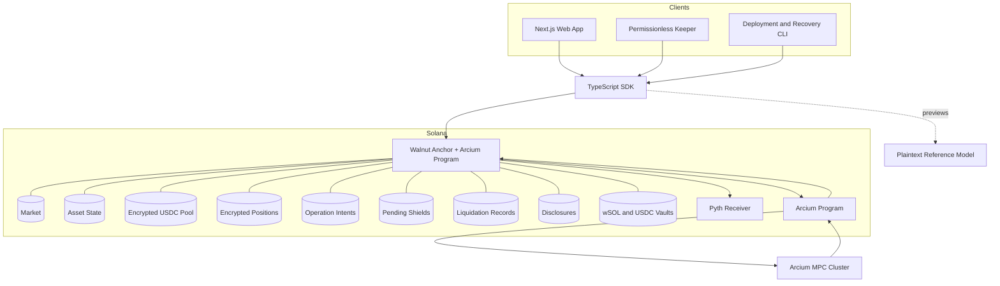

# Design Document: Walnut-Solana

## Overview

This document defines the production-v1 design. It supersedes the earlier dual-asset, credit-tier, private-transfer, and whole-position auction design.

Walnut-Solana is a Solana program coordinated with Arcium MPC. It is not an FHE application. The v1 market has one risk direction:

- collateral: SOL held as wSOL;
- supplied and borrowed asset: Circle USDC;
- settlement: internal encrypted accounting plus public SPL movement only at shield and unshield;
- liquidation: formulaic encrypted partial liquidation;
- disclosure: owner-authorized re-encryption.

This scope preserves the product’s core distinction while reducing accounting, oracle, callback-size, and liquidation risk.

### Design priorities

1. Preserve custody and value under every callback, expiry, and retry ordering.
2. Prevent stale computations from committing against changed financial dependencies.
3. Reveal only the fields listed in the privacy model.
4. Keep every queue and callback transaction within Solana limits.
5. Guarantee that rescue actions cannot be indefinitely blocked by untrusted callers.
6. Use open-source or freely usable software without requiring paid SaaS.
7. Launch mainnet only with measured caps, reviews, and operating funds for unavoidable network costs.

## Architecture



### Trust model

- Solana orders and finalizes Walnut instructions.
- Arcium executes encrypted circuits using dishonest-majority, detect-and-abort MPC.
- Privacy requires at least one honest cluster member under Arcium’s documented model.
- Integrity relies on correct circuit code, Arcium’s authenticated output, and callback verification.
- A malicious or unavailable cluster participant may harm liveness even when it cannot silently forge a valid result.
- Pyth supplies signed market data, but Walnut remains responsible for freshness, confidence, bounds, and anomaly policy.
- Upgrade and risk multisigs remain trusted until upgrades are frozen.
- The frontend is part of the key-security boundary because it derives and handles the Viewing Key.

### Repository layout

```text
walnut-solana/
  programs/walnut/
    src/
      state/
      instructions/
      math/
      oracle/
      operation/
      lock/
      errors.rs
      events.rs
  encrypted-ixs/
  packages/sdk/
  packages/reference-model/
  keeper/
  web/
  tests/
  config/networks/
  scripts/
  docs/
    adr/
```

Rust, Solana, Anchor, and Arcium commands run in Linux or WSL2. CI uses the exact coordinated Arcium release selected during Task 1.

## Data Models

#### Position

The preferred v1 encrypted payload is one structure owned by the user’s Viewing Key:

```rust
struct PositionSecret {
    free_sol: u64,
    free_usdc: u64,
    collateral_sol: u64,
    supply_shares_usdc: u128,
    debt_shares_usdc: u128,
}
```

The on-chain Position stores:

```rust
struct Position {
    owner: Pubkey,
    viewing_pubkey: [u8; 32],
    viewing_key_epoch: u64,
    status: PositionStatus,
    has_debt: bool,
    frozen: bool,
    freeze_epoch: u64,
    frozen_since_slot: u64,
    generation: u64,
    lock: Lock,
    next_operation_seq: u64,
    next_disclosure_seq: u64,
    encrypted_state: EncGroup,
}
```

`EncGroup` contains the exact public key metadata, nonce, and ciphertext format approved by ADR-0003.

One encrypted structure avoids independent groups accidentally reusing a shared key/nonce sequence. If the Arcium feasibility gate rejects this layout, all financial work stops until ADR-0003 selects and documents a safe fallback.

#### Pool State

```rust
struct PoolState {
    generation: u64,
    lock: Lock,
    accounted_borrow_index: u128,
    encrypted: PoolSecret,
}

struct PoolSecret {
    cash_usdc: u128,
    total_supply_shares: u128,
    total_debt_shares: u128,
    reserves_usdc: u128,
}
```

The Pool payload is `Enc<Mxe>` because no individual user owns aggregate state.

#### Market and Asset State

The Market stores authorities, public `position_count`, public `debt_position_count`, public `unsettled_recovery_claim_count`, count caps, vaults, and the active Asset State. Each successful Position initialization increments `position_count`. Borrow, full repay, liquidation, and Absorb update `has_debt` and `debt_position_count` only on authenticated zero/nonzero transitions. Absorb and completed recovery settlement update the unsettled claim count.

Asset State stores:

- configuration, oracle, and rate-epoch generations;
- accounting Borrow Index and timestamp;
- current utilization band and observation slot;
- LTV, Liquidation Threshold, target Health Factor, bonus, close factor, reserve factor, and rate parameters;
- `supply_cap_usdc`, `total_debt_cap_usdc`, and `position_debt_cap_usdc`;
- granular pauses and timelock state.

Supply cap means encrypted supplier equity after a new supply. Debt caps mean debt projected at the risk index through Decision Expiry. Passive interest may place existing positions above a cap, but no new risk may then be added.

#### Generations and Locks

A Lock is:

```rust
struct Lock {
    active: bool,
    computation_offset: u64,
    operation_intent: Pubkey,
    expiry_slot: u64,
}
```

A generation changes whenever accepted state changes or an old operation is abandoned. Callbacks compare captured and current generations before writing.

The safety invariant is not “only one computation is executing.” Walnut cannot prove that after expiry. The enforceable invariant is:

> Only one generation is current, and only a callback bound to that generation may commit.

## Components and Interfaces

### Operation Intent state machine

```rust
struct OperationIntent {
    owner: Pubkey,
    payer: Pubkey,
    kind: OperationKind,
    computation_offset: u64,
    position: Option<Pubkey>,
    position_generation: Option<u64>,
    second_position: Option<Pubkey>,
    second_position_generation: Option<u64>,
    pool_generation: Option<u64>,
    asset_generation: u64,
    oracle_generation: u64,
    rate_epoch_generation: u64,
    accounting_borrow_index: u128,
    accounting_index_timestamp: i64,
    risk_borrow_index_at_expiry: u128,
    oracle_publish_time_sol: Option<i64>,
    oracle_publish_time_usdc: Option<i64>,
    accounts_commitment: [u8; 32],
    inputs_commitment: [u8; 32],
    queued_slot: u64,
    decision_expiry_slot: u64,
    status: IntentStatus,
}
```

`accounts_commitment` hashes a canonical domain-separated serialization of every ordered account and its role, expected owner, mint, authority, writability, and generation. `inputs_commitment` hashes the operation kind and every immutable public or encrypted input, including ciphertext metadata, requested amount, destination, feed observations, indexes, key epochs, masks, and operation-specific PDAs. The callback recomputes both commitments.

The accounting index is used only for Pool checkpointing and share/value conversion. The projected risk index is computed from the captured accounting index, rate, and bounded time through Decision Expiry and is used only for health and cap checks.

State transitions:

```text
Queued -> Applied     authenticated, current, nonzero transition
Queued -> Zero        authenticated, current, approved zero
Queued -> Failed      authenticated static failure
Queued -> Stale       authenticated but dependency/commitment changed
Queued -> Expired     authenticated after Decision Expiry
Queued -> Abandoned   permissionless timeout after Lock expiry
```

No terminal state may transition again.

#### Queue path

1. Validate signer, accounts, pause controls, caps, and oracle where required.
2. Accrue the accounting Borrow Index if this operation reads or mutates Pool accounting.
3. Calculate the projected risk Borrow Index through Decision Expiry when health or caps are checked.
4. Create the Operation Intent and both commitments.
5. Acquire all encrypted-balance and custody writer Locks atomically.
6. Capture generations, indexes, rate epoch, oracle generation and publish times, and Decision Expiry.
7. Queue the Arcium computation with success and static failure callbacks.

#### Success callback

1. Verify callback context and signed output.
2. Verify Intent status is `Queued`.
3. Verify computation offset.
4. Recompute and verify account and input commitments.
5. Verify every captured generation, accounting index, and rate epoch.
6. If dependencies changed, mark `Stale`; if Decision Expiry passed, mark `Expired`. Apply no financial state in either case.
7. Otherwise apply every encrypted and public write atomically.
8. Increment written account generations.
9. Mark `Applied` or `Zero`.
10. Clear only matching Locks.

Invalid or unauthenticated output does not change Intent or Locks. Timeout recovery handles it.

#### Failure callback

An authenticated static failure callback marks the Intent `Failed` and clears only Locks matching the Intent. It does not change financial state.

#### Expiry and abandonment

A permissionless instruction may abandon an expired, still-queued Intent. It:

- confirms Lock expiry and lack of a terminal callback;
- marks `Abandoned`;
- increments every still-matching protected generation;
- clears only Locks still owned by that Intent;
- leaves all funds in their recorded recoverable location.

`Expired` is reserved for an authenticated callback that arrives after Decision Expiry while the Intent is still queued. `Stale` is reserved for an authenticated callback whose dependency or commitment changed. A callback for an already terminal Intent returns successfully without applying state.

### Shield and unshield custody

#### Shield

Each shield creates:

```rust
struct PendingShield {
    owner: Pubkey,
    position: Pubkey,
    asset: Asset,
    source_token_account: Pubkey,
    amount: u64,
    sequence: u64,
    attempt_sequence: u64,
    active_intent: Option<Pubkey>,
    active_computation_offset: Option<u64>,
    captured_position_generation: u64,
    status: PendingShieldStatus,
}
```

Flow:

1. Transfer public amount into the correct vault.
2. Create `PendingShield` in `Deposited` state and install the first attempt.
3. Lock Position and queue encrypted credit.
4. Callback credits Free Balance only when all active-attempt fields match, then marks `Credited`.
5. Retry requires `Deposited`, a terminal prior Intent, and no queued active attempt; it increments `attempt_sequence` and installs a new Intent and offset.
6. Refund requires `Deposited` and no queued active attempt, returns value to the recorded owner/source destination, and marks `Refunded`.
7. Old callbacks after retry or refund are terminal no-ops. Credit and refund are mutually exclusive.

#### Unshield

1. User supplies a public requested amount. The outgoing transfer is public in all cases.
2. Circuit checks encrypted Free Balance and returns updated Position plus approved plaintext amount.
3. Callback transfers approved SPL tokens from the vault with PDA authority.
4. For SOL, the callback delivers wSOL. The user separately closes the wSOL account to receive native SOL.

### Viewing Key and rotation

The client signs:

```text
walnut-solana viewing key v1 |
program=<PROGRAM_ID> |
network=<NETWORK> |
position=<POSITION_PDA> |
epoch=<VIEWING_KEY_EPOCH>
```

The signature is passed through a documented KDF to derive an x25519 secret. Initialization uses epoch zero. The signature and secret remain client-side and are never transaction inputs.

Rotation uses an owner-signed transaction and commits old/new key epochs and public keys, Position generation, network, program ID, sequence, and expiry. The callback re-encrypts state, writes the new public key, and increments `viewing_key_epoch` atomically.

Ordinary rotation is not wallet-loss recovery. V1 makes no claim that a lost wallet can recover its Viewing Key.

### Oracle design

The oracle module:

- validates the Pyth receiver program and PriceUpdateV2 account owner;
- validates configured SOL/USD and USDC/USD feed IDs;
- rejects stale, nonpositive, malformed, or over-wide-confidence prices;
- normalizes mantissa/exponent with checked u128 arithmetic;
- uses `price - confidence` for SOL collateral;
- uses `price + confidence` for USDC debt;
- compares spot with configured EMA/deviation bounds;
- records last-good observations and anomaly status.

Price-sensitive Intents capture feed publish times, oracle generation, and expire quickly. Liquidation always obtains a new observation rather than trusting the original freeze observation.

Entering anomaly mode increments oracle generation. It blocks health freezing, liquidation opening, partial liquidation, Absorb, borrowing, and collateral withdrawal. Pending price-sensitive callbacks from the old generation become `Stale`. Repay and collateral addition remain available. Normal operation resumes only after both feeds pass every configured check in a fresh observation.

If posting an update and queueing Arcium exceeds the transaction limit, the SDK posts the update first and immediately sends the queue transaction referencing the verified PriceUpdate account.

### Interest and pool accounting

#### Borrow Index

The public accounting Borrow Index uses WAD precision:

```text
new_index = old_index × (1 + borrow_rate_per_second × dt)
```

All operations use checked fixed-point helpers with explicit rounding. Risk-sensitive Intents also capture:

```text
risk_index_at_expiry = project(accounting_index, captured_rate, decision_expiry - accounting_timestamp)
```

The accounting index is the sole authority for share and Cash conversion. The risk index is the sole authority for health and cap checks. A callback rejects a changed accounting index or rate-epoch generation.

The rate uses the upper edge of the latest revealed utilization band. This is conservative for solvency and prevents exact aggregate disclosure.

Example bands:

```text
0–5%, 5–10%, ..., 90–95%, 95–100%
```

`update_utilization_band` is a read-only-generation computation:

```text
current_debt = ceil(total_debt_shares × captured_index / WAD)
utilization = current_debt / (cash + current_debt)
```

A zero denominator selects the lowest band. The callback reveals and stores only the band index and applies it only if Pool generation, accounting index, and rate epoch still match. Risk-increasing actions return zero when the band observation is older than the configured maximum age.

#### Pool interest checkpoint

Before every operation that mutates Pool Cash, Supply Shares, Debt Shares, or Reserves, the circuit first calculates:

```text
old_debt = ceil(total_debt_shares × accounted_index / WAD)
new_debt = ceil(total_debt_shares × accounting_index / WAD)
interest = new_debt - old_debt
reserve_add = floor(interest × reserve_factor_bps / 10_000)
reserves += reserve_add
accounted_index = accounting_index
```

This applies to supply, withdrawal, borrow, repay, reserve withdrawal, partial liquidation, and Absorb before any share mutation.

Supplier equity is:

```text
supplier_equity = cash + new_debt - reserves
```

This makes the encrypted NAV, rather than a stale public Supply Index, the accounting authority.

#### Supply

For the first valid supplier, the circuit requires encrypted Cash, Debt Shares, and Reserves to equal zero, while the program requires public `unsettled_recovery_claim_count == 0`:

```text
shares = amount × INITIAL_SHARE_SCALE
```

A failed canonical-empty precondition returns zero and moves no value. A separately reviewed recovery operation must restore the canonical empty state before supply reopens.

For later suppliers:

```text
shares = floor(amount × total_supply_shares / supplier_equity_before)
```

If shares are zero, no value moves.

#### Withdraw supply

```text
amount = floor(requested_shares × supplier_equity_before / total_supply_shares)
```

The operation succeeds only if the owner has the shares and Pool Cash covers the full amount.

#### Borrow

```text
shares_added = ceil(amount × WAD / accounting_borrow_index)
booked_debt = ceil(shares_added × accounting_borrow_index / WAD)
rounding_surplus = booked_debt - amount
reserves += rounding_surplus
```

The circuit checks caps, Pool Cash, minimum size, and post-borrow health before moving value.

#### Repay

Full repayment:

```text
payment = ceil(user_debt_shares × accounting_borrow_index / WAD)
shares_burned = user_debt_shares
```

A full-repayment callback sets `has_debt` false, decrements the debt-Position count, unfreezes the Position, and marks a matching open Liquidation Record `Resolved`. The transition reveals debt existence changing to zero, never the amount.

Partial repayment selects the greatest share count satisfying:

```text
ceil(shares_burned × accounting_borrow_index / WAD) <= min(request, free_usdc)
```

The same calculated payment is added to Pool Cash. If no share can be burned, no value moves.

#### Reserve withdrawal

Reserve withdrawal uses a public requested amount and all-or-zero approval after the interest checkpoint:

```text
approved = requested if requested <= reserves && requested <= cash
           else 0
```

On approval the callback atomically:

```text
cash -= requested
reserves -= requested
```

and transfers exactly `requested` USDC from the vault to the single configured treasury USDC token account. The account, mint, token program, owner, authority, and requested amount are bound by the Intent commitments. The public transfer amount is listed in the privacy model. Because Cash and Reserves decrease equally, supplier equity remains unchanged.

### Health model

All oracle prices are normalized to one committed USD scale `USD_SCALE` before entering risk math:

```text
sol_value_down(lamports) =
  floor(lamports × normalized_sol_price_low / 10^9)

usdc_value_up(units) =
  ceil(units × normalized_usdc_price_high / 10^6)

debt_units(shares, accounting_index) =
  ceil(shares × accounting_index / WAD)

projected_debt_units =
  ceil(shares × risk_index_at_expiry / WAD)

collateral_value = sol_value_down(collateral_lamports)
debt_value = usdc_value_up(projected_debt_units)
borrow_capacity = floor(collateral_value × ltv_bps / 10_000)
liquidation_capacity = floor(collateral_value × liquidation_threshold_bps / 10_000)
borrow_healthy = borrow_capacity >= debt_value
health_factor = liquidation_capacity / debt_value
```

Borrow and collateral withdrawal use the LTV and projected risk index. Liquidation uses the Liquidation Threshold and projected risk index. Debt-share minting, burning, payment, and Pool Cash use only the accounting index.

Read-only health computations do not lock Position. They capture Position generation and are ignored if the generation changes or a writer Lock is active before callback. A valid healthy-to-frozen callback increments `freeze_epoch`, stores `frozen_since_slot`, and increments Position generation.

Partial liquidation is an encrypted-balance writer and therefore locks borrower, liquidator, and Pool. Repay or collateral addition cannot bypass that writer Lock. If the liquidation exceeds its bounded Lock expiry, anyone may abandon it, increment still-matching generations, and clear its Locks; rescue can then queue and the late liquidation callback cannot write.

### Liquidation design

V1 uses private formulaic partial liquidation, not a sealed whole-position auction.

#### Freeze

1. Keeper or user creates a Health Intent.
2. Circuit reveals only `unhealthy`.
3. Callback freezes only when generation and expiry still match.
4. `open_liquidation` creates the Liquidation Record in a normal user/keeper transaction.

#### Partial liquidation

The liquidator supplies an encrypted maximum USDC repayment. The computation locks borrower Position, liquidator Position, and Pool and checkpoints Pool interest at the accounting index before changing shares.

Let:

```text
C = normalized SOL collateral value
D = normalized projected USDC debt value
L = liquidation_threshold_bps / 10_000
B = (10_000 + bonus_bps) / 10_000
T = target_health_factor
```

Governance requires `T > L × B` and `L × B < 1` with a rounding margin.

```text
target_repayment_value =
  max(0, ceil((T × D - L × C) / (T - L × B)))

max_by_collateral_value = floor(C / B)
max_by_collateral_usdc =
  floor(max_by_collateral_value × 10^6 / normalized_usdc_price_high)
```

The circuit selects the greatest Debt Share burn whose rounded payment at the accounting index is no greater than:

```text
requested_usdc
liquidator_free_usdc
borrower_debt_usdc
close_factor_limit_usdc
max_by_collateral_usdc
target_repayment_usdc
```

The exact rounded payment debited from the liquidator is credited to Pool Cash and corresponds to the exact Debt Shares removed.

Seized SOL is calculated with borrower-protecting floor rounding:

```text
seized_lamports = floor(
  usdc_value_up(payment_usdc) × B × 10^9
  / normalized_sol_price_low
)
```

If rounding cannot satisfy the value promise without excess seizure, the operation returns zero. The circuit recomputes post-operation health and rejects any nonzero result that does not weakly improve it.

The callback:

- subtracts the rounded payment from liquidator Free USDC;
- adds the same payment to Pool Cash;
- burns borrower and Pool Debt Shares consistently;
- subtracts only calculated SOL from borrower collateral;
- adds that SOL to liquidator Free SOL;
- updates `has_debt` and `debt_position_count` only on debt-to-zero transition;
- unfreezes and resolves the matching Liquidation Record at target health or zero debt.

The Liquidation Record is keyed by Position and freeze epoch:

```rust
struct LiquidationRecord {
    position: Pubkey,
    freeze_epoch: u64,
    position_generation_at_open: u64,
    frozen_since_slot: u64,
    opened_slot: u64,
    status: LiquidationStatus, // Open | Resolved | Absorbed
    active_intent: Option<Pubkey>,
}
```

Borrower and liquidator Receipts are fixed-size ciphertexts sealed to their current Viewing Key epochs and emitted in the authenticated callback event. No callback creates a Receipt account. Transaction-size tests include both ciphertexts.

#### Absorb and recovery

Absorb is a last-resort accounting path after `Position.frozen_since_slot + recovery_delay`. It requires an `Open` Liquidation Record whose freeze epoch matches the Position.

1. Recheck health, debt, prices, oracle generation, and generations.
2. Checkpoint Pool interest at the accounting Borrow Index.
3. Calculate residual debt from the Debt Shares being removed.
4. Allocate at most residual debt plus bounded recovery penalty in SOL to the Recovery Position.
5. Keep excess SOL with the borrower.
6. Calculate `reserve_used = min(residual_debt, reserves)` and `supplier_loss = residual_debt - reserve_used`.
7. Remove matching Position and Pool Debt Shares and reduce Reserves only by `reserve_used`. The loss appears once through removal of the debt asset; no second loss term is subtracted from supplier equity.
8. Update `has_debt`, `debt_position_count`, Position freeze state, and Liquidation Record status.
9. Populate the Recovery Claim pre-created by the Absorb queue instruction, tying received SOL to supplier and Reserve obligations.

```rust
struct RecoveryClaim {
    borrower_position: Pubkey,
    freeze_epoch: u64,
    absorb_intent: Pubkey,
    status: RecoveryClaimStatus,
    generation: u64,
    encrypted: RecoveryClaimSecret,
}

struct RecoveryClaimSecret {
    collateral_sol_remaining: u64,
    supplier_loss_usdc_remaining: u64,
    reserve_replenishment_usdc_remaining: u64,
    recovered_usdc: u64,
}
```

Accepted Absorb increments public `unsettled_recovery_claim_count`. The remaining amounts stay encrypted.

`settle_recovery_claim` uses a unique pre-created Pending Recovery Settlement. The queue transaction transfers a public USDC offer from the buyer into the USDC vault, records the requested public wSOL amount and buyer destination, validates fresh Pyth prices and a bounded sale discount, and queues the encrypted claim check.

On approval, the callback debits encrypted claim-bound SOL from the Recovery Position, transfers exactly the requested public wSOL to the buyer, and updates the encrypted Recovery Claim. Escrowed USDC first reduces encrypted supplier loss by increasing Pool Cash, then reduces encrypted Reserve-replenishment obligation by increasing Cash and Reserves equally. Only excess after both obligations reach zero may become treasury revenue. Completing the claim decrements `unsettled_recovery_claim_count`.

On Zero, Failed, Stale, Expired, or Abandoned outcomes, the buyer may refund the escrowed USDC exactly once. The Pending Recovery Settlement uses the same active-attempt protections as Pending Shield. All accounts, public amounts, prices, destinations, and authorities are bound by the Intent commitments.

### Selective disclosure

A Disclosure is created before its callback and contains enough allocated space for the approved snapshot.

The owner chooses which v1 fields to include. The computation re-encrypts those fields to the auditor key. Metadata binds the snapshot to:

- owner and Position;
- Position generation;
- Walnut program and version;
- network;
- slot and timestamp;
- Borrow Index;
- Pyth feed IDs and publish times;
- auditor key.

The auditor tool decrypts locally. A superseding record can mark old data stale but cannot revoke data already decrypted.

### Callback envelope strategy

Every callback uses generated callback helpers and only pre-created accounts. No callback creates or resizes an account.

The Requirement 2 ADR records serialized size and compute use for:

- Position initialization;
- shield;
- unshield plus token CPI;
- supply;
- withdrawal;
- borrow;
- repay;
- health callback;
- reserve withdrawal with treasury token CPI;
- utilization-band update;
- partial liquidation with two Positions, Pool, Liquidation Record, and two encrypted Receipt outputs;
- absorb and Recovery Claim creation/precreation flow;
- Recovery Claim settlement with token CPIs;
- disclosure;
- key rotation.

If any transaction exceeds the engineering ceiling, the corresponding feature is redesigned or split through recoverable claim accounts. The size gate cannot be waived.

### Keeper architecture

Jobs:

- advance rate epochs;
- accrue public Borrow Index when Pool is unlocked;
- discover debt Positions;
- schedule non-locking health checks;
- create Liquidation Records after valid freezes;
- advertise liquidation opportunities;
- release expired Locks and abandon expired Intents;
- reclaim keeper-paid computation rent and fees;
- monitor Recovery Claims;
- report RPC, latency, failure, and balance metrics.

The keeper does not finance liquidations. Liquidators use their own shielded USDC.

The on-chain debt-Position cap is chosen so that the measured keeper fleet can scan all debt Positions within the promised detection window. Multiple keepers race safely through Intent and generation checks.

### Web and key security

The Web App uses the project owner-approved Telegraf fonts and replicates zama.org's visual system: the palette (#FFD209, #000000, #2D2D2D, #F4F4F4, #FFFFFF), type scale, spacing, layout grid, component shapes, and motion. These are measured from the live site and recorded as tokens in `docs/design-tokens.md`, then implemented as Tailwind v4 `@theme` tokens. Only the styling is reused. Every word of copy, the name, the logo, imagery, and product claims are Walnut's own; no Zama text, logo, or illustration is copied.

Routes: `/` (landing), `/docs/[slug]` (rendered from `docs/*.md`), and `/app/*` (protocol screens).

The landing page mirrors zama.org's section order with Walnut copy: hero, positioning statement, live protocol section, use-case cards, four-step how-it-works (shield → supply or borrow → private liquidation → selective disclosure), an Arcis snippet taken from `encrypted-ixs`, call to action, and footer. The live section is a server component that reads only protocol-public values (utilization band, borrow rate, Position and debt-Position counts, caps), revalidates every 60 seconds, and shows an explicit unavailable state on RPC failure or before market initialization. Exact TVL is encrypted in v1 and is never shown or estimated.

While the Viewing Key is unlocked:

- no third-party analytics or advertising scripts load;
- CSP denies unapproved scripts and network destinations;
- secrets remain in memory;
- error reporting removes transaction data and encrypted payloads;
- the UI exposes a lock action that clears key material;
- every action shows public and private fields before signature.

Asynchronous UI states are:

```text
idle -> signing -> queued -> computing ->
Applied | Zero | Failed | Stale | Expired | Abandoned | TimedOut
```

Recovery actions are shown from on-chain Intent and Pending Shield state rather than guessed client timers.

### Network and cost design

Network Profiles contain only public configuration. RPC adapters support standard Solana JSON-RPC, so no paid provider is mandatory.

- Localnet uses test-only fixtures.
- Devnet uses real Arcium devnet, Pyth updates, and Circle devnet USDC.
- Mainnet uses verified production addresses and separately configured authorities and caps.

Open-source software does not make mainnet operation free. Deployment, rent, Solana transactions, Arcium computations, keeper activity, audits, and liquidity remain real costs. The UI estimates user-paid fees before signing, and operations alert when keeper funds fall below threshold.

## Correctness Properties

1. **USDC vault conservation:** `vault_usdc = Σ free_usdc + pool_cash_usdc + deposited_pending_usdc + segregated_recovery_usdc`.
2. **wSOL vault conservation:** `vault_wsol = Σ(free_sol + collateral_sol) + recovery_position_sol + deposited_pending_sol`; recovery collateral is not counted twice.
3. **Generation safety:** only the current generation can commit.
4. **Terminal idempotency:** an Intent reaches one terminal state once.
5. **Nonce safety:** no effective encryption key/nonce pair repeats.
6. **Supplier equity:** shares claim no more than Cash plus current debt minus Reserves; bad-debt removal expresses loss once.
7. **No historical-interest capture:** newly minted shares receive no value earned before minting.
8. **Debt conservation:** repayment credited to Cash matches debt removed at the accounting index.
9. **Index separation:** accounting and projected risk indexes are never substituted for one another, and the accounting index never decreases.
10. **Failed-operation neutrality:** zero, failed, stale, expired, duplicate, and abandoned operations move no financial value.
11. **Health safety:** approved borrow and collateral withdrawal remain healthy at committed conservative inputs.
12. **Liquidation improvement:** every partial liquidation weakly improves health and cannot over-seize.
13. **Reserve withdrawal neutrality:** exact public USDC transferred equals encrypted Cash and Reserve reduction, leaving supplier equity unchanged.
14. **Privacy:** logs contain no private amount outside explicitly public shield, unshield, reserve, and recovery behavior.
15. **Rescue liveness:** untrusted health callers cannot lock a Position, and expired writers can be abandoned.

## Error Handling

Every failure path preserves custody and moves no financial value.

- **Unauthenticated or invalid callback output:** Intent and Locks are unchanged. Timeout recovery through permissionless abandonment handles it.
- **Authenticated static failure:** the Intent becomes `Failed` and only matching Locks clear.
- **Changed dependency or commitment:** the Intent becomes `Stale` and no state is applied.
- **Callback after Decision Expiry:** the Intent becomes `Expired` and no state is applied.
- **Expired Lock:** anyone may mark the Intent `Abandoned`, increment matching generations, and clear matching Locks. Late callbacks cannot write.
- **Duplicate or late callback on a terminal Intent:** returns successfully without applying state.
- **Zero outcomes** (failed preconditions, caps, health, rounding): no value moves.
- **Shield failure:** the owner retries the credit or refunds the deposit exactly once. Credit and refund are mutually exclusive.
- **Recovery settlement failure:** the buyer refunds escrowed USDC exactly once.
- **Oracle anomaly:** price-sensitive Intents become `Stale`. Repay and collateral addition remain available.
- **Transaction size or compute overrun:** the feature is redesigned or split. The size gate cannot be waived.

## Testing Strategy

- Rust unit tests for checked math, bounds, generations, locks, intents, oracle validation, rates, and PDA derivation.
- Property tests with large offline run counts for every security property.
- TypeScript reference-model differential tests against real local Arcium circuits.
- Adversarial interleaving tests for accrual, queueing, callbacks, expiry, governance changes, and oracle changes.
- Transaction serialization tests for every largest envelope.
- Fault injection for RPC loss, callback failure, process restart, duplicate keeper, and cluster delay.
- Economic simulations for price gaps, utilization shocks, supplier runs, liquidator scarcity, reserve depletion, and rounding dust.
- Devnet soak testing before mainnet.
- Independent program, circuit, and economic review after feature freeze.
