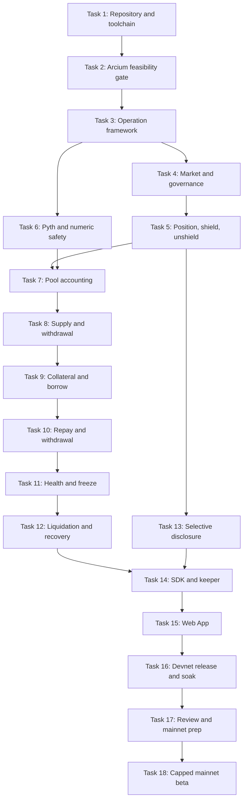

# Implementation Plan: Walnut-Solana

## Overview

Tasks are ordered by dependency. Do not skip a checkpoint because later UI or launch work is waiting.

- Tasks 1 and 2 establish whether the chosen Arcium state model is usable.
- No financial program code starts before Task 2 passes.
- Interest and Pool accounting are completed before borrow or repay.
- Formulaic partial liquidation is completed before mainnet work.
- Mainnet work starts only after the devnet soak and independent reviews.

All Rust, Solana, Anchor, and Arcium commands run in Linux or WSL2. Mandatory software and services must be open-source or freely usable. Paid RPC and hosting products may be supported as optional adapters but may not be required.

Mainnet still requires SOL for deployment, rent and transactions, Arcium computation fees, keeper operating funds, market liquidity, and security review. The implementation must minimize and disclose these costs rather than claiming they do not exist.

## Task Dependency Graph



Parallelizable task waves (each wave starts after the previous wave completes):

```json
{
  "waves": [
    { "id": 0, "tasks": ["1"] },
    { "id": 1, "tasks": ["2"] },
    { "id": 2, "tasks": ["3"] },
    { "id": 3, "tasks": ["4", "6"] },
    { "id": 4, "tasks": ["5"] },
    { "id": 5, "tasks": ["7", "13"] },
    { "id": 6, "tasks": ["8"] },
    { "id": 7, "tasks": ["9"] },
    { "id": 8, "tasks": ["10"] },
    { "id": 9, "tasks": ["11"] },
    { "id": 10, "tasks": ["12"] },
    { "id": 11, "tasks": ["14"] },
    { "id": 12, "tasks": ["15"] },
    { "id": 13, "tasks": ["16"] },
    { "id": 14, "tasks": ["17"] },
    { "id": 15, "tasks": ["18"] }
  ]
}
```

## Tasks

- [ ] 1. Repository, toolchain, and baseline controls

  - [x] 1.1 Initialize the repository
    - Initialize Git and set the approved remote.
    - Scaffold the Arcium/Anchor workspace.
    - Create `programs/walnut`, `encrypted-ixs`, `packages/sdk`, `packages/reference-model`, `keeper`, `web`, `tests`, `config/networks`, `scripts`, and `docs`.
    - Add a pnpm workspace and root commands.

  - [x] 1.2 Pin the coordinated toolchain
    - Verify the current Arcium compatibility matrix.
    - Pin Rust, Solana CLI, Anchor, Arcium CLI/crates/TypeScript packages, Node, and pnpm.
    - Add `scripts/check-toolchain.sh`; fail and name every mismatch.
    - Document WSL2 setup.

  - [x] 1.3 Configure CI
    - Build the Anchor program and Arcis circuits.
    - Run clippy with warnings denied, rustfmt, TypeScript type-check, eslint, and prettier.
    - Run unit, property, local Arcium, and transaction-size tests.
    - Run cargo audit, pnpm audit, gitleaks, and fixture-import checks.
    - Require justified and expiring advisory exceptions.

  - [x] 1.4 Write baseline documents
    - `docs/SPEC.md`
    - `docs/ARCHITECTURE.md`
    - `docs/PRIVACY_MODEL.md`
    - `docs/THREAT_MODEL.md`
    - `docs/OPERATIONS.md`
    - `docs/adr/0001-stack-and-scope.md`
    - `docs/adr/0002-deferred-features.md`
    - State that Walnut uses MPC, not FHE.
    - Record public and encrypted fields.

  - [-] 1.5 Baseline checkpoint
    - Run the Arcium hello-world test locally and in CI.
    - Verify no paid provider is required.
    - Verify secrets and keypairs are ignored.
    - Commit and push the scaffold.

- [ ] 2. Blocking Arcium feasibility and transaction-envelope gate

  - [ ] 2.1 Implement test-only generations, Locks, and Operation Intents
    - Add minimal account structures and state transitions.
    - Add success, static failure, expiry, and abandonment handlers.
    - Do not add financial logic.

  - [ ] 2.2 Prove persistent encrypted Position state
    - Compile the exact account-backed encrypted-input API against the pinned release.
    - Store the complete proposed Position payload.
    - Read it in later computations.
    - Update fields in randomized orders.
    - Decrypt every result locally.

  - [ ] 2.3 Prove nonce and ownership safety
    - Test two users and a computation that outputs to both owners.
    - Record effective key identities and nonces.
    - Assert no key/nonce pair repeats.
    - Test Viewing Key rotation.
    - If one shared Position payload fails, test `Enc<Mxe>` plus owner-authorized view.

  - [ ] 2.4 Exercise the complete failure matrix
    - Success callback.
    - Circuit failure and static failure callback.
    - Invalid signed output.
    - Callback custom-account failure.
    - Callback token CPI failure.
    - Compute-unit exhaustion.
    - `OutputTooLarge`.
    - Queued expiry.
    - Abandonment while an old computation may still execute.
    - Duplicate callback.
    - Late callback.
    - Finalized-rent claim.
    - Expired-fee reclaim.

  - [ ] 2.5 Build transaction-envelope prototypes
    - Serialize realistic queue and callback transactions for Position initialization, shield, unshield, supply, withdraw supply, borrow, repay, reserve withdrawal, utilization-band update, health, two-Position liquidation with two encrypted Receipt outputs, Absorb with pre-created Recovery Claim, Recovery Claim settlement, disclosure, and key rotation.
    - Include actual Arcium standard accounts and all custom accounts.
    - Simulate callback compute units.
    - Require less than 1,232 bytes and target no more than 1,150 bytes.

  - [ ] 2.6 Benchmark the platform
    - Measure p50 and p95 callback latency over at least 50 devnet runs.
    - Measure fees, callback compute units, failure rate, and accepted operations per minute.
    - Test 10 concurrent writers with retry and abandonment.
    - Test sustained Pool-like contention.

  - [ ] 2.7 Write ADR-0003 and stop/go decision
    - Record exact APIs, encryption layout, nonce evidence, transaction sizes, callback behavior, fees, latency, and throughput.
    - Select `Enc<Shared>` local reads or the `Enc<Mxe>` fallback.
    - Update requirements and design if measurements differ.
    - Do not begin Task 3 until CI passes and ADR-0003 records a go decision.

- [ ] 3. Production operation framework

  - [ ] 3.1 Implement account generations and Locks
    - Atomic multi-account Lock acquisition.
    - Matching callback release.
    - Expired abandonment increments generations.
    - Property tests for every event ordering.

  - [ ] 3.2 Implement Operation Intent PDAs
    - Unique seeds and sequences.
    - Accounting index/timestamp and projected risk index.
    - Asset, oracle, and rate-epoch generations.
    - Canonical account and input commitments.
    - Decision Expiry.
    - One-way terminal states with exact transition ownership.
    - Payer and reclaim ownership.

  - [ ] 3.3 Implement callback helpers
    - Verify Arcium output and callback context.
    - Verify offset, Intent, both commitments, generations, accounting index, rate epoch, and expiry.
    - Recompute commitments to prevent account or input substitution.
    - Handle Applied, Zero, Stale, Expired, static Failed, and timeout Abandoned paths separately.
    - Leave invalid unauthenticated output queued for timeout recovery.
    - Ignore callbacks for terminal Intents without financial changes.

  - [ ] 3.4 Implement SDK lifecycle core
    - Network Profile validation.
    - PDA helpers.
    - Encryption and decryption helpers.
    - Queue and callback tracker.
    - Rent and fee reclaim builders.
    - Transaction-size check.
    - Typed terminal outcomes.

  - [ ] 3.5 Framework checkpoint
    - Run model-based tests over queue, callback, failure, expiry, abandonment, and retry.
    - Prove failed operations move no financial value.

- [ ] 4. Market, governance, caps, and vaults

  - [ ] 4.1 Implement initialization
    - Create Market, Asset State, Pool State, wSOL vault, USDC vault, vault authority, and Recovery Position.
    - Reject repeat initialization.
    - Validate mint and token-program ownership.

  - [ ] 4.2 Implement roles
    - Two-step admin transfer.
    - Separate upgrade, risk, treasury, and guardian roles.
    - Mainnet-compatible multisig addresses.
    - Events for every change.

  - [ ] 4.3 Implement granular pause controls
    - Separate risk-increasing, withdrawal, rescue, and settlement actions.
    - Keep repay, collateral addition, callback completion, and recovery available where safe.
    - Add expiring guardian pauses.

  - [ ] 4.4 Implement timelocked configuration
    - Propose, wait, execute, and cancel.
    - Increment Asset State generation on execution.
    - Enforce maximum parameter movement and bounds.
    - Invalidate incompatible pending computations.

  - [ ] 4.5 Implement on-chain launch caps and public lifecycle counts
    - Supply cap checked against encrypted supplier equity after new supply.
    - Total debt cap checked at projected risk index.
    - Per-Position debt cap checked at projected risk index.
    - Public Position count and cap.
    - Public `has_debt`, debt-Position count, and cap.
    - Authenticated zero/nonzero transition booleans update counts.
    - Passive interest may exceed a cap, but new risk then returns zero.
    - Timelocked cap increases.

  - [ ] 4.6 Governance tests
    - Unauthorized access.
    - Timelock bypass.
    - Pause expiry.
    - Generation invalidation.
    - Cap boundaries.
    - Liquidation bonus/threshold cross-bound.

- [ ] 5. Position, Viewing Key, shield, and unshield

  - [ ] 5.1 Implement Position initialization
    - `Initializing`, `Active`, and recoverable failed states.
    - Owner and Viewing Key registration.
    - Encrypted zero-state computation.
    - Retry and owner close path.

  - [ ] 5.2 Implement unique Pending Shield PDAs
    - Owner, Position, source, asset, amount, sequence, status, attempt sequence, active Intent/offset, and captured generation.
    - `Deposited -> Credited | Refunded` only.
    - Retry requires a terminal prior attempt and installs a new attempt sequence and Intent.
    - Refund requires no queued active attempt.
    - Old attempt callbacks are no-ops.
    - No overwrite or replay.

  - [ ] 5.3 Implement SOL and USDC shield
    - Wrap SOL to wSOL in the user transaction.
    - Transfer exact public amount into the vault.
    - Queue encrypted credit.
    - Retry and refund after terminal failure or abandonment.

  - [ ] 5.4 Implement unshield
    - Circuit approves requested public amount or zero.
    - Callback transfers SPL tokens with vault PDA authority.
    - SOL path returns wSOL.
    - Add separate owner-signed unwrap builder.

  - [ ] 5.5 Implement local view and key rotation
    - Store `viewing_key_epoch`, starting at zero.
    - Derive the Viewing Key from program, network, Position PDA, and epoch.
    - Keep the wallet signature and secret client-side.
    - Decrypt Position locally.
    - Owner-authorized rotation commits old/new epochs and public keys.
    - Atomically re-encrypt, update public key, and increment epoch.
    - Clear browser key material on lock and disconnect.

  - [ ] 5.6 Balance reference model and tests
    - Vault conservation.
    - Pending Shield exclusivity.
    - Failure and late callback neutrality.
    - Oversized unshield returns zero.
    - Pause and rescue behavior.
    - Local decryption and wrong-key rejection.

  - [ ] 5.7 Devnet balance demo
    - Shield SOL and USDC.
    - Decrypt locally.
    - Unshield USDC.
    - Unshield wSOL and unwrap in a second transaction.

- [ ] 6. Pyth and numeric range safety

  - [ ] 6.1 Implement Pyth validation
    - Receiver owner and feed ID.
    - Age and confidence.
    - Positive value.
    - Exponent and normalization bounds.
    - Conservative low/high prices.

  - [ ] 6.2 Implement anomaly controls
    - Spot-versus-EMA deviation.
    - Last-good observation.
    - Oracle anomaly state and generation increment.
    - Fail closed for borrow, collateral withdrawal, health freeze, liquidation opening/execution, and Absorb.
    - Stale all pending price-sensitive callbacks from the prior generation.
    - Keep repay and collateral addition available.
    - Resume only after both feeds pass every check in a fresh observation.

  - [ ] 6.3 Commit arithmetic range table
    - Maximum token balances.
    - Prices and exponents.
    - Indexes and rates.
    - Elapsed time.
    - Shares.
    - Collateral and debt values.
    - Liquidation formulas.

  - [ ] 6.4 Implement Pyth SDK flows
    - Same-transaction post-and-use prototype.
    - Two-transaction post-then-use fallback.
    - Choose based on serialized size and reliability.

  - [ ] 6.5 Oracle tests and checkpoint
    - Wrong owner/feed.
    - Stale, zero, negative, wide-confidence, bad exponent, overflow, and extreme deviation.
    - Decision Expiry.
    - Localnet signed-update fixture and real devnet update.

- [ ] 7. Borrow Index, encrypted NAV, and Pool accounting

  - [ ] 7.1 Implement fixed-point primitives
    - WAD multiplication and division.
    - Floor and ceil variants.
    - Checked conversions.
    - Rust/Arcis/TypeScript equivalence tests.

  - [ ] 7.2 Implement rate model, index projection, and utilization-band computation
    - Bounded kinked rate.
    - Accounting Borrow Index and timestamp.
    - Projected risk index through Decision Expiry.
    - Coarse utilization bands computed from encrypted Cash and debt.
    - `update_utilization_band` reveals only band index and checks Pool/index/rate generation.
    - Maximum band-observation age; stale bands block new risk.
    - Use upper band edge conservatively.
    - Borrow Index monotonicity.

  - [ ] 7.3 Implement encrypted Pool interest checkpoint
    - Make it the first circuit step for supply, withdrawal, borrow, repay, reserve withdrawal, partial liquidation, and Absorb.
    - Old and current debt values at the accounting index.
    - Borrower interest.
    - Reserve-factor allocation.
    - Accounted Borrow Index.
    - Encrypted supplier equity.

  - [ ] 7.4 Implement Pool/index serialization
    - Every Pool-financial-state mutation queue accrues accounting index and Locks Pool.
    - Keep accounting and projected risk indexes distinct.
    - No independent accounting-index mutation while Pool is locked.
    - Read-only utilization update neither checkpoints nor locks; it stales if Pool/index/rate generation changes.
    - Abandonment invalidates old output.

  - [ ] 7.5 Implement reserve withdrawal
    - Public all-or-zero request.
    - Interest checkpoint before approval.
    - Approve only when the full request is no greater than encrypted Cash and Reserves.
    - Equal encrypted Cash and Reserve reduction.
    - Transfer the exact approved USDC from the vault to the configured treasury token account.
    - Bind requested amount, destination, mint, token program, owner, and authority in Intent commitments.
    - Supplier-equity neutrality.

  - [ ] 7.6 Pool property tests
    - Rate continuity and monotonicity.
    - Interest split.
    - NAV identity.
    - Reserve withdrawal neutrality.
    - Zero supply shares.
    - Long elapsed time.
    - All rounding limits.

  - [ ] 7.7 Pool accounting checkpoint
    - Differential tests against the reference model.
    - Adversarial index/queue/callback interleavings.
    - Do not begin supply or borrowing until this passes.

- [ ] 8. USDC supply and withdrawal

  - [ ] 8.1 Implement first-supplier rules
    - When total Supply Shares is zero, require encrypted Cash, Debt Shares, and Reserves to be zero and public `unsettled_recovery_claim_count` to be zero.
    - Atomically maintain the claim count on accepted Absorb and fully settled Recovery Claim.
    - Return Zero and move no value if any canonical-empty condition fails.
    - Apply the initial share scale only in canonical empty state.
    - Add a separately reviewed recovery operation before supply can reopen from inconsistent residual state.

  - [ ] 8.2 Implement supply
    - Checkpoint Pool interest.
    - Mint against current encrypted supplier equity.
    - Reject zero shares and insufficient balance without moving value.
    - Atomically update Position and Pool.

  - [ ] 8.3 Implement withdraw supply
    - Calculate claim from encrypted NAV.
    - Require owner shares and complete Pool Cash coverage.
    - Move zero on failure.

  - [ ] 8.4 Supply property and integration tests
    - No historical-interest capture.
    - Just-before/after rate epoch.
    - First and last supplier.
    - Insufficient liquidity.
    - Dust.
    - Contention and expiry.

  - [ ] 8.5 Supply devnet demo
    - Shield USDC.
    - Supply.
    - Accrue an interest scenario.
    - Decrypt owner claim.
    - Withdraw available supply.

- [ ] 9. SOL collateral and USDC borrow

  - [ ] 9.1 Implement normalized value and health math
    - One committed USD scale.
    - SOL lamports and 9-decimal normalization with floor rounding.
    - USDC 6-decimal normalization with ceil rounding.
    - Accounting debt units and projected risk debt units.
    - SOL collateral low price and USDC debt high price.
    - LTV and Liquidation Threshold.
    - Conservative rounding and maximum-domain tests.

  - [ ] 9.2 Implement collateral addition
    - Move Free SOL to Collateral SOL.
    - Move zero if insufficient.
    - Allow while frozen.

  - [ ] 9.3 Implement borrow
    - Fresh Pyth validation and fresh utilization-band requirement.
    - Pool interest checkpoint at accounting index.
    - Minimum size and encrypted liquidity.
    - Supply, total-debt, Position-debt, Position-count, and debt-Position caps at defined values.
    - Health at projected risk index through Decision Expiry.
    - Debt shares booked at accounting index and rounded against borrower.
    - Rounding surplus to Reserves.
    - Reveal only zero-to-nonzero debt transition and update `has_debt`/count.
    - Atomic Position and Pool callback.

  - [ ] 9.4 Borrow property tests
    - At-limit success and over-limit zero.
    - Stale dependency rejection.
    - No borrow while frozen.
    - Every cap.
    - Oracle anomaly mode.
    - Debt and Pool conservation.

  - [ ] 9.5 Borrow devnet demo
    - Shield and post SOL.
    - Shield/supply USDC from lender.
    - Borrow USDC.
    - Decrypt debt.
    - Unshield borrowed USDC.

- [ ] 10. Repay and collateral withdrawal

  - [ ] 10.1 Implement full and partial repay
    - Checkpoint Pool interest at accounting index.
    - Full repayment burns all shares and pays rounded full debt.
    - Full repayment sets `has_debt` false, decrements debt-Position count, unfreezes, and resolves a matching open Liquidation Record.
    - Partial repayment burns the greatest affordable shares at accounting index.
    - Pool Cash increase equals debt value removed.
    - Zero-share repayment moves zero.
    - Reveal only nonzero-to-zero debt transition and update public lifecycle fields.

  - [ ] 10.2 Implement collateral withdrawal
    - Fresh Pyth and projected index.
    - Post-withdraw LTV health.
    - Reject while frozen.
    - Debt-free full withdrawal.

  - [ ] 10.3 Repay and withdrawal tests
    - One-base-unit boundaries.
    - Full debt dust removal.
    - Partial repayment conservation.
    - Repayment during freeze.
    - Unhealthy withdrawal zero.
    - Stale callback neutrality.

  - [ ] 10.4 Lifecycle demo
    - Borrow.
    - Accrue interest.
    - Partial repay.
    - Full repay.
    - Withdraw and unshield collateral.

- [ ] 11. Non-locking health checks and freeze lifecycle

  - [ ] 11.1 Implement Health Intents
    - Do not lock Position.
    - Reject queue while writer Lock is active.
    - Capture Position generation, prices, projected index, and expiry.

  - [ ] 11.2 Implement health circuit and callback
    - Reveal only unhealthy boolean.
    - Freeze only on verified current generation, no active writer Lock, and current oracle/rate epoch.
    - On healthy-to-frozen transition, increment `freeze_epoch`, set `frozen_since_slot`, and increment Position generation.
    - Ignore stale and expired results.
    - Apply cooldown/rate limit or caller bond.

  - [ ] 11.3 Implement `open_liquidation`
    - Block during oracle anomaly.
    - Create Liquidation Record outside callback, keyed by Position and freeze epoch.
    - Store generation at open, frozen-since slot, status, and active Intent.
    - No private amounts.

  - [ ] 11.4 Health tests
    - Healthy and unhealthy.
    - Position changes before callback.
    - Owner rescue while Health Intent is pending.
    - Attacker spam attempt.
    - Price recovery before liquidation.

- [ ] 12. Formulaic private partial liquidation and recovery

  - [ ] 12.1 Implement liquidation parameter bounds and normalized algebra
    - Bonus/threshold health-improvement inequality.
    - `target_health_factor > liquidation_threshold × bonus_factor`.
    - Close factor.
    - Target-repayment value formula under the common USD scale.
    - Collateral-supported repayment converted back to USDC units.
    - Recovery delay and penalty.

  - [ ] 12.2 Implement partial-liquidation circuit
    - Lock borrower, liquidator, and Pool.
    - Checkpoint Pool interest at accounting index before mutation.
    - Recheck health with fresh Pyth and projected risk index; block anomaly mode.
    - Bound Debt Share burn by request, balance, debt, close factor, target, and collateral support.
    - Debit and credit the exact rounded payment at accounting index.
    - Compute seized SOL lamports with explicit token decimals and borrower-protecting floor rounding.
    - Recompute and require post-operation health improvement.
    - Return zero if value-preserving rounding cannot be satisfied.
    - Produce fixed-size borrower and liquidator encrypted Receipt outputs.

  - [ ] 12.3 Implement liquidation callback and record lifecycle
    - Atomic two-Position and Pool update.
    - Bind and update only the matching Position/freeze-epoch Liquidation Record.
    - Update `has_debt` and debt-Position count only on debt-to-zero transition.
    - Unfreeze and mark Resolved at target health or zero debt.
    - Remain frozen and Open otherwise.
    - Emit encrypted Receipt ciphertexts, not callback-created accounts.
    - No plaintext amount event.

  - [ ] 12.4 Implement Absorb and Recovery Claims
    - Require matching Open freeze epoch and `frozen_since_slot + recovery_delay`.
    - Recheck oracle, debt, and health and checkpoint Pool interest first.
    - Pre-create Recovery Claim in the Absorb queue transaction; callback populates public metadata and encrypted remaining amounts in fixed space.
    - Increment public `unsettled_recovery_claim_count` only on accepted Absorb and decrement only on complete settlement.
    - Allocate no excess SOL.
    - Calculate reserve used and supplier loss once; remove debt shares without a second loss subtraction.
    - Update `has_debt`, debt-Position count, freeze state, and record status.
    - Implement Pending Recovery Settlement with public buyer USDC escrow, requested wSOL, destination, active attempt, and one-time refund.
    - Validate fresh Pyth prices and bounded sale discount before queueing.
    - On approval, debit Recovery Position, transfer public wSOL to buyer, and allocate escrowed USDC first to supplier loss, then Reserve replenishment, then treasury excess.
    - On Zero/Failed/Stale/Expired/Abandoned, refund buyer escrow exactly once.
    - Bind all accounts, mints, authorities, prices, attempts, destinations, and amounts in Intent commitments.

  - [ ] 12.5 Liquidation reference model
    - Health-improvement algebra.
    - All caps and rounding.
    - Repeated partial liquidations.
    - Price recovery.
    - Reserve and shortfall accounting.

  - [ ] 12.6 Adversarial liquidation tests
    - Liquidator cannot overpay.
    - Borrower cannot lose excess collateral.
    - Every successful liquidation improves health.
    - No double liquidation callback.
    - Abandon expired liquidation, queue rescue, and prove the late liquidation callback cannot write.
    - Oracle anomaly stales pending liquidation and blocks new liquidation/Absorb.
    - Insufficient liquidator balance returns zero.
    - Absorb before and after frozen-since recovery delay.
    - Recovery Claim settlement allocation and public token conservation.

  - [ ] 12.7 Liquidation devnet demo
    - Freeze an unhealthy Position.
    - Open a Liquidation Record.
    - Execute one or more encrypted partial liquidations.
    - Show only public lifecycle state and owner-decrypted Receipts.

- [ ] 13. Selective disclosure

  - [ ] 13.1 Implement Disclosure accounts
    - Pre-create full account space.
    - Owner authorization.
    - Position generation and protocol metadata.
    - Selected field mask.

  - [ ] 13.2 Implement disclosure circuit and callback
    - Re-encrypt selected fields to auditor key.
    - Reject stale Position generation.
    - No callback account creation or resize.

  - [ ] 13.3 Build auditor CLI
    - Local-only secret input.
    - Decrypt and print snapshot plus evidence metadata.
    - Verify program, network, generation, index, and oracle timestamps.

  - [ ] 13.4 Disclosure tests
    - Auditor decrypts.
    - Third party fails.
    - Non-owner rejected.
    - Superseding record does not claim revocation.

- [ ] 14. SDK and keeper completion

  - [ ] 14.1 Complete typed SDK action builders
    - Every v1 instruction.
    - Pyth update paths.
    - Fee estimation.
    - Privacy labels.
    - Provider adapters.

  - [ ] 14.2 Complete event and Receipt handling
    - Stable error catalog.
    - Local Receipt decryption.
    - User history.
    - No plaintext private amount.

  - [ ] 14.3 Build keeper scheduler
    - Rate epochs, accounting Borrow Index, and utilization-band computations.
    - Discover debt Positions from public `has_debt` with privacy documentation.
    - Health checks.
    - Liquidation Record creation keyed by freeze epoch.
    - Intent/Lock recovery.
    - Keeper-owned rent and fee reclaim.
    - Recovery Claim monitoring without custody of sale assets.

  - [ ] 14.4 Add keeper safety and observability
    - Multiple-instance race safety.
    - Bounded concurrency and backoff.
    - JSON logs.
    - `/healthz` and Prometheus metrics.
    - RPC failover.
    - Fee-payer alert.
    - Dockerfile.

  - [ ] 14.5 Keeper capacity checkpoint
    - Set a target health-detection window.
    - Derive scan rate from measured latency.
    - Set the on-chain debt-Position cap no higher than measured capacity.
    - Stress price shocks, RPC failures, restarts, and duplicate keepers.

- [ ] 15. Web App and product communication

  - [ ] 15.1 Build design system
    - Next.js App Router, TypeScript, Tailwind v4.
    - Local Telegraf fonts (200, 400, 800) via next/font/local with fallbacks.
    - Measure zama.org's type scale, spacing, grid, component shapes, and motion; record them in `docs/design-tokens.md`; implement as `@theme` tokens with the palette #FFD209, #000000, #2D2D2D, #F4F4F4, #FFFFFF.
    - Copy styling only: all text, the logo, and imagery are Walnut's own.
    - _Requirements: 15.7, 15.8_

  - [ ] 15.2 Build landing page and docs
    - Sections in zama.org's order with Walnut copy: hero, positioning statement, live protocol section, use-case cards, four-step how-it-works, Arcis snippet from `encrypted-ixs`, CTA, footer.
    - Live section reads only protocol-public values (utilization band, borrow rate, Position and debt-Position counts, caps), revalidates every 60 s, and shows an unavailable state on failure. No TVL, no placeholder numbers.
    - Render `docs/*.md` at `/docs/[slug]`.
    - Responsive from 360 to 1,920 px; mobile Lighthouse targets; public-copy rules (MPC, not FHE; no unsupported claims).
    - _Requirements: 15.14, 15.15, 15.16, 15.17_

  - [ ] 15.3 Build wallet and Viewing Key shell
    - Phantom, Solflare, and Backpack.
    - Deterministic-signature compatibility tests.
    - In-memory key context.
    - Strict CSP.
    - No third-party scripts while unlocked.

  - [ ] 15.4 Build protocol screens
    - Dashboard.
    - Shield and unshield.
    - Supply and withdraw.
    - Collateral and borrow.
    - Repay and collateral withdrawal.
    - Liquidation opportunities.
    - Disclosure and auditor view.
    - History and settings.

  - [ ] 15.5 Build asynchronous state UX
    - Signing, queued, computing, Applied, Zero, Failed, Stale, Expired, Abandoned, and TimedOut.
    - Recovery actions driven by on-chain state.
    - Separate wSOL unwrap step.
    - Computation rent and fee reclaim.

  - [ ] 15.6 Add truthful privacy and risk copy
    - State MPC, not FHE.
    - List public and encrypted fields per action.
    - Explain that shield/unshield amounts and timing are public, with a "shield ahead of time" tip: shielding well before use makes it harder to link a shield to a later action.
    - Explain Arcium and frontend trust assumptions.
    - Do not claim first, anonymous, fully private, compliance-ready, or production-grade without evidence.

  - [ ] 15.7 Web quality tests
    - Type-check and lint.
    - Component tests.
    - Playwright critical flows.
    - Axe with no serious or critical findings.
    - Reduced motion.
    - Mobile Lighthouse targets.
    - Free-tier and self-hosted deployment tests.

- [ ] 16. Devnet release and soak

  - [ ] 16.1 Build idempotent deployment scripts
    - Deploy program.
    - Initialize computation definitions.
    - Create vaults and Pool.
    - Verify Circle devnet USDC and Pyth feeds from official sources.
    - Configure Arcium devnet cluster.
    - Create address lookup tables.

  - [ ] 16.2 Deploy without mandatory paid services
    - Standard configurable Solana RPC.
    - Docker keeper on self-hosted or free-tier compute.
    - Web App on static/free-tier hosting.
    - Optional adapters for paid providers.

  - [ ] 16.3 Run complete devnet end-to-end suite
    - Every success, zero, failure, stale, expiry, abandonment, and recovery path.
    - Every v1 financial action.
    - Keeper automation.
    - Browser smoke test.

  - [ ] 16.4 Run devnet soak
    - At least 14 continuous days after feature freeze.
    - Record latency, fees, failure rate, RPC failures, expired computations, keeper gaps, Pool contention, and accounting reconciliation.
    - Resolve every unexplained invariant or balance difference.

  - [ ] 16.5 Devnet checkpoint
    - Publish program addresses, release hash, test report, privacy model, known limitations, and measured capacity.
    - Freeze features before external review.

- [ ] 17. Independent review and mainnet preparation

  - [ ] 17.1 Conduct independent technical review
    - Solana/Anchor account validation and CPI review.
    - Arcis circuit and encryption review.
    - Callback and generation-state review.
    - SDK/frontend Viewing Key review.
    - Resolve all critical and high findings.

  - [ ] 17.2 Conduct economic review
    - Share and debt rounding.
    - Rate bands.
    - Reserve accounting.
    - Supplier run scenarios.
    - Oracle gaps and SOL crashes.
    - Liquidator scarcity.
    - Absorb and Recovery Claims.

  - [ ] 17.3 Configure production governance
    - Squads or equivalent multisigs.
    - Timelocks.
    - Cancellation role.
    - Pause runbook.
    - Cap-change runbook.
    - Upgrade freeze policy.

  - [ ] 17.4 Test Arcium disaster recovery
    - Recovery Peers.
    - Cluster migration.
    - Paused migration mode.
    - In-flight Intent reconciliation.
    - Recovery-time objective.

  - [ ] 17.5 Complete operational and legal review
    - Intended jurisdictions and frontend obligations.
    - Sanctions and AML decision.
    - Circle USDC freeze risk disclosure.
    - Incident response.
    - Coordinated disclosure or bug bounty.
    - Keeper funding and RPC failover.

  - [ ] 17.6 Produce signed mainnet checklist
    - Link every gate to evidence.
    - Record unresolved low-risk limitations.
    - Record initial supply, debt, Position, and debt-Position caps.
    - Record expected unavoidable deployment and operating costs.

- [ ] 18. Capped mainnet beta

  - [ ] 18.1 Verify release artifact
    - Rebuild reproducibly.
    - Compare program binary hash with reviewed release.
    - Verify Network Profile addresses and authorities.
    - Require explicit program ID and release hash in the deployment confirmation.

  - [ ] 18.2 Deploy and initialize mainnet
    - Deploy reviewed artifact.
    - Initialize computation definitions and accounts.
    - Verify Arcium cluster, Pyth feeds, Circle USDC, vaults, multisigs, timelocks, and caps.
    - Transfer upgrade and admin authorities.

  - [ ] 18.3 Run capped smoke tests
    - Small real-value shield/unshield.
    - Supply/withdraw.
    - Collateral/borrow/repay.
    - Health and partial liquidation with controlled test Positions.
    - Disclosure.
    - Reconcile every vault and encrypted allocation.

  - [ ] 18.4 Open capped beta
    - Display beta status and caps.
    - Monitor continuously.
    - Publish incident contact and risk documents.
    - Do not increase caps until the configured observation period passes with no unresolved invariant, security, or liveness issue.

## Notes

Every property runs in the plaintext model and, where applicable, differentially against the real circuit:

1. Exact USDC and wSOL vault conservation equations.
2. Generation safety.
3. Intent terminal-state ownership and idempotency.
4. Account/input commitment substitution resistance.
5. Nonce uniqueness across key epochs and owners.
6. Pending Shield attempt, credit, and refund exclusivity.
7. Failed-operation neutrality.
8. Accounting Borrow Index monotonicity and accounting/risk index separation.
9. Utilization-band generation and staleness.
10. Supplier NAV identity with no double-counted bad-debt loss.
11. Canonical-empty first-supplier rule.
12. No historical-interest capture.
13. Supply rounding does not favor the user.
14. Debt repayment conservation and debt-existence transitions.
15. Borrow and withdrawal health safety under normalized decimals.
16. Oracle validation, anomaly generation, and Decision Expiry.
17. Parameter cross-bounds.
18. Partial liquidation target algebra and post-state health improvement.
19. No liquidator overpayment.
20. No excess borrower collateral seizure.
21. Absorb, Recovery Claim, and recovery-settlement allocation.
22. Reserve withdrawal physical transfer and supplier-equity neutrality.
23. Callback transaction-size ceiling.
24. Event and log privacy, including public debt existence and recovery amounts.
25. Mainnet Network Profile validation.
26. Rescue liveness under hostile health traffic and expired liquidation writers.
