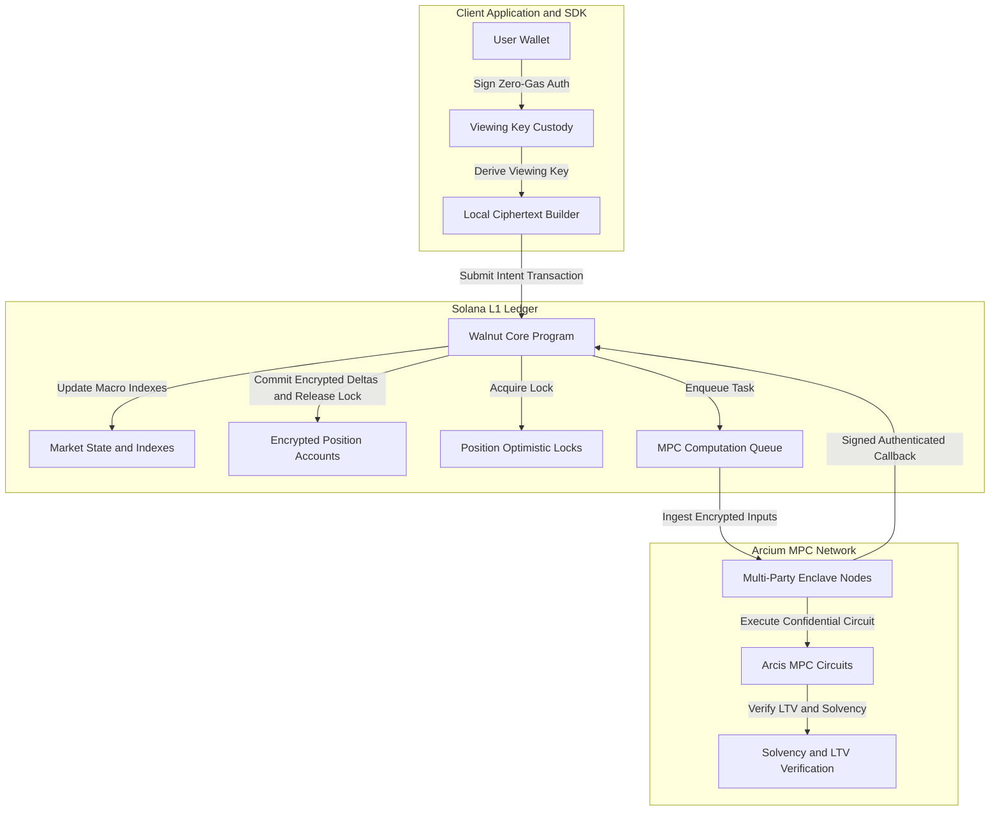
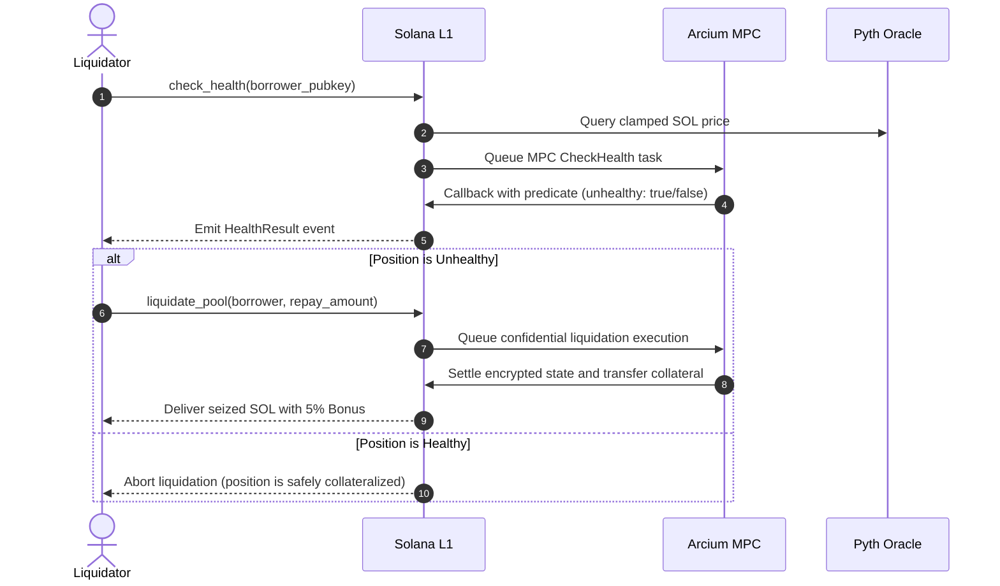

<div align="center">

<picture>
  <source media="(prefers-color-scheme: dark)" srcset="brand/logo/walnut-lockup-bone.png">
  
</picture>

# Walnut Protocol

**Native confidential lending and liquidity on Solana L1, powered by Arcium MPC**

<br/>

[](https://explorer.solana.com/address/5EunnixqNofjZDMwZudttJCKq675d99dwjqR8jTcjea?cluster=devnet)
[](#8-addresses--revenue)
[](https://arcium.com)
[](https://anchor-lang.com)
[](packages/sdk)
[](#21-license)

[Website](https://walnut.so) · [App](#17-run-locally) · [X](https://x.com/walnut_solana) · [Telegram](https://t.me/walnut_solana) · [GitHub](https://github.com/Iam-jayant/walnut-solana) · [Brand kit](brand)

</div>

<br/>

## Table of contents

1. [What this is and who it's for](#1-what-this-is-and-who-its-for)
2. [Story & inspiration](#2-story--inspiration)
3. [Problem](#3-problem)
4. [Solution](#4-solution)
5. [How it works](#5-how-it-works)
6. [Target users](#6-target-users)
7. [Features](#7-features)
8. [Addresses & revenue](#8-addresses--revenue)
9. [Sponsor & partner integrations](#9-sponsor--partner-integrations)
10. [Tech stack](#10-tech-stack)
11. [Architecture](#11-architecture)
12. [Competitors](#12-competitors)
13. [Go to market](#13-go-to-market)
14. [Business model](#14-business-model)
15. [Roadmap](#15-roadmap)
16. [Team](#16-team)
17. [Run locally](#17-run-locally)
18. [Verify / tests](#18-verify--tests)
19. [Repo layout](#19-repo-layout)
20. [Security notes](#20-security-notes)
21. [License](#21-license)
22. [Previous hackathon wins](#22-previous-hackathon-wins)
23. [Previous grants taken](#23-previous-grants-taken)
24. [Public tweet links mentioned by reputable OGs](#24-public-tweet-links-mentioned-by-reputable-ogs-optional)
25. [Token flywheel](#25-token-flywheel)
26. [Token details](#26-token-details)

---

## 1. What this is and who it's for

Walnut is a **confidential lending and liquidity protocol** on Solana L1. You can supply USDC to earn yield, deposit SOL as collateral, and borrow USDC, like on any money market. The difference is that **your balances, collateral and debt are stored encrypted on-chain**. Only you can read them, with a Viewing Key derived from your own wallet.

Risk checks (is this loan still safe? can this position be liquidated?) run inside **Arcium multi-party computation (MPC)**. The network learns a yes or no answer, never your numbers.

Walnut is for:

- **Borrowers and lenders** who don't want their balance sheet public.
- **DAOs, treasuries and trading desks** that can't lend on-chain without leaking their strategy.
- **Builders** who want private lending as a building block (TypeScript SDK).

---

## 2. Story & inspiration

On public lending markets, anyone can open an explorer and see exactly how much a wallet has borrowed, how close it is to liquidation, and at what price. Liquidation bots turn that visibility into profit, and serious users either accept being watched or stay away.

Two things came together to make a better design possible:

- **Confidential DeFi is becoming real.** FHE-based confidential finance on Ethereum (Zama, Fhenix) showed that encrypted balances and private liquidation checks are practical, and that there is demand for them.
- **Solana now has a native private-compute layer.** Arcium brings MPC to Solana, so a Solana program can hand encrypted inputs to a compute network and get a verified result back, while keeping Solana's speed and cost.

Walnut applies the first idea on the second foundation: private lending that feels like normal DeFi, on the chain where most on-chain lending already lives.

---

## 3. Problem

In transparent DeFi lending:

- **Liquidation hunting and MEV.** Bots scan public accounts and trade against positions close to liquidation, especially when prices move fast.
- **Strategy and balance-sheet exposure.** Market makers, desks and treasuries can't borrow or hedge without showing competitors their exposure in real time.
- **Surveillance by default.** Every deposit, debt and yield account is public and indexable, which ties a person's financial health to their wallet.

---

## 4. Solution

Walnut separates **pool-level health** from **user-level privacy**:

| Layer | What is visible | What is hidden |
| :--- | :--- | :--- |
| **Public (macro)** | Total liquidity, utilization in 5% bands, interest indexes, oracle price, risk parameters | Nothing here is sensitive |
| **Private (micro)** | Nothing | Each user's free balances, collateral, debt shares and supply shares (encrypted ciphertexts) |

Solvency is proven as a boolean predicate inside Arcium MPC circuits: *"is this position healthy?"* returns yes or no without revealing the balances behind it.

---

## 5. How it works

1. **Connect your wallet.** Sign a message once; your wallet signature derives a private Viewing Key that never leaves your browser.
2. **Shield.** Wrap SOL or USDC into confidential balances. From this point, your balance is stored encrypted.
3. **Use it.** Add collateral, borrow, repay, supply to earn, or withdraw. The app encrypts your amount and sends it to Solana.
4. **MPC checks the rules.** The Walnut program queues a computation. Arcium nodes compute on the encrypted values (collateral limits, interest, share conversion) and return a signed result.
5. **State updates.** Solana commits the new encrypted position and releases the position lock. Public pool numbers (indexes, utilization band) update at the same time.
6. **Liquidations stay confidential.** Anyone can ask "is this position unhealthy?". If yes, a partial liquidation settles in MPC with a 5% bonus to the liquidator; if no, it is refused and refunded.
7. **Selective disclosure.** You can reveal chosen fields to an auditor's public key without making anything public.

---

## 6. Target users

| User | Why they use Walnut |
| :--- | :--- |
| **Retail lenders and borrowers** | Earn and borrow without a public balance sheet or liquidation target |
| **DAO and project treasuries** | Raise liquidity without signalling treasury moves to the market |
| **Market makers and trading desks** | Leverage without revealing positions to competitors |
| **Institutions and funds** | Private by default, with selective disclosure for auditors and compliance |
| **Developers and wallets** | Integrate confidential lending using the TypeScript SDK |

---

## 7. Features

Status on Solana Devnet today:

- ✅ **Shield / unshield** SOL and USDC into confidential balances
- ✅ **Collateral management**: add and withdraw SOL collateral privately
- ✅ **Borrow and repay** USDC with MPC-verified solvency
- ✅ **Supply and earn**: private supply shares that accrue interest
- ✅ **Kinked interest-rate model** with 1e9-scale borrow and supply indexes
- ✅ **Utilization bands** (5% steps) so rate changes don't leak trade sizes
- ✅ **Confidential health checks and partial liquidations** (50% close factor, 5% bonus)
- ✅ **Viewing Keys**: derived from your wallet, decrypted locally, rotatable
- ✅ **Selective disclosure** of chosen fields to an auditor's key
- ✅ **Pyth oracle** with age, confidence and price-clamp checks
- ✅ **Timelocked governance, pause controls and role separation**
- ✅ **Web app** (landing page and dApp) and **TypeScript SDK**
- 🔜 **Mainnet launch** (see [Roadmap](#15-roadmap))

---

## 8. Addresses & revenue

### Deployed addresses

| Entity | Devnet (live) | Mainnet |
| :--- | :--- | :--- |
| **Walnut program** | [`5EunnixqNofjZDMwZudttJCKq675d99dwjqR8jTcjea`](https://explorer.solana.com/address/5EunnixqNofjZDMwZudttJCKq675d99dwjqR8jTcjea?cluster=devnet) | `TBD` |
| **Lending market** | [`Du5ZWegZJj1RvpZ2GHVNgsy2MXAhiThpP3AHWRkJEEGr`](https://explorer.solana.com/address/Du5ZWegZJj1RvpZ2GHVNgsy2MXAhiThpP3AHWRkJEEGr?cluster=devnet) | `TBD` |
| **USDC mint** | [`GHLMq3gCUHkb9sGPouXNo4Lt9QpGCmz5UMrtF7EwVDLT`](https://explorer.solana.com/address/GHLMq3gCUHkb9sGPouXNo4Lt9QpGCmz5UMrtF7EwVDLT?cluster=devnet) (devnet test mint) | `EPjFWdd5AufqSSqeM2qN1xzybapC8G4wEGGkZwyTDt1v` (native USDC) |
| **Wrapped SOL mint** | `So11111111111111111111111111111111111111112` | `So11111111111111111111111111111111111111112` |
| **wSOL vault** | [`8wLfwZZbLUqkqpJ4gu2jdEqKtrqT9D17d1LwPX7EyBvP`](https://explorer.solana.com/address/8wLfwZZbLUqkqpJ4gu2jdEqKtrqT9D17d1LwPX7EyBvP?cluster=devnet) | `TBD` |
| **USDC vault** | [`4Nk1Lvbs5cHZ4V1oVBtG5JRbimEKrPVMxg6M1fL6h9JZ`](https://explorer.solana.com/address/4Nk1Lvbs5cHZ4V1oVBtG5JRbimEKrPVMxg6M1fL6h9JZ?cluster=devnet) | `TBD` |
| **Treasury authority** | `TBD` | `TBD` |
| **Treasury USDC account** | `TBD` | `TBD` |
| **Arcium cluster offset** | `456` (shared devnet cluster) | `2026` |

> Mainnet rows marked `TBD` are filled in at launch. Devnet values come from [`config/networks/devnet.json`](config/networks/devnet.json).

### How Walnut earns revenue

Walnut earns through a **reserve factor** on borrower interest. It is built into the program today:

- Borrowers pay interest, which accrues continuously through the borrow index.
- On every accrual, a share of that interest (**10% at launch**, `reserve_factor_bps = 1000`) is credited to protocol **reserves**.
- The remaining **90%** goes to suppliers through the supply index.
- Reserves sit in the treasury USDC account and are withdrawn by the treasury authority through the reserve-withdrawal instruction.
- The reserve factor is a governed parameter: changes go through the timelock.

Illustrative example at the 80% utilization kink with the launch rate curve (borrow APR 4%): suppliers earn about `0.8 × 4% × 90% = 2.88%`, and the protocol earns about `0.8 × 4% × 10% = 0.32%` of pool deposits per year. Revenue grows with pool size, utilization and the rate curve.

---

## 9. Sponsor & partner integrations

| Partner | How Walnut uses it |
| :--- | :--- |
| **[Arcium](https://arcium.com)** | MPC network. All private logic is written as Arcis circuits and executed by an Arcium MXE cluster (offset `456` on devnet, `2026` on mainnet). Arcium client `v0.16.0`. |
| **[Pyth Network](https://pyth.network)** | SOL/USD price oracle for LTV, health checks and liquidations, with maximum age (60 s), confidence (2%) and sanity-clamp checks. |
| **[Solana](https://solana.com) & [Anchor](https://anchor-lang.com)** | L1 settlement and the program framework (Anchor `1.0.2`). |
| **Phantom, Solflare and other wallets** | Detected automatically through the Wallet Standard; no wallet-specific code needed. |
| **[Vercel](https://vercel.com)** | Hosts the web app and runs the scheduled utilization-band refresh. |
| **[Fhenix](https://www.fhenix.io)** | Ecosystem support for the team: buildathon win and grant (see [22](#22-previous-hackathon-wins) and [23](#23-previous-grants-taken)). |

---

## 10. Tech stack

| Layer | Technology |
| :--- | :--- |
| **Smart contract** | Rust, Anchor `1.0.2`, Arcium program integration |
| **Confidential compute** | Arcis circuits (Rust) in `encrypted-ixs/`, Arcium MPC `0.16.0` |
| **Cryptography** | Rescue ciphertexts, x25519 key exchange, HKDF-derived Viewing Keys from Ed25519 wallet signatures |
| **Oracle** | Pyth |
| **Client SDK** | TypeScript, `@solana/web3.js`, `@arcium-hq/client` |
| **Web app** | Next.js 16 (App Router, Turbopack), React 19, Tailwind CSS 4, Solana Wallet Adapter |
| **Tooling** | pnpm workspaces, ESLint, Prettier, rustfmt, clippy, mocha and Node test runner |
| **CI / security** | GitHub Actions, cargo-audit, pnpm audit, gitleaks |
| **Hosting** | Vercel |

---

## 11. Architecture

Walnut pairs Solana's L1 execution with Arcium's multi-party execution environment (MXE).



### Position state

Each user owns an encrypted `Position` account derived from their public key:

```
PDA = find_program_address(["position", market, owner], PROGRAM_ID)
```

It holds five encrypted values: `free_sol`, `collateral_sol`, `free_usdc`, `debt_shares_usdc` and `supply_shares_usdc`.

### Viewing Keys

1. You sign a fixed message with your Ed25519 wallet key.
2. The signature is run through HKDF to produce an x25519 keypair.
3. That key decrypts your position locally in the browser. No server ever sees it.
4. The key is cleared from memory on lock or after inactivity, and can be rotated on-chain (`rotate_position_key`).

### Active MPC circuits

| Circuit | Purpose |
| :--- | :--- |
| `lend_op` | Core lending operations: add and withdraw collateral, borrow, repay, supply, withdraw supply, health check, liquidate |
| `pool_op` | Encrypted-amount supply, withdraw, borrow and repay against the pool (ADR-0004) |
| `position_private` | Private position updates (ADR-0004) |
| `liquidate_pool` | Pool-level confidential liquidation |
| `pool_band` | Utilization band computation for the public pool state |
| `disclose_position` | Field-masked disclosure sealed to an auditor's key |
| `rotate_position_key` | Re-encrypts a position to a new Viewing Key |

### Risk model

Launch defaults (basis points, 10,000 = 100%):

| Parameter | Value |
| :--- | :--- |
| Max loan-to-value | 5,000 (50%) |
| Liquidation threshold | 6,500 (65%) |
| Liquidation bonus | 500 (5%) |
| Close factor | 5,000 (50%) |
| Target health factor after liquidation | 11,000 (1.10) |
| Reserve factor | 1,000 (10%) |
| Oracle max age / max confidence | 60 s / 2% |
| Rate curve | base 0%, slope 4% up to 80% utilization, then 75% |

Borrowing power:

$$\text{Borrow Limit} = \frac{S_{\text{collateral}} \times P_{\text{SOL/USDC}} \times \text{LTV}_{\text{bps}}}{10^4 \times 10^9}$$

Interest accrues through 1e9-scale indexes:

$$I_{\text{borrow}}(t) = I_{\text{borrow}}(t_0) \times \left(1 + \frac{R_{\text{borrow}} \times (t - t_0)}{\text{SECONDS\_PER\_YEAR}}\right), \qquad \text{Debt}(t) = \frac{\text{debt\_shares} \times I_{\text{borrow}}(t)}{10^9}$$

Utilization is published in 5% bands so rate changes can't be used to guess a single trade's size:

$$U_{\text{band}} = \left\lfloor \frac{U_{\text{exact}}}{5\%} \right\rfloor \times 5\%$$

### Confidential liquidation



More diagrams (operation lifecycle, callback decisions, intent states, Viewing Key flow, account map, interest flow): [`docs/DIAGRAMS.md`](docs/DIAGRAMS.md).

All docs: [`docs/README.md`](docs/README.md). More detail: [`docs/ARCHITECTURE.md`](docs/ARCHITECTURE.md), [`docs/PRIVACY_MODEL.md`](docs/PRIVACY_MODEL.md), [`docs/THREAT_MODEL.md`](docs/THREAT_MODEL.md) and the decision records in [`docs/adr/`](docs/adr).

---

## 12. Competitors

| Category | Examples | Balances and debt private? | Solana-native? | Notes |
| :--- | :--- | :---: | :---: | :--- |
| **Transparent Solana lenders** | Kamino, Jupiter Lend, Save, marginfi | No | Yes | Deep liquidity and strong integrations, but every position is public |
| **Transparent EVM lenders** | Aave, Compound | No | No | Established, but public and on other chains |
| **FHE-based confidential DeFi** | Zama, Fhenix | Yes | No (EVM) | Confidential lending and vaults on Ethereum using FHE; different chain and different cryptography |
| **Early MPC / Arcium experiments** | Hackathon-stage private lending projects on Solana | Yes | Yes | Mostly prototypes; Walnut is deployed on devnet with a full app, SDK and CI |

**Walnut's edge:** it is the combination of **Solana-native speed and cost**, **MPC-based privacy** (no single party can see plaintext), a **complete product** (app, SDK, tests, runbooks), and **selective disclosure** for compliance. Walnut doesn't need to beat incumbents on liquidity on day one; it serves users and sizes those markets can't serve because they are public.

---

## 13. Go to market

1. **Devnet beta (now).** Open app and SDK, public demos, feedback from builders and the Arcium and Solana communities.
2. **Mainnet launch.** Start with capped limits and conservative risk parameters, then raise caps as the system proves itself.
3. **Private-first segments.** DAO treasuries, market makers and funds that can't use public lending today.
4. **Integrations.** Wallets, portfolio apps and aggregators through the SDK; Arcium ecosystem partners.
5. **Community.** Builder tutorials, ecosystem grants and hackathon tracks, active presence on [X](https://x.com/walnut_solana) and [Telegram](https://t.me/walnut_solana).

---

## 14. Business model

- **Protocol fee on borrower interest** (the reserve factor): 10% of interest at launch, flowing to the treasury; see [Addresses & revenue](#8-addresses--revenue).
- **Governed and transparent.** The factor is a public parameter changed only through the timelock.
- **Revenue scales with usage:** more supplied liquidity and higher utilization mean more interest and more reserves.
- **Future options** (not yet built): SDK and integration partnerships, and institutional features such as managed disclosure workflows.

---

## 15. Roadmap

**Done**
- [x] Anchor program with encrypted positions and optimistic locking
- [x] 7 Arcis circuits registered on the Arcium devnet cluster
- [x] Lending pool with kinked rates, indexes and utilization bands
- [x] Confidential borrow, repay, supply, withdraw, health check and liquidation
- [x] Viewing Keys, key rotation and selective disclosure
- [x] TypeScript SDK, reference model, demos and benchmarks
- [x] Next.js web app and landing page
- [x] CI: tests, property tests, lint, dependency audit, secret scan

**Next**
- [ ] Mainnet deployment and treasury setup
- [ ] Independent security audit
- [ ] Production keeper for rate epochs, health checks and recovery
- [ ] Publish `@walnut/sdk` to npm
- [ ] More collateral and borrow assets
- [ ] Token launch (see [25](#25-token-flywheel) and [26](#26-token-details))

---

## 16. Team

| Name | Role | Links |
| :--- | :--- | :--- |
| **Jayant Kurekar** | Founder and sole developer: protocol, circuits, SDK and web app | [GitHub](https://github.com/Iam-jayant) |

---

## 17. Run locally

**Prerequisites:** Node.js 20 or newer, pnpm 9.15.9. To build the program and circuits you also need Linux or WSL2 with the pinned toolchain: Rust, Solana CLI 3.1.10, Anchor 1.0.2 and Arcium 0.16.0 (exact versions in [`toolchain.versions`](toolchain.versions), setup guide in [`docs/WSL2_SETUP.md`](docs/WSL2_SETUP.md)).

**Web app (devnet):**

```bash
git clone https://github.com/Iam-jayant/walnut-solana.git
cd walnut-solana
pnpm install

# Optional: use your own RPC endpoint (defaults to the public devnet RPC)
cp web/.env.example web/.env.local

pnpm --filter @walnut/web dev
# open http://localhost:3000
```

Connect a Solana wallet set to **devnet**. Get devnet SOL from the [Solana faucet](https://faucet.solana.com).

**Build program and circuits (Linux / WSL2):**

```bash
pnpm check:toolchain   # verify pinned versions
pnpm build             # arcium build
```

**Deploy to devnet and try the end-to-end demos:** follow [`docs/DEVNET_DEPLOY.md`](docs/DEVNET_DEPLOY.md), then:

```bash
bash scripts/lend-devnet.sh                 # build, upgrade, init pool, register circuits (resumable)
pnpm --filter @walnut/sdk demo:lend         # supply, borrow, health check, repay, liquidation, key rotation, disclosure
```

Other demos: `demo:balance`, `demo:loan`, `demo:supply`, `demo:private`, `demo:oracle`.

---

## 18. Verify / tests

```bash
pnpm test:unit            # script tests + TypeScript unit tests
pnpm test:property        # property-based tests
pnpm test:tx-size         # transaction size checks
pnpm test:rust            # Rust unit tests
pnpm test:rust:property   # Rust property tests
pnpm test                 # arcium test (localnet integration, Linux / WSL2)

pnpm typecheck            # TypeScript types
pnpm lint                 # ESLint
pnpm lint:rust            # clippy, warnings as errors
pnpm format:check         # Prettier
pnpm check:toolchain      # pinned toolchain matches every manifest
pnpm audit:deps           # dependency advisories (cargo audit + pnpm audit)
```

CI ([`.github/workflows/ci.yml`](.github/workflows/ci.yml)) runs JS checks, Rust and Arcium build and tests, a dependency audit and a full-history secret scan on every change, plus a daily scheduled run. Details: [`docs/CI.md`](docs/CI.md).

---

## 19. Repo layout

```
├── programs/walnut/           # Anchor program: market, positions, locks, callbacks, governance
├── encrypted-ixs/             # Arcis circuits compiled for Arcium MPC
├── packages/sdk/              # @walnut/sdk: encryption, Viewing Keys, instruction builders, oracle, disclosure, demos, benchmarks
├── packages/reference-model/  # Plaintext reference model used to verify the circuits
├── web/                       # Next.js 16 web app and landing page
├── keeper/                    # Keeper scaffold (band refresh currently runs as a Vercel cron route in web/)
├── tests/                     # Anchor / Arcium integration tests
├── scripts/                   # Toolchain checks, devnet deploy, test harnesses
├── config/networks/           # Public network profiles (devnet)
├── brand/                     # Logo, colours, X and social assets, usage rules
├── docs/                      # Specs, architecture, privacy and threat models, runbooks, ADRs (index: docs/README.md)
├── security/                  # Advisory exceptions
└── .github/workflows/         # CI
```

---

## 20. Security notes

- **Optimistic position locks.** A position is locked when an MPC computation is queued; nothing else can touch it until the callback finalizes or the decision expires (150 slots). This prevents double-spends and race conditions.
- **Oracle safety.** Pyth prices must be fresh (60 s) and tight (2% confidence), and are sanity-clamped to resist manipulation.
- **No single party sees plaintext.** Arcium nodes compute on secret shares; Walnut's servers never hold Viewing Keys.
- **Governance controls.** Risk changes are bounded and timelocked; the market has pause controls and separated roles (all covered by tests).
- **Supply-chain hygiene.** Exact toolchain pins, `cargo audit`, `pnpm audit` and a full-history gitleaks scan run in CI.
- **Never commit secrets.** `NEXT_PUBLIC_*` values are public in the browser; use RPC keys restricted to your domain.
- **Audit status.** Independent third-party audit: `TBD` (link the report here once published). Until then, treat the software as unaudited and use at your own risk.
- **Reporting a vulnerability.** Please email **contact@walnut.so** (or open a private security advisory on GitHub) instead of a public issue.

See [`docs/THREAT_MODEL.md`](docs/THREAT_MODEL.md) for the full threat analysis.

---

## 21. License

Walnut is released under the [Apache License 2.0](LICENSE).

---

## 22. Previous hackathon wins

| Hackathon | Result | Link |
| :--- | :--- | :--- |
| **Fhenix: Private By Design dApp Buildathon** (on Akindo) | 🏆 Winner | [Announcement on X](https://x.com/akindo_io/status/2042768226761760768) |

---

## 23. Previous grants taken

| Grantor | Amount | Status |
| :--- | :--- | :--- |
| **Fhenix** | $5,000 | Received |

---

## 24. Public tweet links mentioned by reputable OGs (optional)

_Add links here when available:_

- `TBD`

---

## 25. Token flywheel

_Coming after the token launch._

---

## 26. Token details

_Coming after the token launch._
