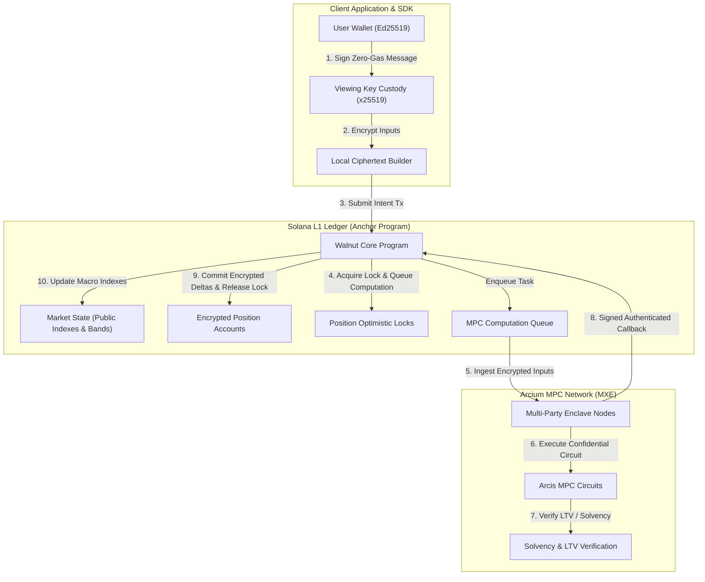

```
██╗    ██╗ █████╗ ██╗     ███╗   ██╗██╗   ██╗████████╗
██║    ██║██╔══██╗██║     ████╗  ██║██║   ██║╚══██╔══╝
██║ █╗ ██║███████║██║     ██╔██╗ ██║██║   ██║   ██║   
██║███╗██║██╔══██║██║     ██║╚██╗██║██║   ██║   ██║   
╚███╔███╔╝██║  ██║███████╗██║ ╚████║╚██████╔╝   ██║   
 ╚══╝╚══╝ ╚═╝  ╚═╝╚══════╝╚═╝  ╚═══╝ ╚═════╝    ╚═╝   
```

# Walnut Protocol: Confidential Lending on Solana L1

[](https://explorer.solana.com/address/5EunnixqNofjZDMwZudttJCKq675d99dwjqR8jTcjea?cluster=devnet)
[](https://arcium.com)
[](https://anchor-lang.com)
[](https://github.com/Iam-jayant/walnut-solana/tree/v2/packages/sdk)
[](LICENSE)

Walnut is a **native confidential lending and liquidity protocol** built on Solana L1, powered by **Arcium Multi-Party Computation (MPC)**.

Unlike legacy DeFi lending markets (Aave, Kamino, Marginfi) that expose borrower balances, exact collateral ratios, and liquidation prices on the public ledger, Walnut enforces account privacy directly at the state level. Account balances, borrowed debt, and collateral positions are stored as encrypted ciphertexts on Solana, while risk validation, solvency checks, and interest index updates execute within off-chain MPC computation enclaves.

---

## 1. The Architectural Problem

In transparent DeFi lending protocols:
- **Predatory MEV & Liquidation Cascades**: Onchain liquidator bots constantly scan public memory pools and state accounts. When market volatility occurs, searchers front-run oracle updates, manipulate local pools, and trigger cascading liquidations to harvest liquidation bonuses.
- **Credit & Strategy Exposure**: Institutional market makers, proprietary trading desks, and treasury managers cannot leverage public lending protocols without broadcasting their net exposure, balance sheet liabilities, and hedging positions to competitors in real time.
- **Surveillance by Default**: Every debt position, collateral deposit, and yield-earning account is globally indexed, doxxing users' personal financial health.

### The Walnut Solution
Walnut decouples **macroeconomic pool solvency** from **microeconomic user privacy**:
1. **Public Macro State**: Total liquidity, utilization bands (revealed in 5% granular steps), and global interest rate index accumulators remain verifiable on Solana L1.
2. **Private Micro State**: Individual borrower collateral ($S_{\text{collateral}}$), outstanding debt shares ($D_{\text{shares}}$), and free asset allocations are strictly encrypted. Solvency checks are evaluated as zero-knowledge boolean predicates inside Arcium MPC circuits.

---

## 2. System Architecture

Walnut combines Solana's high-throughput L1 execution with Arcium's decentralized Multi-Party Execution Environment (MXE).



---

## 3. Cryptographic State & Account Model

### Position State Layout
Each user owns an encrypted `Position` PDA derived from their public key:

$$\text{PDA} = \text{find\_program\_address}([\text{"position"}, \text{market}, \text{owner}], \text{PROGRAM\_ID})$$

Within the position, balances are held as homomorphic/Rescue ciphertexts:
- `free_sol`: Encrypted available SOL balance.
- `collateral_sol`: Encrypted SOL collateral backing active borrow capacity.
- `free_usdc`: Encrypted available USDC balance.
- `debt_shares_usdc`: Encrypted borrow shares accruing interest via the global borrow index.
- `supply_shares_usdc`: Encrypted pool supply shares accruing interest via the global supply index.

### Viewing Key Derivation & Client-Side Decryption
Walnut employs non-custodial Viewing Keys. Decryption never occurs on a central server.
1. The user signs an offchain authentication payload with their Ed25519 wallet key.
2. The signature is expanded into an x25519 keypair used to decrypt Rescue/ElGamal state ciphertexts directly in browser memory.
3. An automatic 5-minute inactivity timeout purges viewing keys from volatile memory to prevent session hijacking.

---

## 4. Mathematical Model & Risk Management

### 1. Loan-To-Value (LTV) & Borrow Limits
A borrower's maximum borrowing capacity is bounded by their collateral value and the protocol LTV:

$$\text{Borrow Limit} = \frac{S_{\text{collateral}} \times P_{\text{SOL/USDC}} \times \text{LTV}_{\text{bps}}}{10^4 \times 10^9}$$

- **Max LTV ($\text{LTV}_{\text{bps}}$)**: $5000\text{ bps}$ ($50.0\%$)
- **Liquidation Threshold ($\text{LT}_{\text{bps}}$)**: $8000\text{ bps}$ ($80.0\%$)
- **Close Factor**: $5000\text{ bps}$ ($50.0\%$)
- **Liquidation Bonus**: $500\text{ bps}$ ($5.0\%$)

### 2. Continuous Interest Accrual
Debt accumulates interest continuously on Solana using ray-style fixed-point indexes ($10^9$ scale):

$$I_{\text{borrow}}(t) = I_{\text{borrow}}(t_0) \times \left(1 + \frac{R_{\text{borrow}} \times (t - t_0)}{\text{SECONDS\_PER\_YEAR}}\right)$$

$$\text{User Debt}(t) = \frac{\text{debt\_shares} \times I_{\text{borrow}}(t)}{10^9}$$

### 3. Macro Utilization Bands
To prevent observers from deducing private trade sizes by monitoring micro-fluctuations in interest rates, pool utilization is partitioned into discrete $5\%$ bands:

$$U_{\text{band}} = \left\lfloor \frac{U_{\text{exact}}}{5\%} \right\rfloor \times 5\%$$

The dynamic interest rate curve updates only when utilization crosses a band boundary, completely masking individual transaction sizes.

---

## 5. Confidential Liquidation Engine

In Walnut, liquidations are permissionless yet confidential. Any liquidator can check whether a borrower is insolvent without knowing their balances:

```mermaid
sequenceDiagram
    autonumber
    actor Liquidator
    participant Solana as Solana L1 (Walnut Program)
    participant Arcium as Arcium MPC Cluster
    participant Oracle as Pyth Network (SOL/USD)

    Liquidator->>Solana: check_health(borrower_pubkey)
    Solana->>Oracle: Read current clamped price
    Solana->>Arcium: Queue MPC CheckHealth task
    Note over Arcium: Computes inside MPC:<br/>Collateral * Price * LT < Debt * 10^4
    Arcium->>Solana: Callback with 1-bit predicate (unhealthy: true/false)
    Solana-->>Liquidator: Emit HealthResult event

    alt Position is Unhealthy
        Liquidator->>Solana: liquidate_pool(borrower, repay_usdc_amount)
        Solana->>Arcium: Queue confidential Liquidation execution
        Note over Arcium: Deducts up to CloseFactor (50%) debt<br/>Calculates Seized SOL = Repay / Price * (1 + 5% Bonus)
        Arcium->>Solana: Settle encrypted state & Transfer seized collateral
        Solana-->>Liquidator: Deliver seized SOL + 5% Bonus
    else Position is Healthy
        Note over Liquidator: Liquidation aborted; position remains protected
    end
```

---

## 6. Deployed Onchain Infrastructure

Walnut is live on **Solana Devnet** connected to the official **Arcium MXE cluster**:

| Entity | Address | Explorer |
| :--- | :--- | :--- |
| **Walnut Core Program** | `5EunnixqNofjZDMwZudttJCKq675d99dwjqR8jTcjea` | [Inspect on Solscan](https://explorer.solana.com/address/5EunnixqNofjZDMwZudttJCKq675d99dwjqR8jTcjea?cluster=devnet) |
| **Lending Market Account** | `Du5ZWegZJj1RvpZ2GHVNgsy2MXAhiThpP3AHWRkJEEGr` | [Inspect on Solscan](https://explorer.solana.com/address/Du5ZWegZJj1RvpZ2GHVNgsy2MXAhiThpP3AHWRkJEEGr?cluster=devnet) |
| **Confidential USDC Mint** | `GHLMq3gCUHkb9sGPouXNo4Lt9QpGCmz5UMrtF7EwVDLT` | [Inspect on Solscan](https://explorer.solana.com/address/GHLMq3gCUHkb9sGPouXNo4Lt9QpGCmz5UMrtF7EwVDLT?cluster=devnet) |
| **Wrapped SOL (wSOL) Mint** | `So11111111111111111111111111111111111111112` | [Inspect on Solscan](https://explorer.solana.com/address/So11111111111111111111111111111111111111112?cluster=devnet) |
| **Arcium Cluster Offset** | `456` | Shared Devnet Enclave |

---

## 7. Developer SDK & Integration

### Installation
```bash
pnpm add @walnut/sdk @solana/web3.js @anchor-lang/core
```

### Initializing the Client & Reading Private Positions
```typescript
import { Connection, PublicKey } from "@solana/web3.js";
import { WalnutClient, deriveViewingKey, positionValues } from "@walnut/sdk";

const connection = new Connection("https://api.devnet.solana.com", "confirmed");
const client = new WalnutClient({
  connection,
  programId: new PublicKey("5EunnixqNofjZDMwZudttJCKq675d99dwjqR8jTcjea"),
  market: new PublicKey("Du5ZWegZJj1RvpZ2GHVNgsy2MXAhiThpP3AHWRkJEEGr"),
});

// 1. Derive Viewing Key from off-chain wallet signature
const viewingKey = await deriveViewingKey(wallet);

// 2. Fetch and decrypt confidential balances
const encryptedPosition = await client.getPosition(wallet.publicKey);
const decryptedBalances = client.decryptPosition(encryptedPosition, viewingKey);

console.log("Free SOL:", decryptedBalances.freeSol);
console.log("Collateral SOL:", decryptedBalances.collateralSol);
console.log("Confidential Debt:", decryptedBalances.debtSharesUsdc);
```

### Performing a Zero-Knowledge Health Check
```typescript
// Query borrower solvency through Arcium MPC without learning balance values
const healthResult = await client.checkHealth(borrowerPublicKey);

if (healthResult.unhealthy) {
  console.log("Account is liquidatable! Executing liquidation...");
  await client.liquidate({
    borrower: borrowerPublicKey,
    repayAmount: 10_000_000n, // 10 USDC
  });
} else {
  console.log("Account is safely collateralized.");
}
```

---

## 8. Selective Disclosure & Institutional Compliance

To comply with regulatory standards (e.g. proof of assets, tax reporting) without publishing data globally, Walnut includes an on-chain **Auditor Disclosure protocol**:

```typescript
import { discloseToAuditor, DISCLOSURE_FIELDS } from "@walnut/sdk";

// Selectively reveal only collateral and debt to an authorized auditor's x25519 public key
const auditorKey = new Uint8Array(/* Auditor's 32-byte public key */);
const mask = DISCLOSURE_FIELDS.COLLATERAL | DISCLOSURE_FIELDS.DEBT;

await client.disclose({
  auditorPublicKey: auditorKey,
  fieldMask: mask,
});
```

---

## 9. Security & Formal Invariants

1. **Optimistic Locking**: Position accounts are locked on Solana L1 upon queueing an MPC transaction. No subsequent operations can execute on that position until the MPC callback finalizes or times out, eliminating double-spend and concurrency race conditions.
2. **Oracle Sanity Clamping**: Pyth price feeds are mathematically bounded by strict upper/lower deviation bands (`clampPrice`) to prevent flash-loan price manipulation attacks.
3. **Double-Blind Enclaves**: Arcium MPC nodes process encrypted shares using secure multiparty computation. No individual node ever possesses the complete plaintext state.

---

## Repository Structure

```
├── programs/walnut/           # Anchor Solana L1 smart contracts
│   └── src/                   # Lending market, position management, callbacks
├── encrypted-ixs/             # Arcis Rust circuits compiled for Arcium MPC
│   ├── src/                   # Confidential balance math, health checks & pool ops
├── packages/sdk/              # @walnut/sdk TypeScript client library
├── packages/reference-model/  # High-precision verification and testing model
├── web/                       # Next.js 16 Web dApp (App Router, Tailwind CSS, Turbopack)
├── keeper/                    # Autonomous band refresh and rate curve keeper
└── scripts/                   # Toolchain coordination and test harnesses
```

---

## License

Walnut is dual-licensed under [Apache 2.0](LICENSE) and [MIT](LICENSE).
