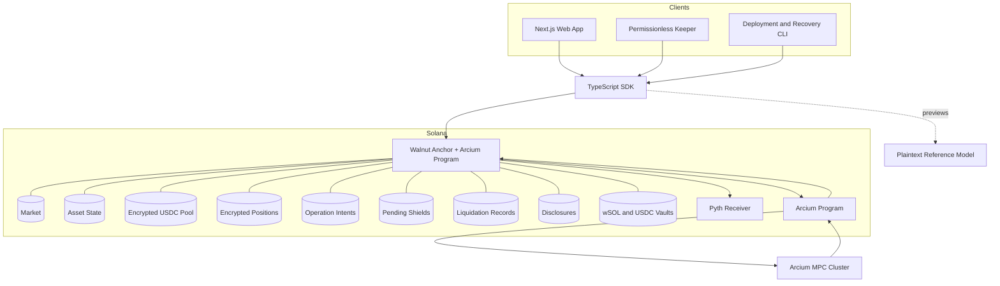

# Walnut-Solana architecture

Status: baseline (Task 1.4). Source of truth: `.kiro/specs/walnut-solana/design.md`. Account layouts below are the design's proposed layouts. The encrypted-state format (`EncGroup`) and the Position layout are pending ADR-0003 (the Task 2 Arcium feasibility gate).

## Encryption mechanism

Walnut uses **Arcium MPC**, not FHE. Encrypted inputs and state are Arcium ciphertexts. Computations are written as Arcis circuits in `encrypted-ixs/`, queued by the Walnut program, executed by an Arcium MPC cluster, and returned to the Walnut program through an authenticated callback.

Two ciphertext ownership modes are used:

- `Enc<Shared>`: encrypted under a shared secret between the MXE and a client x25519 key. The client can decrypt it locally. Used for owner-readable data such as the preferred Position layout, Receipts, and Disclosures (sealed to the auditor key).
- `Enc<Mxe>`: encrypted to the MXE cluster only. No individual can decrypt it. Used for aggregate Pool State and Recovery Claim payloads. It is also the fallback for Position state if ADR-0003 rejects the `Enc<Shared>` layout.

## Components



| Component              | Path                       | Role                                                                                                    |
| ---------------------- | -------------------------- | ------------------------------------------------------------------------------------------------------- |
| Walnut program         | `programs/walnut`          | Anchor program. Validates accounts, manages Intents, Locks, generations, custody, and Arcium callbacks. |
| Encrypted instructions | `encrypted-ixs`            | Arcis circuits for every encrypted state transition.                                                    |
| SDK                    | `packages/sdk`             | Builds every instruction, encrypts inputs, derives Viewing Keys, tracks outcomes. Browser and Node.     |
| Reference model        | `packages/reference-model` | Plaintext model of all accounting, used for previews and differential tests. Never used for settlement. |
| Keeper                 | `keeper`                   | Self-hosted Docker service for permissionless maintenance. Holds no admin authority or user keys.       |
| Web App                | `web`                      | Next.js App Router frontend. Derives and holds the Viewing Key in memory.                               |
| Network profiles       | `config/networks`          | Public per-network configuration: program ID, Arcium cluster, mints, vaults, Pyth feeds, RPC.           |
| Tests and scripts      | `tests`, `scripts`         | Integration, transaction-size, and deployment tooling.                                                  |

Rust, Solana, Anchor, and Arcium commands run in Linux or WSL2. Pinned versions are in `toolchain.versions`; see [WSL2_SETUP.md](WSL2_SETUP.md).

## Trust model

- Solana orders and finalizes Walnut instructions.
- Arcium executes circuits using dishonest-majority, detect-and-abort MPC. Privacy requires at least one honest cluster member under Arcium's documented model. A malicious or unavailable member can stop progress but cannot silently forge a valid result.
- Integrity depends on correct circuit code, Arcium's authenticated output, and Walnut's callback verification.
- Pyth supplies signed prices. Walnut is responsible for freshness, confidence, bounds, and anomaly handling.
- Upgrade and risk multisigs are trusted until upgrades are frozen.
- The frontend is inside the key-security boundary because it derives and handles the Viewing Key.

Threats are analysed in [THREAT_MODEL.md](THREAT_MODEL.md).

## Accounts

Public versus encrypted fields for every account are tabulated in [PRIVACY_MODEL.md](PRIVACY_MODEL.md#account-field-tables). This section describes purpose and relationships.

| Account                     | Owner of ciphertext     | Created by                          | Purpose                                                                                  |
| --------------------------- | ----------------------- | ----------------------------------- | ---------------------------------------------------------------------------------------- |
| Market                      | none                    | `initialize_market`                 | Authorities, vaults, public counts and count caps, active Asset State.                   |
| Asset State                 | none                    | `initialize_market`                 | Risk parameters, accounting Borrow Index, rate epoch, utilization band, caps, pauses.    |
| Pool State                  | `Enc<Mxe>`              | `initialize_market`                 | Encrypted USDC Cash, total Supply Shares, total Debt Shares, Reserves.                   |
| wSOL and USDC vaults        | none                    | `initialize_market`                 | SPL token accounts with PDA authority. Balances are public.                              |
| Position                    | `Enc<Shared>`\*         | `init_position` (owner-signed)      | One user's encrypted balances plus public lifecycle fields.                              |
| Recovery Position           | `Enc<Mxe>`\*            | `initialize_market`                 | Protocol-owned Position that receives collateral allocated during Absorb.                |
| Operation Intent            | none                    | Every queue instruction             | Captured dependencies, commitments, expiry, and terminal status of one computation.      |
| Pending Shield              | none                    | `shield`                            | Records a deposit until encrypted credit or refund.                                      |
| Liquidation Record          | none                    | `open_liquidation` (permissionless) | Lifecycle of one freeze epoch of one Position.                                           |
| Recovery Claim              | `Enc<Mxe>`              | `absorb` queue instruction          | Binds recovered collateral to supplier loss and Reserve replenishment still owed.        |
| Pending Recovery Settlement | none                    | `settle_recovery_claim` queue       | Escrows a buyer's public USDC offer while the claim check runs.                          |
| Disclosure                  | `Enc<Shared>` (auditor) | Owner-signed disclosure queue       | Snapshot of owner-selected fields re-encrypted to an auditor key, with binding metadata. |

\* Pending ADR-0003. The Recovery Position's ciphertext mode will be chosen in ADR-0003 together with the user Position layout.

### Market initialization and layouts (Task 4.1)

Code: `programs/walnut/src/market/` (`state.rs` layouts, `validation.rs` pure checks, `mod.rs` seeds), `programs/walnut/src/instructions/initialize_market.rs` (accounts and handler), `PoolState` in `programs/walnut/src/state/accounts.rs`, and the `init_pool_state` circuit in `encrypted-ixs/src/lib.rs`. Offsets are asserted by unit tests next to each struct.

| Account           | Seeds                           | Size (bytes) | Notes                                                                                     |
| ----------------- | ------------------------------- | ------------ | ----------------------------------------------------------------------------------------- |
| Market            | `["market"]` (singleton)        | 668          | Authorities, mints, vaults, linked accounts, public counts and count caps, 120 reserved.  |
| Asset State       | `["asset_state", market]`       | 319          | Generations, Borrow Index (WAD), band, risk/rate params, caps, pauses, timelock.          |
| Pool State        | `["pool_state", market]`        | 260          | `Coordination` (generation + Lock), status, `accounted_borrow_index`, `Enc<Mxe>` payload. |
| Vault authority   | `["vault_authority", market]`   | 41           | Owns both vaults and signs vault transfers.                                               |
| wSOL / USDC vault | `["vault", market, mint]`       | 165          | Classic SPL Token accounts, authority = vault authority.                                  |
| Recovery Position | `["recovery_position", market]` | 437          | Production `Position` with `owner` = Market PDA. Payload stays zero until recovery tasks. |

`initialize_market` checks, in order and before any write: the signer is the program upgrade authority (an immutable program cannot initialize, matching Arcium's MXE rule), risk/treasury/guardian keys are non-zero, both mints are classic SPL Token mints, wSOL is the native mint, USDC is a different 6-decimal mint, and every account is still zeroed. Token-2022 is out of scope: `Program<Token>` and `Account<Mint>` reject it. All accounts use `init_if_needed` so a second call reaches the freshness check and fails with `MarketAlreadyInitialized` (6028); every address is a Walnut PDA, so nobody can pre-create one. Error codes 6026 to 6040 are appended in `errors.rs`.

Risk and rate parameters start at `RiskParams::LAUNCH_DEFAULT` and `RateParams::LAUNCH_DEFAULT`, caps and count caps come from the instruction arguments, pauses start clear, and the timelock delay starts at 48 hours.

The Pool starts `Initializing` with an all-zero payload, because only the MXE can encrypt to itself. The admin queues `queue_pool_state_init`; the `init_pool_state` callback stores the `Enc<Mxe, PoolSecret>` zero payload, sets `Active`, and bumps the Pool generation to 1. Later callbacks are no-ops and later queues fail with `PoolStateNotInitializing`.

Extension points for Tasks 4.2 to 4.5:

- **Roles (4.2):** `Market.admin`, `pending_admin` (all zero = none), `upgrade_authority`, `risk_authority`, `treasury_authority`, `guardian_authority`, `treasury_usdc_account`.
- **Pauses (4.3):** `AssetState.pauses` with `flags`, `guardian_flags`, `guardian_expiry_slot`; bit constants in `market::pause_flags` follow Requirement 4.7.
- **Timelocked config (4.4):** `AssetState.generation` (the Asset State generation Intents capture), `risk`, `rates`, `timelock.delay_seconds`, `timelock.next_proposal_id`.
- **Caps and counts (4.5):** `AssetState.caps`, `Market.position_count`, `debt_position_count`, `unsettled_recovery_claim_count`, `position_count_cap`, `debt_position_count_cap`.
- **New fields:** take them from the front of the `reserved` tail of Market or Asset State and shrink `reserved` by the same size, so sizes and offsets stay fixed.

### Roles (Task 4.2)

Code: `programs/walnut/src/market/roles.rs` (pure rules and tests) and `programs/walnut/src/instructions/roles.rs` (accounts, handlers, events). Task 4.2 adds no Market fields; it uses the role keys written by `initialize_market`.

Every privileged instruction calls `market::authorize(market, role, signer)`. A signer holds a role only when it equals that role's stored key; a zero key never matches, and no role stands in for another. The admin is the governance root that changes roles, but it does not pass `authorize` for the risk, treasury, guardian, or upgrade roles.

| Instruction                   | Required signer | Effect                                                        | Event                    |
| ----------------------------- | --------------- | ------------------------------------------------------------- | ------------------------ |
| `propose_admin(new_admin)`    | admin           | Sets `pending_admin`; a later proposal overwrites it.         | `AdminTransferProposed`  |
| `accept_admin()`              | pending admin   | `admin = pending_admin`, `pending_admin` cleared.             | `AdminTransferAccepted`  |
| `cancel_admin_transfer()`     | admin           | Clears `pending_admin` (fails with `NoPendingAdmin` if none). | `AdminTransferCancelled` |
| `set_risk_authority(new)`     | admin           | Sets `risk_authority`.                                        | `RoleAuthorityChanged`   |
| `set_treasury_authority(new)` | admin           | Sets `treasury_authority`.                                    | `RoleAuthorityChanged`   |
| `set_guardian_authority(new)` | admin           | Sets `guardian_authority`.                                    | `RoleAuthorityChanged`   |
| `set_upgrade_authority(new)`  | admin           | Records `upgrade_authority`; the loader must already name it. | `RoleAuthorityChanged`   |

Every event carries the Market, the old key, the new key, and the slot; `RoleAuthorityChanged` also carries the role and the signer.

Key rules: a new role key must be non-zero, must not be one of the Market's own accounts (Market PDA, vault authority PDA, Asset State, Pool State, Recovery Position, both vaults, the program id), and must differ from its current value. The upgrade, risk, treasury, and guardian authorities must be four different keys (Requirement 4.4); `initialize_market` now checks this too. The admin may share a key with one of them, as it does with the upgrade authority right after initialization.

Multisigs: roles are plain `Pubkey`s and may be Squads vault PDAs, which are off-curve and sign through CPI. The instructions use Anchor's `Signer`, so no on-curve key is required. Mainnet should make the admin, upgrade, and risk keys Squads multisigs.

Upgrade authority: the real authority lives in the BPF upgradeable loader. To rotate it, change it in the loader first (for example from the current Squads multisig), then call `set_upgrade_authority(new)`; it fails with `UpgradeAuthorityMismatch` unless the program-data account names `new`. A frozen (immutable) program cannot be recorded; a later task can add that transition if needed.

Timelock: the design does not place role changes behind the Task 4.4 timelock, so they apply immediately (rationale in [Timelocked configuration](#timelocked-configuration-task-44)). `market::apply_role_change(market, market_key, kind, new_key)` is the validated, unauthorized transition; a timelocked execute instruction would authorize its own proposal and then call it. Error codes 6041 to 6051 are appended in `errors.rs`.

### Pause controls (Task 4.3)

Code: `programs/walnut/src/market/pause.rs` (pure rules and tests) and `programs/walnut/src/instructions/pause.rs` (accounts, handlers, event). The 12-byte `AssetState.pauses` from Task 4.1 is enough, so no layout changed: `flags` holds durable governance pauses, and `guardian_flags` holds guardian pauses that block only while the slot is below `guardian_expiry_slot`.

The ten `pause_flags` bits follow Requirement 4.7 and fall into four classes:

| Class           | Bits                                                | Mask              |
| --------------- | --------------------------------------------------- | ----------------- |
| Risk-increasing | `SUPPLY`, `BORROW`, `WITHDRAW_COLLATERAL`, `SHIELD` | `RISK_INCREASING` |
| Withdrawal      | `WITHDRAW_SUPPLY`, `UNSHIELD`                       | `WITHDRAWAL`      |
| Settlement      | `LIQUIDATION_START`, `LIQUIDATION_COMPLETE`         | `SETTLEMENT`      |
| Rescue          | `REPAY`, `ADD_COLLATERAL`                           | `NEVER_PAUSABLE`  |

Rescue bits exist so the ten controls stay distinct, but no instruction may set them (`PauseNotAllowed`) and the check ignores them. Repay, collateral addition, callbacks, Intent abandonment, Pending Shield retry and refund, and Pending Recovery Settlement refund map to no bit, so no pause state can block them (Requirement 4.8).

Operation mapping (`market::pause_category(OperationKind)` and `action_pause_category(Action)`): Shield → `SHIELD`; Unshield → `UNSHIELD`; Supply → `SUPPLY`; WithdrawSupply and reserve withdrawal → `WITHDRAW_SUPPLY`; Borrow → `BORROW`; collateral withdrawal → `WITHDRAW_COLLATERAL`; Health and `open_liquidation` → `LIQUIDATION_START`; Liquidation, `absorb`, and `settle_recovery_claim` → `LIQUIDATION_COMPLETE`. Probe, PositionInit, Viewing Key rotation, and `update_utilization_band` are not pausable. Every future queue instruction calls `market::ensure_not_paused(&asset_state.pauses, category, slot)` (or `ensure_action_allowed`) in queue step 1; callbacks never call it.

| Instruction                         | Signer   | Effect                                      |
| ----------------------------------- | -------- | ------------------------------------------- |
| `guardian_pause(flags, duration)`   | guardian | Sets guardian bits until `slot + duration`. |
| `set_pause(flags, paused)`          | risk     | Sets or clears durable bits.                |
| `renew_guardian_pause(expiry_slot)` | risk     | Moves the active guardian expiry later.     |
| `clear_guardian_pause()`            | risk     | Resets guardian bits and expiry to zero.    |

Guardian rules (Requirement 4.9): `1 <= duration <= GUARDIAN_MAX_PAUSE_SLOTS` (216,000 slots, about 24 hours). While a guardian pause is active, another guardian pause adds bits and keeps the expiry. After a guardian pause expires on its own, the guardian must wait `GUARDIAN_PAUSE_COOLDOWN_SLOTS` (9,000 slots, about one hour) past the expiry, so chained pauses cannot become permanent. Only governance (the risk authority) renews, clears, or makes a pause durable; the admin is not an implicit pauser.

Every change emits `PauseUpdated` with the change kind, actor, requested mask, old and new `flags`, `guardian_flags`, and `guardian_expiry_slot`, and the slot. Pauses apply immediately (Requirement 4.5 allows immediate emergency pauses, and the design does not timelock unpausing) and do not bump the Asset State generation, so queued work still completes. The `apply_*` functions in `market::pause` are the validated, unauthorized transitions that a Task 4.4 timelocked execute could call. Error codes 6052 to 6058 are appended in `errors.rs`.

### Timelocked configuration (Task 4.4)

Code: `programs/walnut/src/market/config.rs` (account, bounds, pure transitions, tests) and `programs/walnut/src/instructions/config.rs` (accounts, handlers, events). Market and Asset State layouts are unchanged: proposals live in their own PDAs, and the existing `AssetState.timelock` (`delay_seconds`, `next_proposal_id`) and `AssetState.generation` fields are used as reserved in Task 4.1.

`ConfigProposal` = `PDA["config_proposal", market, id (u64 LE)]`, 372 bytes: layout version, bump, `status` (`Pending`, `Executed`, `Cancelled`), `group` (`Risk`, `Rates`, `Caps`, `TimelockDelay`, and the Task 4.5 `CountCaps`), market, id, proposer, `proposed_at`, `earliest_execute_at`, `expires_at`, `proposal_generation`, `old_values` and `new_values` (fixed 72-byte `ConfigValues` snapshots of all four groups), `resolved_at`, `resolved_by`, `executed_generation`, `old_count_caps` and `new_count_caps` (Task 4.5), and 32 reserved bytes. Snapshots are used instead of a Borsh enum because an enum's encoded length depends on the variant and would move later offsets. Offsets are asserted in `config.rs`.

| Instruction                              | Signer                     | Effect                                                                         | Event                   |
| ---------------------------------------- | -------------------------- | ------------------------------------------------------------------------------ | ----------------------- |
| `propose_config_change(id, ConfigValue)` | risk authority (+ payer)   | Validates against the current config, creates the proposal, increments the id. | `ConfigChangeProposed`  |
| `execute_config_change(id)`              | anyone                     | After the delay, before the grace window ends: writes the group, generation+1. | `ConfigChangeExecuted`  |
| `cancel_config_change(id)`               | risk authority or guardian | Marks a pending proposal `Cancelled`.                                          | `ConfigChangeCancelled` |

Rules:

- `id` must equal `next_proposal_id`. `earliest_execute_at = proposed_at + delay`. Execution needs `now >= max(earliest_execute_at, proposed_at + current delay)` and `now < expires_at`, where `expires_at = earliest_execute_at + 14 days` (`EXECUTION_GRACE_SECONDS`) is fixed at proposal time; after that a proposal can only be cancelled. A later delay raise therefore cannot reopen an expired proposal (Task 4.6 fix), and because the delay is at most 14 days a raised delay still leaves at least one day to execute.
- Execution requires the changed group to still hold `old_values` for that group (`ConfigProposalBaseChanged`), so two proposals built on the same risk group cannot silently revert each other. A change to another group does not block it.
- Bounds, movement, and the cross-bound are checked at proposal time and again at execution against the then-current config. Proposing and cancelling never change configuration or the generation.
- Execution increments `AssetState.generation` exactly once. Every Intent captures that generation, and the Task 3.3 callback marks it `Stale` with no financial write when it differs. The design does not mark any configuration change as compatible with pending work, so every executed change stales every Intent queued before it. Test: `market::config::tests::executed_change_stales_a_pending_intent_without_moving_value`.

Bounds (basis points unless noted). Every launch default from Task 4.1 is inside them, so no default changed.

| Field                       | Min    | Max     | Max change per execution | Launch |
| --------------------------- | ------ | ------- | ------------------------ | ------ |
| `ltv_bps`                   | 1,000  | 8,000   | 500                      | 5,000  |
| `liquidation_threshold_bps` | 1,000  | 8,500   | 500                      | 6,500  |
| `liquidation_bonus_bps`     | 100    | 1,500   | 200                      | 500    |
| `target_health_factor_bps`  | 10,100 | 15,000  | 1,000                    | 11,000 |
| `close_factor_bps`          | 1,000  | 10,000  | 2,500                    | 5,000  |
| `reserve_factor_bps`        | 0      | 5,000   | 1,000                    | 1,000  |
| `oracle_max_age_seconds`    | 5 s    | 300 s   | 60 s                     | 60 s   |
| `oracle_max_confidence_bps` | 10     | 500     | 100                      | 200    |
| `decision_expiry_slots`     | 10     | 1,500   | 150                      | 150    |
| `base_rate_bps`             | 0      | 2,000   | 200                      | 0      |
| `slope1_bps`                | 0      | 5,000   | 400                      | 400    |
| `slope2_bps`                | 0      | 50,000  | 5,000                    | 7,500  |
| `optimal_utilization_bps`   | 5,000  | 9,500   | 1,000                    | 8,000  |
| `band_max_age_slots`        | 150    | 216,000 | 9,000                    | 9,000  |
| `timelock.delay_seconds`    | 24 h   | 14 days | any (inside the range)   | 48 h   |

Also `ltv < liquidation_threshold` and `slope1 <= slope2`. Cap bounds and the cap raise limit are Task 4.5 rules; see [Caps and lifecycle counts](#caps-and-lifecycle-counts-task-45). Task 4.5 also adds a fifth group, `CountCaps`, stored in the Market, and two 16-byte proposal fields (`old_count_caps` at 308, `new_count_caps` at 324) taken from the reserved tail, which shrinks to 32 bytes. The proposal size stays 372 bytes, and `execute_config_change` now takes the Market as writable.

Cross-bound (Requirement 4.13), exact integer bps arithmetic with margin `m = 100` bps: `L × (1 + bonus) <= 0.99` and `T >= L × (1 + bonus) + 0.01`. With the bounds above the largest `L × (1 + bonus)` is `0.85 × 1.15 = 0.9775` and the smallest `T` is 1.01, so every in-bounds configuration satisfies it; the check still runs so that a later bound change cannot break it silently.

Role changes stay immediate. Requirement 4.5 timelocks adverse risk changes and upgrades. A role setter changes no risk parameter, cap, or code: whoever holds the risk role still needs this timelock for every parameter change, and the cancellation role can stop it. Upgrades are timelocked at the loader's authority (the Squads multisig, Task 17.3); `set_upgrade_authority` only records what the loader already names. The residual risk is a compromised admin replacing both the risk authority and the guardian; users then still get the full delay to exit, and the admin should itself be a Squads multisig with a time lock (Task 17.3).

Rate changes: once Borrow Index accrual exists (Task 7), executing a `Rates` change must accrue the index at the old rate first, so new rates are not applied to elapsed time. Error codes 6059 to 6070 are appended in `errors.rs`.

### Caps and lifecycle counts (Task 4.5)

Code: `programs/walnut/src/market/caps.rs` (pure rules and tests), `programs/walnut/src/instructions/caps.rs` (`decrease_caps`), the `CountCaps` group in `market/config.rs`, and the localnet test `tests/market-limits.ts`.

Layout changes, all inside fixed sizes: `Market.debt_position_reservations` (u64 at 540) is taken from the reserved tail (now 120 bytes at 548; Market stays 668 bytes). `Position.has_debt` (bool at 98) is appended after `bump` (Position grows from 98 to 99 bytes; no Position other than the Recovery Position exists yet). `ConfigProposal` gains the count-cap fields described above.

Where each cap is checked:

| Cap                       | Compared value                                              | Where                                            | Over the cap                                   |
| ------------------------- | ----------------------------------------------------------- | ------------------------------------------------ | ---------------------------------------------- |
| `supply_cap_usdc`         | Encrypted supplier equity after the proposed supply         | Supply circuit                                   | Circuit approves zero                          |
| `total_debt_cap_usdc`     | Encrypted total debt after the borrow, at the risk index    | Borrow circuit                                   | Circuit approves zero                          |
| `position_debt_cap_usdc`  | Encrypted Position debt after the borrow, at the risk index | Borrow circuit                                   | Circuit approves zero                          |
| `position_count_cap`      | `position_count + 1`                                        | Program, when the Position PDA is created        | `PositionCountCapReached` (no Lock exists yet) |
| `debt_position_count_cap` | `debt_position_count + debt_position_reservations`          | Program, Borrow queue of a Position without debt | Borrow resolves to zero without queueing       |

A value passes when `value <= cap`. `check_supply_cap`, `check_total_debt_cap`, `check_position_debt_cap`, `supply_cap_outcome`, and `borrow_cap_outcome` are the plaintext reference the circuits must match. The queue instruction passes the public caps and the projected risk Borrow Index to the circuit and commits them in `inputs_commitment`; every cap change bumps the Asset State generation, so a computation against old caps resolves `Stale`.

Passive interest: accrual is not an action and never reads a cap, so it cannot fail because of one. `cap_scope` gives a cap check only to Supply, Borrow, and Position creation; Repay, liquidation, Absorb, withdrawals, callbacks, and recovery check none. If interest has moved a value above its cap, `before + amount > cap` holds for every amount, so each new risk-increasing action approves zero. A zero approval classifies `Zero` at the callback and releases the Lock without an error.

Debt-Position count:

1. Borrow queue on a Position with `has_debt == false` calls `reserve_debt_slot`. If `debt_position_count + debt_position_reservations < debt_position_count_cap` one slot is reserved; otherwise the result is `Unavailable` and the borrow resolves to zero without queueing.
2. Every terminal path of that Intent (`Applied`, `Zero`, `Stale`, `Expired`, `Failed`, abandonment) calls `settle_debt_intent` exactly once. It releases the slot and, only for `Applied`, applies the revealed zero/nonzero transition. `DebtTransition` can only be built from `CallbackDecision::Applied`, so counts never move on client input or a non-applied outcome.
3. The transition must agree with the public `has_debt` and the action: zero to nonzero only for Borrow, nonzero to zero only for Repay, liquidation, and Absorb. A contradiction fails with `DebtTransitionMismatch` and changes nothing. Overflow and underflow fail with `LifecycleCountOutOfRange`.

The Position is Locked by its Intent, so `has_debt` cannot change between queue and settlement, and "Borrow on a Position without debt" identifies exactly the Intents holding a slot. The Recovery Position is protocol-owned and not counted.

Cap changes:

- **Raises** (any USDC cap or count cap) go only through `propose_config_change` with a `Caps` or `CountCaps` value, because extra room for new risk is an adverse risk change under Requirement 4.5.
- **Decreases** apply immediately through `decrease_caps(ConfigValue)`, signed by the risk authority. Every field must be at or below its current value and at least one must be lower; anything else fails with `CapChangeNotDecrease`. The guardian cannot call it: its emergency tool is the expiring pause, and a cap decrease does not expire. A decrease bumps the Asset State generation once and emits `CapsDecreased`; a pending proposal for the same group then fails with `ConfigProposalBaseChanged`. A cap below the current count or debt only blocks new risk.
- **Bounds** (checked at initialization, proposal, execution, and decrease): `position_debt_cap_usdc <= total_debt_cap_usdc <= supply_cap_usdc <= 1,000,000,000 USDC` and `debt_position_count_cap <= position_count_cap <= 1,000,000`.
- **Raise limit:** one change may raise a cap to at most `max(2 × old, old + floor)`, with floor 100,000 USDC for USDC caps and 100 for count caps.

Events: `CapsDecreased` (emitted now), `PositionCountChanged` and `DebtPositionCountChanged` (defined now, emitted by the Position-initialization and debt callbacks in Tasks 5 and 8 to 10). Error codes 6083 to 6086 are appended in `errors.rs`, after the Task 6 oracle codes.

### Governance test checkpoint (Task 4.6)

Code: `programs/walnut/src/market/governance_tests.rs` (test-only). It drives the real pure transitions of Tasks 4.1 to 4.5 with an independent reference model written from Requirement 4. Signers: admin, pending admin, upgrade, risk, treasury, guardian, an attacker key, a spare key, and an off-curve multisig PDA; role-key candidates add the zero key and the Market PDA. The action alphabet is `propose_admin`, `accept_admin`, `cancel_admin_transfer`, `set_role` (risk, treasury, guardian), `set_upgrade_authority`, `guardian_pause`, `set_pause`, `renew_guardian_pause`, `clear_guardian_pause`, `propose`, `execute`, `cancel`, `decrease_caps`, `on_position_initialized`, `reserve_debt_slot`, `settle_debt_intent` (applied, contradictory, and non-applied outcomes), and time and slot advances, including jumps to `ready - 1`, `ready`, `expires_at - 1`, `expires_at`, the guardian expiry, and the cooldown end.

| Invariant (checked after every step)                                                                                                                                                                                                                                     | Tests                                                                                                                                                                                                                                                                                                                |
| ------------------------------------------------------------------------------------------------------------------------------------------------------------------------------------------------------------------------------------------------------------------------ | -------------------------------------------------------------------------------------------------------------------------------------------------------------------------------------------------------------------------------------------------------------------------------------------------------------------- |
| Unauthorized access: only the exact role holder succeeds; anyone else gets the role's error and nothing changes. No role stands in for another; an inactive Market authorizes nobody.                                                                                    | `unauthorized_signers_change_nothing_for_every_privileged_action`, `inactive_market_rejects_every_privileged_action`, both `prop_governance_model_*`                                                                                                                                                                 |
| Timelock bypass: a governed value changes only by executing a pending proposal at `now >= max(earliest_execute_at, proposed_at + current delay)` and `now < expires_at`, or moves down through `decrease_caps`. Final, reused, and base-changed proposals never execute. | `execute_at_earliest_but_not_one_second_before`, `execute_in_last_grace_second_but_not_at_expiry`, `expired_proposal_stays_expired_after_a_delay_raise`, `raising_delay_delays_and_lowering_never_shortens`, `final_reused_and_base_changed_proposals_never_execute`, `cap_decrease_then_raise_needs_the_full_delay` |
| Pause expiry: an expired guardian pause never blocks; a guardian-only pause lasts at most `GUARDIAN_MAX_PAUSE_SLOTS` and the next one starts at least `GUARDIAN_PAUSE_COOLDOWN_SLOTS` after it ended; rescue actions are never blocked.                                  | `guardian_pause_blocks_before_its_expiry_slot_and_not_at_it`, `guardian_repause_waits_exactly_until_the_cooldown_end`, `rescue_actions_are_never_blocked_by_any_pause_state`, `prop_guardian_only_pauses_never_exceed_max_or_skip_cooldown`                                                                          |
| Generation invalidation: each execution and each cap decrease bumps the Asset State generation exactly once and an Intent captured before it classifies `Stale(AssetGeneration)` with no value moved; nothing else bumps it.                                             | `only_executions_and_cap_decreases_bump_the_generation`, both `prop_governance_model_*`                                                                                                                                                                                                                              |
| Cap boundaries: `value == cap` passes, `cap + 1` resolves to zero (never an error); counts stop exactly at their caps; `debt_position_count` equals the Positions with `has_debt`; bound ordering always holds.                                                          | `cap_checks_pass_at_the_cap_and_resolve_to_zero_one_above`, `count_caps_stop_exactly_at_the_cap`, `cap_bounds_accept_exact_edges_and_reject_one_past`, both `prop_governance_model_*`                                                                                                                                |
| Cross-bound: `L × (1 + bonus) <= 0.99` and `T >= L × (1 + bonus) + 0.01` in exact bps.                                                                                                                                                                                   | `cross_bound_holds_for_every_in_bounds_liquidation_config`, `cross_bound_check_catches_widened_bounds`, `cross_bound_exact_edges`                                                                                                                                                                                    |

`prop_governance_model_random_sequences` runs 1,000 sequences of 80 random steps. `prop_governance_model_exhaustive_short_sequences` primes a Market (two Positions, one with debt; a risk proposal and a delay raise pending; an active guardian pause) and runs all 8,000 sequences of three steps from a 20-step edge alphabet. The whole module runs in about 1.5 s in a debug build.

Findings:

- **Fixed:** `execute` recomputed the deadline as `ready + 14 days` from the current delay, so raising the delay after a proposal had expired made it executable again. It now uses the stored `expires_at`. Regression: `expired_proposal_stays_expired_after_a_delay_raise`; the exhaustive model also caught it.
- With the current bounds the cross-bound is implied by the field bounds (`0.85 × 1.15 = 0.9775 <= 0.99`, and `T >= 1.01 >= 0.9875`). The check stays as defence in depth; `cross_bound_check_catches_widened_bounds` shows it rejects exactly the violating configurations once the bounds are widened.
- By design (single guardian expiry): while governance has renewed a guardian pause, the guardian can add bits to it, and they last until the renewed expiry. Governance can clear them at any time.
- The treasury role has no privileged action yet (reserve withdrawal comes later).

Localnet files `tests/market-{init,limits,pause,roles,timelock}.ts` run alphabetically in one mocha process. Each installs the roles it needs in `before` through the provider wallet, and leaves the provider wallet as admin with no pending admin, no pause, and no pending proposal (`market-roles.ts` also restores the risk, treasury, and guardian keys it started with). `market-init.ts` checks the launch generation, caps, and risk key only on the run that creates the Market.

### Position encrypted payload (preferred layout)

```rust
struct PositionSecret {
    free_sol: u64,
    free_usdc: u64,
    collateral_sol: u64,
    supply_shares_usdc: u128,
    debt_shares_usdc: u128,
}
```

One structure per Position avoids independently encrypted groups reusing a shared key/nonce sequence. If Task 2 shows this layout cannot persist safely and efficiently, all financial work stops until ADR-0003 selects the fallback.

### Position initialization (Task 5.1)

Code: `programs/walnut/src/state/position.rs` (pure rules, unit and property tests), the `Position` layout in `programs/walnut/src/state/accounts.rs`, `programs/walnut/src/instructions/position.rs` (`abandon_position_init`, `close_position`), the queue and callback instructions in `programs/walnut/src/lib.rs`, the `init_position_state` circuit in `encrypted-ixs/src/lib.rs`, and the localnet test `tests/position-init.ts`. The Task 2 `SpikePosition` and its instructions are unchanged.

Address: `Position = PDA["position", market, owner]`, one per owner per Market. Size 437 bytes. The Task 3.1 and 4.5 offsets are kept (`owner` 8, `generation` 40, `lock` 48, `bump` 97, `has_debt` 98) and the remaining design fields are appended: `status` 99, `market` 100, `viewing_pubkey` 132, `viewing_key_epoch` 164, `frozen` 172, `freeze_epoch` 173, `frozen_since_slot` 181, `next_disclosure_seq` 189, `encrypted_state` 197 (nonce 16 + five 32-byte ciphertexts, the ADR-0003 176-byte payload), then the Task 5.2 `next_shield_seq` at 373 (taken from the reserved bytes) and 56 reserved bytes at 381. The design's field order differs; offsets were kept instead of moved. The design's `next_operation_seq` is the existing per-owner `OperationCounter` PDA. The Recovery Position uses the same layout with `owner = market = Market PDA`, status `Uninitialized`, and an all-zero payload until the recovery tasks define its ciphertext.

| From           | Event                                                  | To             | `position_count` |
| -------------- | ------------------------------------------------------ | -------------- | ---------------- |
| (none)         | `initialize_position` (owner-signed)                   | `Initializing` | +1 (cap checked) |
| `Initializing` | callback `Applied`                                     | `Active`       |                  |
| `Initializing` | callback `Stale`, `Expired`, `Failed`, or `Zero`       | `InitFailed`   |                  |
| `Initializing` | `abandon_position_init` after Lock expiry (any signer) | `InitFailed`   |                  |
| `InitFailed`   | `retry_position_init` (owner-signed)                   | `Initializing` |                  |
| `InitFailed`   | `close_position` (owner-signed, rent to owner)         | closed         | -1               |

`initialize_position(computation_offset, sequence, viewing_pubkey, nonce)` rejects an all-zero key (`InvalidViewingKey`), requires an `Active` Market, calls `market::on_position_initialized` (emits `PositionCountChanged`), registers the key at epoch 0, creates the Operation Intent (`kind = PositionInit`, owner = payer = reclaim authority), Locks the Position, and queues `init_position_state(owner: Shared)` with only the key and a fresh nonce. The circuit returns the zero `PositionSecret` sealed to that key. Decision Expiry is 1,500 slots after the queue slot and Lock expiry 300 slots later (fixed constants, because the computation moves no value). Position initialization has no pause category.

Commitments: `accounts_commitment` covers owner (signer, writable), Market (read-only for the computation), and Position (with captured generation). `inputs_commitment` covers the Viewing public key, the key epoch, and the input nonce. The callback rebuilds the inputs from the output: the output encryption key must equal the registered key, and the input nonce is the output nonce minus 1 (ADR-0003). It derives the computation account for the Intent's offset and treats any other account as an offset mismatch. It then runs `classify_callback` and `apply_decision_to_slots`. `Applied` stores the payload, bumps the generation, releases the Lock, and activates the Position (`PositionActivated`). Other authenticated outcomes release the Lock and set `InitFailed` (`PositionInitFailed`). A terminal Intent is a no-op. Unauthenticated output, including Arcium's `Failure` variant (its signature has no verification API in 0.16.0), and every mismatch revert the callback, so the Intent stays `Queued` until `abandon_position_init`.

Retry and close need the Lock free, so neither runs while an attempt is queued (`PositionInitAttemptQueued`). Retry uses a new sequence and Intent and the same key and epoch; it emits `PositionInitQueued` with `retry = true`. Close is allowed only from `InitFailed` without debt (`PositionNotClosable`) and emits `PositionCountChanged` and `PositionClosed`. Closing an `Active` Position would need a computation proving the encrypted state is zero; that is deferred. Error codes 6087 to 6092 are appended in `errors.rs`.

### Pending Shield (Task 5.2)

Code: `programs/walnut/src/state/pending_shield.rs` (account, address, pure state machine, unit and property tests). It moves no tokens and writes no ciphertext; the Task 5.3 shield, retry, refund, and callback instructions do the SPL transfers and the encrypted credit and call these functions.

Address: `PendingShield = PDA["pending_shield", position, sequence u64 LE]`. The sequence is `Position.next_shield_seq`; `open_pending_shield` requires exactly that value and advances it with checked arithmetic, so a replayed or skipped sequence fails (`PendingShieldSequenceMismatch`). Anchor `init` refuses an existing account and the pure layer refuses a non-`Uninitialized` target, so a Pending Shield is never overwritten. Pending Shields are not closed in v1, so an address is never freed for reuse.

Layout (211 bytes): `owner` 8, `position` 40, `source_token_account` 72, `asset` 104 (`Sol` 0, `Usdc` 1), `status` 105 (`Uninitialized` 0, `Deposited` 1, `Credited` 2, `Refunded` 3), `bump` 106, `amount` 107, `sequence` 115, `attempt_sequence` 123, `active_intent` 131, `active_computation_offset` 163, `captured_position_generation` 171, 32 reserved bytes at 179. The design's `Option` attempt fields are plain fields because attempt 1 is installed at creation; after a final status they keep the last attempt.

| From        | Event                                                             | To                        | Value            |
| ----------- | ----------------------------------------------------------------- | ------------------------- | ---------------- |
| (none)      | `open_pending_shield` (attempt 1)                                 | `Deposited`               | tokens in vault  |
| `Deposited` | `settle_shield_attempt`, current attempt `Applied`                | `Credited`                | encrypted credit |
| `Deposited` | `settle_shield_attempt`, current attempt other terminal status    | `Deposited`               | none (retryable) |
| `Deposited` | `retry_pending_shield`, active Intent terminal and not `Applied`  | `Deposited` (attempt + 1) | none             |
| `Deposited` | `refund_pending_shield`, active Intent terminal and not `Applied` | `Refunded`                | tokens to source |
| any         | `settle_shield_attempt` for an old or foreign attempt             | unchanged                 | none             |

The active Intent account is the authority for "queued": retry and refund must present it (key and offset must match) and fail with `PendingShieldAttemptQueued` while it is `Queued`. Retry and refund are owner-only and map to no pause bit. A new attempt must be a `Queued` Shield Intent for the same owner and Position at the Position's current generation, which the Pending Shield records. Credit and refund are mutually exclusive because both require `Deposited` and set a final status. Error codes 6093 to 6106 are appended in `errors.rs`.

### Shield (Task 5.3)

Code: `programs/walnut/src/state/shield.rs` (pure rules, unit and property tests), `shield`, `retry_shield`, and the `shield_credit` callback in `programs/walnut/src/lib.rs`, `refund_shield` and `abandon_shield` in `programs/walnut/src/instructions/shield.rs`, the `shield_credit` circuit in `encrypted-ixs/src/lib.rs`, and the localnet test `tests/position-shield.ts`.

| Instruction                                                            | Signer | Pausable | Effect                                                                                                                        |
| ---------------------------------------------------------------------- | ------ | -------- | ----------------------------------------------------------------------------------------------------------------------------- |
| `shield(computation_offset, sequence, shield_sequence, asset, amount)` | owner  | `SHIELD` | `transfer_checked` of exactly `amount` source → vault, then Pending Shield `Deposited` (attempt 1), Intent, Lock, queue.      |
| `retry_shield(computation_offset, sequence)`                           | owner  | no       | Active attempt terminal and not `Applied`: attempt + 1, new Intent and offset, Lock, queue.                                   |
| `shield_credit` callback                                               | Arcium | no       | `Applied`: store state, generation + 1, `Credited`. `Zero`/`Stale`/`Expired`: release the Lock, stay `Deposited`.             |
| `refund_shield()`                                                      | owner  | no       | Active attempt terminal and not `Applied`: `Refunded`, then `transfer_checked` of exactly `amount` vault → destination.       |
| `abandon_shield()`                                                     | anyone | no       | After Lock expiry: Intent `Abandoned`, generation + 1, Lock released. The Pending Shield stays `Deposited` (retry or refund). |

SOL: the program takes only an SPL token account as the source. The client wraps in the same transaction, before `shield`: a System Program transfer into the owner's wSOL token account, then SPL Token `SyncNative`. One transfer path then serves both assets.

Account rules (`check_shield_accounts`, `check_refund_accounts`): the mint and the vault must be the Market's for the asset (`ShieldMintMismatch`, `ShieldVaultMismatch`); the source must hold that mint, be owned by the signer, and not be the vault (`ShieldSourceAccountInvalid`); the refund destination must hold that mint and be owned by the Pending Shield owner (`ShieldRefundDestinationInvalid`). The recorded source qualifies while it exists; another owner account is allowed so a closed temporary wSOL account cannot strand a refund. Refunds are signed by the vault-authority PDA (`["vault_authority", market]`). `Program<Token>`, `Account<Mint>`, and `Account<TokenAccount>` reject Token-2022.

Circuit: `shield_credit(state: Enc<Shared, PositionSecret>, owner: Shared, is_usdc: bool, amount: u64) -> (Enc<Shared, PositionSecret>, bool)`. The queue instruction reads the stored state from the Position (Viewing key, nonce, five ciphertexts), passes the bare `Shared` output owner (Viewing key plus the derived output-nonce input, see "Output nonces" below), and passes the public asset flag and amount. The sum is formed in `u128`; if it would exceed `u64::MAX` the state is returned unchanged and the revealed flag is `false`, so the callback resolves `Zero` and the deposit stays refundable. Nothing wraps, and no other field changes. The output is sealed to `owner`, so its nonce is the derived output-nonce input + 1, never the stored nonce + 1 (Task 5.4 fix, "Output nonces").

Commitments: `accounts_commitment` covers owner, Market, Asset State, Position (captured generation), Pending Shield (role `PendingShield` = 15), the asset vault (mint, vault authority), and the source token account (mint, owner). The vault and source are bound read-only because the computation never writes them. `inputs_commitment` covers the Viewing public key, key epoch, stored state nonce, Pending Shield address, attempt sequence, asset, amount, the five stored ciphertexts, and the output-nonce input (field 13). The callback rebuilds them from the output (encryption key, output nonce - 1) and the Locked Position, runs `classify_callback` and `apply_decision_to_slots`, and then `settle_shield_attempt`. Unauthenticated output and every mismatch revert, so the Intent stays `Queued` until `abandon_shield`; a terminal Intent or an old attempt is a no-op. Decision Expiry is 1,500 slots after the queue slot and Lock expiry 300 slots later (fixed, because the deposit is already in the vault and the credit reads no price or index).

Events: `ShieldQueued`, `ShieldRetried`, `ShieldCredited`, `ShieldCreditFailed`, `ShieldRefunded`, `ShieldAbandoned`. Error codes 6107 to 6112 are appended in `errors.rs`. `prop_shield_value_is_conserved_and_credit_refund_are_exclusive` drives random shield, credit, overflow, expiry, unauthenticated, abandon, retry, refund, and stray-callback sequences through the real rules and checks after every step that each vault equals the `Credited` plus `Deposited` amounts of its asset, that the credited balance equals the `Credited` sum, that no Pending Shield is both credited and refunded, and that the Position Lock is held exactly by the one queued attempt.

### Output nonces (Task 5.4, fixes a Task 5.3 nonce reuse)

Arcium seals an `Enc<Shared, _>` output under nonce = the owning input's nonce + 1, and Rescue is stream-style: two ciphertexts under one (key, nonce) leak the difference of their plaintexts. Task 5.3 sealed `shield_credit` under the stored state's nonce + 1. An attempt that does not apply (`Zero`, `Stale`, `Expired`, abandoned, or a callback that reverts) leaves the stored nonce in place, so the next attempt sealed a different plaintext under the same (key, nonce), and the rejected output is public in its callback transaction. For shield the difference was a public amount, but for `unshield` and every later private operation it would be private data. ADR-0003 requires that no effective (key, nonce) pair ever repeats.

Mechanism (`programs/walnut/src/state/nonce.rs`, mirrored by `packages/sdk/src/output-nonce.ts`): every Position-mutating circuit (`shield_credit`, `unshield`, and the later ones) takes a bare `owner: Shared` input and seals its output with `owner.from_arcis(..)`, as `init_position_state` does. The program, not the client, derives the nonce of that input:

```text
n = u128_le(sha256("walnut:position-output-nonce:v1" | position | intent_sequence_le)[0..16]) & (2^127 - 1)
```

The output nonce is `n + 1`. Intent sequences come from the owner's `OperationCounter` and are reserved exactly once whether or not the attempt later applies, so no two attempts of one Position share `n`; the cleared top bit keeps `n + 1` from wrapping. `n` is the 13th input of the Shield Intent (and the 11th of the Unshield Intent) in `inputs_commitment`. The callback rebuilds the commitment from the output nonce - 1, so an output sealed under any other nonce, including the old stored nonce + 1, fails with `CallbackInputsCommitmentMismatch`. The stored nonce changes only when an attempt applies, to that attempt's unique output nonce. Tests: `state::nonce` (vectors shared with the SDK, collision properties), `prop_unshield_conserves_the_vault_and_never_reuses_an_output_nonce` (no (key, nonce) repeats across random shield, unshield, zero, expired, unauthenticated, and abandoned attempts, and stray callbacks), the substituted-nonce cases in `state::unshield`, the SDK `NonceLedger` test in `packages/sdk/test/output-nonce.test.ts`, and the stored-nonce assertions in `tests/position-shield.ts` and `tests/position-unshield.ts`.

Residual risk: the guarantee covers every output the program asks the circuit to seal. A client-chosen input nonce (Position initialization, key rotation, receipts) is still random, so a collision with a derived nonce under the same Viewing Key has probability about 2^-127 per pair, the same order as two random 128-bit client nonces. The derivation is only as unique as the Intent sequence, which the counter enforces. A Viewing Key reused across two Positions is separated by the Position address in the hash. The MXE cannot be made to use an output nonce other than input + 1 in Arcis 0.16.0, so a fixed per-circuit output nonce is not available; the derived-input scheme is the general fix.

### Unshield (Task 5.4)

Code: `programs/walnut/src/state/unshield.rs` (pure rules) with tests in `state/unshield/tests.rs`, `unshield` and the `unshield` callback in `programs/walnut/src/lib.rs`, `abandon_unshield` in `programs/walnut/src/instructions/unshield.rs`, the `unshield` circuit in `encrypted-ixs/src/lib.rs`, the SDK `buildUnwrapWsolTransaction` in `packages/sdk/src/unwrap.ts`, and the localnet test `tests/position-unshield.ts`.

| Instruction                                             | Signer | Pausable   | Effect                                                                                                                                                                                                                                                                          |
| ------------------------------------------------------- | ------ | ---------- | ------------------------------------------------------------------------------------------------------------------------------------------------------------------------------------------------------------------------------------------------------------------------------- |
| `unshield(computation_offset, sequence, asset, amount)` | owner  | `UNSHIELD` | `Active` Position, Lock free, `amount > 0`, destination checked and bound. Intent, Lock, queue. Nothing moves.                                                                                                                                                                  |
| `unshield` callback                                     | Arcium | no         | `Applied` (approved): store state, generation + 1, release the Lock, `transfer_checked` exactly `amount` vault → destination signed by the vault-authority PDA. `Zero`: release the Lock, nothing stored, no transfer. `Stale`/`Expired`/failed: release the Lock, no transfer. |
| `abandon_unshield()`                                    | anyone | no         | After Lock expiry: Intent `Abandoned`, generation + 1, Lock released. Nothing moved, so nothing to refund.                                                                                                                                                                      |

Circuit: `unshield(state: Enc<Shared, PositionSecret>, owner: Shared, is_usdc: bool, amount: u64) -> (Enc<Shared, PositionSecret>, u64, u64)`. If the free balance of the asset is at least `amount`, the amount is subtracted and the revealed approved amount equals the request; otherwise the state is returned unchanged and the approved amount is zero. It is all or nothing, with no partial approval and no underflow (the subtrahend is zero when refused). The request is revealed alongside the approved amount: it is public anyway (the outgoing transfer shows it) and the callback needs it to rebuild the commitment when the approval is zero. The output is sealed to `owner` under the derived nonce ("Output nonces").

Destination binding: the destination must be a token account of the asset's mint owned by the Position owner and not the vault (`UnshieldDestinationInvalid`). `accounts_commitment` covers, in order: owner, Market, Asset State, Position (captured generation), the asset vault (mint, vault authority), the mint, the destination (mint, owner), the vault-authority PDA, and the SPL Token program. The callback rebuilds the bindings from the accounts it received, so substituting the destination, vault, mint, vault authority, or token program fails the commitment check. Before transferring, the callback re-checks that the destination is still owned by the Position owner and holds the mint; if its token owner changed or it was closed, the callback reverts and the Intent stays `Queued` until `abandon_unshield`. `inputs_commitment` covers the Viewing public key, key epoch, stored nonce, asset, requested amount, the five stored ciphertexts, and the output-nonce input. A transfer happens only for a verified `Applied` callback whose approved amount is nonzero and equals the committed request (`UnshieldApprovalInvalid` otherwise).

SOL: the asset mint is the wSOL mint, so the callback delivers wSOL to the owner's wSOL token account. The program never closes token accounts. Native SOL comes back through a separate owner-signed transaction, `buildUnwrapWsolTransaction(owner, wsolAccount)` (SPL Token `CloseAccount` to the owner), which is not part of the program.

Timing: Decision Expiry is 1,500 slots after the queue slot and Lock expiry 300 slots later (fixed, because the circuit reads no price or index). Events: `UnshieldQueued`, `UnshieldApproved`, `UnshieldZero`, `UnshieldFailed`, `UnshieldAbandoned`. Error codes 6113 to 6120 are appended in `errors.rs`.

Residual: abandonment releases the Lock only. A queued unshield whose callback keeps reverting (for example a closed destination) cannot move tokens, so the worst case is a delay until Lock expiry, never a loss.

### Viewing Key and rotation (Task 5.5)

**Message.** The wallet signs this UTF-8 text (`viewingKeyMessage` in `packages/sdk/src/viewing-key.ts`; golden vectors in `viewing-key.test.ts`):

```text
walnut-solana viewing key v1 | program=<ID> | network=<NET> | position=<PDA> | epoch=<EPOCH>
```

Public keys are canonical base58, the epoch is a decimal `u64`, and `<NET>` is a lowercase `[a-z0-9-]` name from the Network Profile (so no field can contain the `|` separator). The 64-byte Ed25519 signature is deterministic, so the same wallet, program, network, Position, and epoch always give the same key; changing any of them gives a different key. The x25519 secret is `HKDF-SHA-256(ikm = signature, salt = "walnut-solana viewing key v1", info = "walnut-solana viewing key v1 x25519 secret", 32 bytes)`, computed with WebCrypto. Epoch zero is used by `initialize_position`.

**Client-side custody.** The signature and the secret never appear in a transaction, URL, storage, or log. `ViewingKeySession` holds the secret in one `Uint8Array` and zeroes it on `clear()`. `unlock()` zeroes the caller's signature buffer by default. `toJSON` throws and `util.inspect`/`String` print a redacted form. `lock()`, a wallet `disconnect` or `accountChanged` event, `pagehide`, and a hidden `visibilitychange` clear the session and detach their listeners, and any later use throws. `decryptPosition` runs locally with no Walnut server call and range-checks the five values, so a wrong key throws instead of returning garbage. The one residue is the shared secret inside the transient `RescueCipher` of a decrypt call, which JavaScript cannot wipe; it is dropped when the call returns.

**Rotation flow.**

1. The owner signs the message for `epoch + 1`, derives the new key, and calls `rotate_position_key(computation_offset, sequence, expected_old_epoch, expected_new_epoch, expected_old_pubkey, new_viewing_pubkey)`. The Position PDA seeds name the signer, so only the owner can queue. The Position must be `Active` with a free Lock. The program rejects a zero new key, a new key equal to the old one, a wrong expected old key or epoch, `expected_new_epoch != old + 1`, and epoch overflow. It creates the Intent, Locks the Position, and queues `rotate_position_key`. No Market account is read, and rotation is not pausable (`Action::ViewingKeyRotation`).
2. The Intent commits the old and new epochs and public keys, the stored nonce and five ciphertexts, and the derived output-nonce input (which binds the Position and the Intent sequence), plus the owner and the Position at its captured generation. The Intent also carries the sequence and the Decision Expiry. The program ID is bound by the PDAs. The network is bound only by the client-signed message, because the program has no network concept.
3. The circuit `rotate_position_key(state: Enc<Shared, PositionSecret>, new_owner: Shared)` reads the stored payload under the old key and re-seals the same five values to `new_owner` (the new key and the derived nonce input), so the output nonce is `n + 1` as in 5.4. It reveals nothing.
4. The callback (`state::rotation::settle_rotation`) rebuilds the commitment from the Position it holds and the key the output is sealed to. `Applied` writes the payload, `viewing_pubkey`, and `viewing_key_epoch + 1` together, bumps the generation, and releases the Lock. `Stale`, `Expired`, and failed outcomes release the Lock and change nothing, so the old key stays valid. A terminal Intent is a no-op. Unauthenticated output or any binding mismatch (an output sealed to another key, another nonce, or a wrong committed epoch) reverts and leaves the Intent `Queued` until `abandon_rotation` (any signer, after Lock expiry).

**Atomicity.** The three fields change only in the last statements of the `Applied` arm of `settle_rotation`, after classification, decision application, and the epoch increment have succeeded on copies. No other function writes them, so a Position always holds a payload sealed to the key and epoch it stores. Rust property tests check that the epoch increases by exactly 1 only on `Rotated`, that the stored payload always matches the stored key, and that no output `(key, nonce)` repeats across attempts. A Pending Shield or other operation cannot run during a rotation, because both need the free Lock.

**Events.** `ViewingKeyRotationQueued`, `ViewingKeyRotationApplied`, `ViewingKeyRotationFailed`, and `ViewingKeyRotationAbandoned` carry only public values (epochs, public keys, status, slot). The spike's `ViewingKeyRotated` is unchanged. Rotation is not wallet-loss recovery (Requirement 5.13).

### Balance-layer checkpoint (Task 5.6)

`programs/walnut/src/state/balance_checkpoint.rs` (test-only) follows the Task 3.5 pattern for Position, shield, unshield, and rotation. Every balance is encrypted, so the module gives the payload a test oracle: a reversible test cipher plays the MPC circuit (it opens the stored payload, computes the new balances, and re-seals them under the derived output nonce), and every check reads the stored payload back as integers. The real side drives the production functions the instructions call (`initialize_position`, `queue_shield`, `settle_shield_credit`, `retry_shield`, `refund_shield`, `queue_unshield`, `settle_unshield`, `queue_rotation`, `settle_rotation`, the abandon functions, the pause functions) and performs the vault transfers at the points the handlers do. An independent reference model, written from the requirements and calling no production function, holds plaintext free balances, both vault totals, the Pending Shields, the Intents, the Lock, the generation, the pause state, and the slot. After every action the harness checks the named invariants on the real side, then requires production and reference to agree on the outcome and on a full snapshot.

The action alphabet covers initialization and retry, shield (amounts 0, 1, and the `u64` edge) and shield into an occupied account, shield retry and refund, unshield (within the balance, exactly the balance, balance + 1, `u64::MAX`), rotation and a stale rotation request, callbacks (honest, unauthenticated, wrong key, wrong nonce, wrong offset) aimed at the current, first, or previous Intent, abandonment, durable and guardian pause and unpause, clock advance, and an external generation bump. Unauthenticated delivery is also how an Arcium computation failure arrives. Duplicate, late (after abandonment), and old-attempt callbacks are honest callbacks for a terminal Intent; `Stale` and `Expired` come from an external bump or a clock advance before an honest callback.

Invariants (each failure message starts with the name):

- **`VAULT CONSERVATION`.** Per asset, vault = credited shields + deposited shields - approved unshields, and wallet + vault never changes. A refund returns exactly the deposited amount once.
- **`PENDING SHIELD EXCLUSIVITY`.** A shield only moves `Deposited -> Credited` on its own applied attempt or `Deposited -> Refunded` on a refund, never both, and a final one never changes. At most one attempt is queued per shield, shield sequences are dense and unique, and a shield into an occupied account is rejected.
- **`FAILURE AND LATE CALLBACK NEUTRALITY`.** Zero, stale, expired, unauthenticated, wrong-binding, duplicate, late, and old-attempt callbacks, rejected actions, and abandonment change no balance, key, epoch, payload, vault, or shield. Terminal Intents never change.
- **`OVERSIZED UNSHIELD RETURNS ZERO`.** A request above the free balance resolves `Zero` and changes nothing. A request equal to the balance is approved and leaves exactly zero.
- **`BALANCE BACKING`.** The decrypted free balance of each asset equals credited shields minus approved unshields.
- **`ROTATION`.** The epoch moves by one only on an applied rotation, the stored payload always opens under the stored key (key and payload change together), balances survive, and the previous key no longer opens the payload.
- **`NONCE UNIQUENESS`.** No output `(key, nonce)` repeats across the run, including attempts that never applied.
- **`PAUSE AND RESCUE`.** Only new shield and unshield queueing is ever rejected as paused, and only while its own bit is effective. Refund, retry, abandon, callbacks, and rotation always run, and an expired guardian pause blocks nothing.
- **`LOCK SAFETY`.** At most one Intent is queued, and the Position Lock is held exactly while one is.

Tests, all in that module:

- `prop_balance_exhaustive_lifecycle_sequences_up_to_length_5`, `prop_balance_exhaustive_adversarial_sequences_up_to_length_5`, `prop_balance_exhaustive_funded_lifecycle_sequences_up_to_length_5`, and `prop_balance_exhaustive_funded_adversarial_sequences_up_to_length_5`: every sequence of up to 5 actions (111,110 each) over four 10-action alphabets, two from a fresh world and two from an `Active` Position holding 100 SOL.
- `prop_balance_random_sequences_full_alphabet`: 20,000 deterministic random sequences of up to 40 actions over the full alphabet (about 410,000 actions; a state-aware generator keeps most actions valid).
- `balance_script_agrees_and_ends_with_the_expected_balances`, `balance_oversized_unshield_returns_zero_and_exact_leaves_zero`, `balance_credit_overflow_stays_deposited_and_is_refundable`, `balance_failed_and_late_callbacks_change_nothing`, `balance_rotation_applies_atomically_and_keeps_balances`, `balance_pause_blocks_only_new_shield_and_unshield`, `balance_shield_into_an_occupied_account_is_rejected`, and `balance_init_failure_is_retryable`: scripted scenarios with asserted outcomes.
- `balance_pause_matrix_blocks_only_new_shield_and_unshield`: every durable and guardian pause state, both expiry sides, every rescue action.
- `balance_golden_vectors_hold_for_production_and_the_reference_model`: replays `packages/reference-model/vectors/balance.vectors`. `packages/reference-model/test/vectors.test.ts` replays the same file on the TypeScript model (`@walnut/reference-model`, `BalanceModel`), so the program rules, the Rust reference, and the TypeScript reference agree.
- `balance_injected_faults_are_caught_by_the_named_invariant`: ten injected defects (a refund that skips the vault, a zero callback that writes, a refund that flips a shield to credited, an oversized unshield that drains, a refund blocked by a pause, a rotation that keeps the epoch or swaps the key only, a reused nonce, a late callback that moves tokens), each reported by its named check. `balance_a_reference_model_defect_is_an_agreement_failure` shows a wrong reference is caught too.

Local decryption (Requirements 5.9, 5.10): `packages/sdk/test/position-decrypt.test.ts` seals a Position payload with a locally generated fake MXE key and the real `RescueCipher`, and shows that the right Viewing Key reads the exact balances while a key from another wallet, Position, network, program, or epoch, the pre-rotation key after a rotation, a wrong nonce, or a wrong MXE key throws `ViewingKeyDecryptError`.

### Pool encrypted payload

```rust
struct PoolSecret {
    cash_usdc: u128,
    total_supply_shares: u128,
    total_debt_shares: u128,
    reserves_usdc: u128,
}
```

### Generations and Locks

```rust
struct Lock {
    active: bool,
    computation_offset: u64,
    operation_intent: Pubkey,
    expiry_slot: u64,
}
```

A generation increments whenever accepted state changes or an operation is abandoned. Walnut cannot prove that an old computation has stopped running after its Lock expires. The enforced invariant is: **only one generation is current, and only a callback bound to that generation may commit.**

On-chain, `Position` and `PoolState` each embed a fixed-layout `Coordination` field group: `generation: u64` (8 bytes, little-endian) followed by the `Lock` (49 bytes: `active` 1, `computation_offset` 8, `operation_intent` 32, `expiry_slot` 8), 57 bytes in total. Borsh lays the group out byte-for-byte like two adjacent fields, so it matches the struct above. Later tasks append their own fields after it and never reorder it. The byte layout is asserted by unit tests in `programs/walnut/src/state/`.

One implementation of the transition rules lives in `programs/walnut/src/state/coordination.rs`. The Operation Intent lifecycle handlers and the Anchor instructions both call it.

- **Acquire** is atomic across every affected account. If any account is already locked, or the same account is passed twice, no Lock is taken and the instruction fails.
- **Release** clears only the Locks whose Operation Intent and computation offset both match the caller. A non-matching release changes nothing and returns zero. A callback that applies state bumps each matching generation by one and then releases. Callbacks that apply nothing (`Zero`, `Stale`, `Expired`, `Failed`) release without bumping.
- **Abandon** requires every matching Lock to be past `expiry_slot`. It bumps every still-matching generation before it clears the Locks, and it changes nothing if any bump would overflow.
- **Late callbacks.** After abandonment the Locks are cleared and the generations have moved on, so a callback that captured the old generation fails the writer check. The Intent is also terminal, so the callback is a no-op.

The adapter copies the `Coordination` fields out, runs the shared rules, and writes them back only on success, so a failed operation leaves every account unchanged. Property tests in `programs/walnut/src/operation/ordering.rs` run every ordering of queue, callback, failure, abandonment, duplicate, late, and wrong-owner events through both paths.

### Operation Intent PDA

Each queued computation owns one Operation Intent account (418 bytes: 8 discriminator, 410 data). The pure-Rust status machine from Task 2.1 is the same struct, so one implementation serves tests and the program. Field offsets are documented and asserted in `programs/walnut/src/operation/intent.rs`.

- **Address.** `PDA["operation_intent", owner, sequence u64 LE]`. The sequence comes from the owner's `OperationCounter` PDA (`["operation_counter", owner]`, 49 bytes). The queue instruction must pass exactly `next_sequence`, and the counter advances by one with checked arithmetic. A replayed or skipped sequence is rejected, and the operation kind is not a seed, so one sequence can never serve two operations (`operation/seeds.rs`).
- **Commitments.** `accounts_commitment` and `inputs_commitment` are SHA-256 over a length-prefixed, little-endian serialization that starts with a domain tag and version byte. Account order and role, owner, mint, authority, writability, and generation are all hashed. The byte format is in the module docs of `operation/commitment.rs` and pinned by golden vectors.
- **Timing.** Creation requires `queued_slot < decision_expiry_slot <= lock_expiry_slot`, so abandonment can never open while a callback may still apply a decision. `Applied` and `Zero` need a slot at or before Decision Expiry. `Expired` needs a slot after it. `Abandoned` needs a slot after Lock expiry.
- **Transition ownership.** `Applied`, `Zero`, `Failed`, `Stale`, and `Expired` are driven only by the verified Arcium callback. `Abandoned` is the only permissionless transition. A terminal Intent rejects every further transition. See `operation/ownership.rs` for the table and error codes.
- **Reclaim.** The Intent records `payer` and `reclaim_authority`, which must be equal because Arcium only lets the original payer claim. `claimComputationRent` is allowed after any terminal status. `reclaimExpiredComputationFee` is allowed only after `Expired` or `Abandoned`. Neither is allowed while `Queued`. The Arcium instructions are built by the SDK (Task 3.4).

### Callback verification and decisions

`programs/walnut/src/operation/callback.rs` holds the pure-Rust helpers that production callbacks call. The instruction runs Arcium `verify_output` itself and passes the result in as `output_authenticated`. `classify_callback` reads the Intent and the callback context and returns one decision. It checks in this order:

1. Output authenticated, else `LeaveQueued`.
2. Intent key and operation kind match the callback, else error.
3. Intent is `Queued`, else `Ignore`.
4. Computation offset matches, else error.
5. Recomputed `accounts_commitment` and `inputs_commitment` match, else error. The callback hashes the generations the Intent captured, not the current ones.
6. A static failure report resolves `Failed`.
7. Captured generations, accounting index and timestamp, and rate epoch match the current values, else `Stale`.
8. Slot is at or before Decision Expiry, else `Expired`.
9. Zero approval resolves `Zero`, nonzero resolves `Applied`.

| Decision                               | Intent status | Generations                   | Locks owned by the Intent |
| -------------------------------------- | ------------- | ----------------------------- | ------------------------- |
| `Applied`                              | `Applied`     | bumped                        | released                  |
| `Zero`, `Stale`, `Expired`, `Failed`   | same name     | unchanged                     | released                  |
| Timeout abandon (`abandon_timeout`)    | `Abandoned`   | bumped before the Locks clear | released                  |
| `Ignore` (terminal Intent)             | unchanged     | unchanged                     | unchanged                 |
| `LeaveQueued` (unauthenticated output) | `Queued`      | unchanged                     | still held                |

Errors (steps 2, 4, 5) revert the callback transaction and leave the Intent `Queued`. A commitment mismatch is rejected rather than marked `Stale`, so a public signed output paired with the wrong accounts cannot cancel a live operation. `Stale` is checked before `Expired`, as in the design. `apply_decision` runs the Task 3.2 transition check for the verified-callback actor before each lifecycle handler, so `Applied` after Decision Expiry is refused. The commitment hash stays pure-Rust SHA-256. `CommitmentHasher` is the seam for swapping in the `sol_sha256` syscall once a dependency change is approved.

### Framework checkpoint: invariants and how they are tested

`programs/walnut/src/operation/checkpoint.rs` (Task 3.5, test-only) drives the real queue, callback, failure, expiry, abandonment and retry code over a small model world, next to an independent reference state machine. The framework holds no financial state, so the model adds a plain-integer ledger (one balance per protected account plus a vault). The ledger changes only in `commit_value_effect`, which the driver calls exactly when the framework returns `Applied`. After every action the harness checks that the real system and the reference model agree on the outcome, every Intent status, every generation and Lock owner, the sequence counter, the clock and the whole ledger, then checks these invariants:

- **Financial neutrality.** The ledger changes only on a transition to `Applied`, by exactly the modelled amount. `Zero`, `Stale`, `Expired`, `Failed`, `Abandoned`, `LeaveQueued`, ignored, rejected and failed-queue steps leave it identical. Total value is conserved. `Applied` happens at most once per Intent.
- **Lock safety.** Every active Lock belongs to one `Queued` Intent whose footprint contains the account. A `Queued` Intent holds its whole footprint. No terminal Intent holds a Lock.
- **Generation safety.** Generations never decrease. They move by exactly one, and only on `Applied`, `Abandoned`, or an external write to that account.
- **Terminal immutability.** An Intent leaves `Queued` once. Only the targeted Intent changes.
- **Sequence counter.** One sequence per queued Intent, strictly increasing, never reused. A failed queue consumes none. Offsets and keys are fresh.
- **Late callback.** A terminal Intent never passes `callback_may_write`, so an `Abandoned` Intent's late callback cannot write.
- **Retry safety.** A retry is a new Intent with a fresh sequence, offset and key. The original stays terminal and is never `Applied`. The retry can itself be `Applied`.
- **Liveness.** From any reachable state, abandoning every expired Intent unlocks every account and a new queue succeeds.

The tests are:

- `prop_exhaustive_core_lifecycle_sequences_up_to_length_5` and `prop_exhaustive_adversarial_callback_sequences_up_to_length_5`: every sequence of up to 5 actions (111,110 each) over two 10-action alphabets with two accounts.
- `prop_random_sequences_full_alphabet_three_accounts`: 20,000 deterministic random sequences of up to 40 actions over the full alphabet with three accounts.
- `checkpoint_applied_moves_exactly_the_modelled_value_once`, `checkpoint_every_non_applied_terminal_outcome_moves_no_value`, `checkpoint_rejected_and_unauthenticated_callbacks_change_nothing` and `checkpoint_failed_queues_change_nothing`: financial neutrality.
- `checkpoint_late_callback_after_abandonment_cannot_write`, `checkpoint_external_generation_change_makes_the_callback_stale` and `checkpoint_concurrent_queue_on_a_locked_account_is_rejected`: Lock and generation safety.
- `checkpoint_retry_after_each_non_applied_outcome_applies_exactly_once` and `checkpoint_retry_requires_a_terminal_non_applied_intent`: retry.
- `checkpoint_sequence_counter_is_strictly_increasing_and_never_reused`: sequence counter.
- `checkpoint_expired_locks_never_leave_an_account_permanently_locked`: liveness.
- `checkpoint_injected_value_faults_are_caught`: a driver that commits value on a non-`Applied` outcome fails the neutrality check, so the check is not vacuous.

### Fixed-point math, rate model, utilization band, Pool checkpoint (Tasks 7.1 to 7.3)

**Fixed point (7.1).** `programs/walnut/src/math/fixed.rs` is the single definition: `mul_div_floor/ceil`, `mul_wad_*`, `div_wad_*` (checked `u128`, `MathError` on overflow, division by zero, or a range violation; nothing saturates), the exact `mul_wad_*_wide` variants for public index accrual, `debt_from_shares` (ceil), `shares_from_amount_ceil/floor`, and `to_u64`/`to_i64`. The range table (`MAX_SHARES × MAX_BORROW_INDEX = 10^37`) keeps every share-versus-index product inside `u128`. Rounding: debt up, shares issued for a borrow up, reserve allocation down, per-second rate up. The Arcis helpers in `encrypted-ixs/src/lib.rs` (`circuits::mul_wad_ceil`, `debt_from_shares_checked`, ...) and the bigint mirror `packages/reference-model/src/fixed.ts` replay the same golden vectors (`packages/reference-model/vectors/{fixed,rate,checkpoint}.vectors`). Arcis has no 256-bit type and no `Result`, so circuit helpers range-check first and return an `ok` flag; on `!ok` they compute with clamped inputs and the caller refuses the operation.

**Rate model and index (7.2).** `math/rate.rs`: annualized-bps kinked rate (`borrow_rate_bps`, capped at 100,000 bps), `rate_per_second_wad` (ceil), 20 utilization bands of 5% (`utilization_band`, cross-multiplied, zero total is band 0), accrual at the **upper edge** of the stored band (`band_rate_per_second_wad`), `project_index(index, ts0, ts1, rate)` = `index + ceil(index × rate × dt / WAD)` (identity at `dt = 0`, never decreases, `TimeRegression`/`ElapsedTooLong`/`OutOfRange` errors), `project_risk_index` (accounting index through Decision Expiry at 1 s per slot), `accrue_asset_index`, `ensure_band_fresh` (never observed, future, and older than `band_max_age_slots` all block new risk), and `apply_band_observation`. Executing a `Rates` configuration change now accrues the index at the old rate and increments `rate_epoch_generation` first (`market::config::execute`). AssetState layout is unchanged (no `reserved` bytes used).

**`update_utilization_band` (7.2).** Queue (`update_utilization_band(computation_offset, sequence)`, any payer) builds an `OperationKind::UtilizationBand` Intent owned by the Pool PDA (sequences from a Pool-owned `OperationCounter`, `["operation_counter", pool_state]`, created on first use) and takes no Lock. The `update_utilization_band(pool: Enc<Mxe, PoolSecret>, accounting_index: u128) -> u8` circuit reveals only the band. The callback (`state::band::settle_band_update`) writes `utilization_band` and `utilization_observation_slot` (the queue slot) only when the Pool generation, Asset State generation, rate epoch, accounting index and timestamp still match; otherwise the Intent resolves `Stale` and nothing is written. Out-of-domain circuit inputs reveal band 19 (conservative). Input field ids 16 to 21 bind the Pool payload and the index.

**Pool checkpoint (7.3).** `math/checkpoint.rs` (plaintext) and `circuits::checkpoint_pool` / `checkpoint_pool_values` (Arcis) implement the design's first step of every Pool-mutating circuit: `old_debt`, `new_debt` (ceil at the accounted and accounting index), `interest`, `reserve_add = floor(interest × reserve_factor_bps / 10_000)`, `reserves' = reserves + reserve_add`, `supplier_equity = cash + new_debt - reserves'`. Reserve plus supplier interest equals total interest exactly; cash does not change. `PoolSecret` is unchanged. Error codes 6128 to 6140 are appended in `errors.rs`.

### Pool and Borrow Index serialization (Task 7.4)

Code: `programs/walnut/src/state/pool_mutation.rs`. Every Pool-financial-state mutation (reserve withdrawal now; supply, withdrawal, borrow, repay, partial liquidation, and Absorb in Tasks 8 to 12) uses the same three functions, so the rule exists once.

| Function                                                                                                           | Called                     | Effect                                                                                                                                                                                                                                                                                                                                                                                                                                                 |
| ------------------------------------------------------------------------------------------------------------------ | -------------------------- | ------------------------------------------------------------------------------------------------------------------------------------------------------------------------------------------------------------------------------------------------------------------------------------------------------------------------------------------------------------------------------------------------------------------------------------------------------ |
| `begin_pool_mutation(market_status, &mut asset, &mut pool, pool_key, &mut others, &mut counter, &request, commit)` | queue instruction          | Requires an `Active` Market and Pool and an unlocked Pool. Accrues the accounting index on a copy (`accrue_asset_index`), projects the risk index through Decision Expiry, builds the `PoolCapture`, lets `commit` hash it into the Intent commitments, reserves the sequence, and acquires the Pool Lock and every `others` slot (Positions) all or none. Writes the Asset State, Pool coordination, and counter only on success. Returns the Intent. |
| `settle_pool_decision(&mut pool, pool_key, &mut others, &mut intent, decision, &output, slot)`                     | callback, after `classify` | `Applied`: stores `output` (rejects a nonce equal to the stored one), sets `accounted_borrow_index` to the Intent's accounting index, bumps every matching generation, releases the Locks. `Zero`, `Stale`, `Expired`, `Failed`: releases the Locks, stores nothing. Atomic.                                                                                                                                                                           |
| `abandon_pool_mutation(&mut pool, pool_key, &mut others, &mut intent, kind, slot)`                                 | abandon instruction        | After Lock expiry: bumps the Pool generation, clears the Lock, marks the Intent `Abandoned`. A late callback then sees a terminal Intent and a moved generation.                                                                                                                                                                                                                                                                                       |
| `ensure_pool_unlocked_for_index_mutation(&pool)` and `accrue_independently(&mut asset, &pool, now_ts)`             | any other index writer     | Fails with `PoolLockedForIndexMutation` while any Lock is held. `execute_config_change` calls it for a `Rates` proposal (the instruction now takes the Pool account).                                                                                                                                                                                                                                                                                  |

How Tasks 8 to 12 call it: build the commitments inside the `commit` closure from the `PoolCapture` (accounting index, timestamp, risk index, Pool generation), pass the Position's `CoordinationSlot` in `others`, set `intent.position*` on the returned Intent, and in the callback use `pool_dependencies(&pool, &asset)` for `CurrentDependencies` before `classify_callback`. Use the accounting index for shares, Cash, and checkpoint math and the risk index only for health and cap checks.

Two indexes: `accounting_borrow_index` only grows, and only at queue-time accrual, an independent accrual on an unlocked Pool, or a `Rates` execution. `risk_borrow_index_at_expiry` is never written to an account and is strictly above the accounting index (a positive rate and a nonzero Decision Expiry). The queue cannot run while a Lock is held, so a Locked Pool's index never moves under its computation.

The read-only band update stays lock-free. It captures the Pool generation, the accounting index and timestamp, and the rate epoch, so it resolves `Stale` after any Pool mutation was queued (the index moved), after a Pool generation bump, or after a rate change. If the Pool payload itself changed before delivery, the input commitment no longer matches and the callback reverts, so nothing is written (the Intent stays `Queued`; no abandon instruction exists for lock-free Intents).

`Enc<Mxe>` outputs: the MXE cluster chooses the output nonce, so the Task 5.4 derived-nonce scheme is not needed for the Pool. The callback only rejects a nonce equal to the stored one (`PoolOutputNonceReused`).

### Reserve withdrawal (Task 7.5)

Code: `programs/walnut/src/state/reserve_withdrawal.rs` (rules, tests in `reserve_withdrawal/tests.rs`), `reserve_withdrawal` and its callback in `lib.rs`, `abandon_reserve_withdrawal` and `set_treasury_usdc_account` in `instructions/reserve_withdrawal.rs`, and the `reserve_withdrawal` circuit in `encrypted-ixs/src/lib.rs`.

| Instruction                                                | Signer                                | Pausable          | Effect                                                                                                                                                                                                                                      |
| ---------------------------------------------------------- | ------------------------------------- | ----------------- | ------------------------------------------------------------------------------------------------------------------------------------------------------------------------------------------------------------------------------------------- |
| `reserve_withdrawal(computation_offset, sequence, amount)` | treasury authority (`Role::Treasury`) | `WITHDRAW_SUPPLY` | Pool `Active` and unlocked, `amount > 0`, treasury account configured, USDC, owned by the treasury authority, not the vault. Accrues the index, creates the Intent (Pool-owned counter), Locks the Pool, queues.                            |
| `reserve_withdrawal` callback                              | Arcium                                | no                | `Applied`: store the Pool payload, accounted index, generation + 1, release the Lock, `transfer_checked` exactly the approved USDC vault to treasury, signed by the vault-authority PDA. Others: release the Lock, nothing stored or moved. |
| `abandon_reserve_withdrawal()`                             | anyone                                | no                | After Lock expiry: generation + 1, Lock released, Intent `Abandoned`.                                                                                                                                                                       |
| `set_treasury_usdc_account()`                              | admin                                 | no                | Records `Market.treasury_usdc_account` (a classic SPL USDC account owned by the current treasury authority, not the vault). Rotating the treasury authority later makes the account invalid until the admin sets it again.                  |

Circuit: `reserve_withdrawal(pool: Enc<Mxe, PoolSecret>, accounted_index: u128, accounting_index: u128, reserve_factor_bps: u128, requested: u64) -> (Enc<Mxe, PoolSecret>, u64 approved, u64 requested_echo)`. `reserve_withdrawal_values` runs `checkpoint_pool` first, approves only if `requested > 0`, the checkpoint succeeded, and `requested <= cash` and `requested <= reserves` (after the checkpoint), and then subtracts exactly `requested` from both, so supplier equity is unchanged. Plaintext twin: `math::checkpoint::reserve_withdrawal`. The request echo is a third output (a deviation from the two-output signature in the task text) because the callback needs it to rebuild the input commitment when the approval is zero, as for `unshield`.

A refusal commits nothing. The circuit returns the input payload unchanged, and the callback stores only on `Applied`, so a `Zero` does not advance `accounted_borrow_index` either; the next operation checkpoints the same interval once. The design states the effect only for approval, so this is a documented choice.

Commitments: `accounts_commitment` covers the signer, Market, Asset State, Pool (captured generation), the USDC vault (mint, vault authority), the USDC mint, the treasury token account (mint, token owner), the vault-authority PDA, and the SPL Token program. `inputs_commitment` covers the Pool nonce and four ciphertexts, the accounting and accounted indexes, the requested amount, and the destination key (input ids 16 to 22, 24, 25; the reserve factor is covered by the Asset State generation, since a bound value would turn a governed change into a revert instead of `Stale`). The callback rebuilds both from the Intent's payer and the accounts it received, requires the approval to equal the request, and re-checks the destination against the Market before transferring. Decision Expiry is 300 slots and Lock expiry 150 slots later. Error codes 6141 to 6149 are appended in `errors.rs`.

### Pool property tests (Task 7.6)

`programs/walnut/src/math/properties.rs` (test-only) drives the real `rate`, `checkpoint`, and `fixed` functions with a deterministic sampler: `prop_rate_curve_is_monotone_and_continuous_at_the_kink` (monotone in utilization, each step bounded by the steeper slope's per-bp increment, exact kink and endpoints), `prop_band_rate_never_undercharges_the_true_utilization`, `prop_interest_split_is_exact_and_rounds_toward_suppliers` (reserve plus supplier interest equals interest, `reserve_add = floor`, interest within one unit of the exact product), `prop_nav_identity_and_nav_grows_by_the_supplier_interest`, `prop_reserve_withdrawal_is_all_or_zero_and_equity_neutral` (cash, reserves, and the transfer move together; refusals commit nothing), `prop_zero_supply_shares_are_safe_and_irrelevant_to_pool_math`, `prop_long_elapsed_time_errors_instead_of_wrapping` (`ElapsedTooLong` or `OutOfRange`, never a wrap), `prop_accrual_is_monotone_and_step_splitting_never_lowers_it`, and `prop_debt_and_borrow_rounding_never_favor_the_borrower` (booked debt is at least the amount delivered and exceeds it by at most `ceil(index / WAD)`). `packages/reference-model/test/pool-properties.test.ts` checks the same properties on the TypeScript mirror (`reserveWithdrawal` in `checkpoint.ts`).

### Pool accounting checkpoint (Task 7.7)

`programs/walnut/src/state/pool_checkpoint.rs` (test-only) follows the Task 3.5 pattern. The real side drives `queue_reserve_withdrawal`, `settle_reserve_withdrawal`, `abandon_reserve_withdrawal`, `queue_band_update`, `settle_band_update`, `accrue_independently`, `math::checkpoint::reserve_withdrawal` (the circuit's plaintext twin, behind a reversible test cipher), and `rate::ensure_band_fresh`, and performs the vault transfer where the handler does. An independent model (`M`) re-derives the rate curve, accrual, projection, checkpoint, band, approval, Lock, generation, and staleness rules without calling production code. After every action the harness checks the named invariants on the real side, then requires the real side and the model to agree on the outcome and a full view.

Action alphabet: queue a reserve withdrawal (zero, one, current reserves, the exact post-checkpoint boundary, boundary plus one), honest, unauthenticated, and wrong-binding callbacks aimed at the last, first, or previous Intent, abandon, band queue and band callback, clock advances (10, 301, 451, and 9,100 slots, each with one day of time), independent accrual, `Rates` execution, an external Pool generation bump, an Asset State generation bump, treasury account set and unset, treasury authority rotation, the `WITHDRAW_SUPPLY` pause, and a band freshness check.

Invariants (each failure message starts with the name):

- **`LOCK SAFETY`.** At most one queued Pool mutation; the Pool Lock is held exactly by it; a queue on a locked Pool is never accepted.
- **`GENERATION`.** The Pool generation moves by exactly 1 on `Applied`, `Abandoned`, and an external write, and by 0 otherwise.
- **`INDEX FROZEN`.** The accounting index never decreases, cannot change while the Pool is Locked, and moves only at queue-time accrual, an independent accrual, or a `Rates` execution.
- **`INDEX DISTINCTION`.** Every Intent's projected risk index is strictly above its accounting index; a queued Intent's accounting index is the current one.
- **`ACCOUNTED INDEX`.** The accounted index never exceeds the index and changes only on `Applied`, to that Intent's accounting index.
- **`LEDGER`.** Vault USDC equals Pool Cash plus funds held for others, vault plus treasury is constant, and an approved withdrawal moves exactly the approved amount (and reduces Cash by it).
- **`EQUITY`.** An approved withdrawal leaves supplier equity equal to the checkpointed equity before it; share counts are untouched.
- **`NEUTRALITY`.** Every outcome except `Applied` leaves the payload, the accounted index, the vault, and the treasury unchanged.
- **`TERMINAL`.** A terminal Intent never changes; one action resolves at most one Intent.
- **`NONCE`.** The stored nonce changes only on `Applied`, and no stored nonce repeats.
- **`BAND`.** The band and its observation slot change only when a current band callback writes; freshness follows the maximum age.

Tests, all in that module: `prop_pool_exhaustive_lifecycle_sequences_up_to_length_5`, `prop_pool_exhaustive_adversarial_sequences_up_to_length_5`, and `prop_pool_exhaustive_governance_sequences_up_to_length_5` (every sequence of up to 5 actions, 111,110 each, over three 10-action alphabets); `prop_pool_random_sequences_full_alphabet` (20,000 deterministic sequences of up to 40 actions over the full alphabet and three starting Pools: rich, canonical empty, reserve-heavy); scripted scenarios `pool_approved_withdrawal_moves_exactly_the_approved_amount`, `pool_an_oversized_request_returns_zero_and_commits_nothing`, `pool_stale_expired_and_late_callbacks_are_neutral`, `pool_concurrent_queue_and_independent_index_writes_fail_while_locked`, `pool_pause_treasury_and_rotation_gate_queue_and_delivery`, `pool_unauthenticated_wrong_binding_and_duplicate_callbacks_change_nothing`, `pool_band_staleness_freshness_and_payload_binding`, `pool_empty_pool_refuses_every_withdrawal`, and `pool_consecutive_withdrawals_each_move_exactly_their_amount`; and the negative controls `pool_injected_faults_are_caught_by_the_named_invariant` (nine injected defects: a refusal that writes state, a transfer on a stale callback, an index move while Locked, an abandon without the generation bump, a risk index equal to the accounting index, a leaked Lock, a band written by a stale callback, a double transfer, and an off-by-one transfer, each reported by its named check) and `pool_a_reference_model_defect_is_an_agreement_failure`. Supply and borrowing (Tasks 8 and 9) must not start until this checkpoint passes.

### USDC supply and withdrawal (Task 8)

Code: `programs/walnut/src/math/supply.rs` (plaintext rules, tests in `math/supply/tests.rs`), `state/supply.rs` (queue, callback, abandonment; tests in `state/supply/tests.rs`), `state/first_supplier.rs` (claim-count hooks), `state/recovery.rs` (recovery operation), `supply_flow`, `recover_empty_pool`, their callbacks and abandon instructions in `lib.rs` and `instructions/{supply,recovery}.rs`, and the `supply_flow` and `recover_empty_pool` circuits in `encrypted-ixs/src/lib.rs`. TypeScript mirrors: `packages/reference-model/src/supply.ts` and `packages/sdk/src/supply.ts` (`claimForShares`, `sharesForSupply`). Shared vectors: `packages/reference-model/vectors/supply.vectors`, replayed by the Rust math, the circuit helpers, the reference model, and the SDK.

One circuit, two Intent kinds (`Supply`, `WithdrawSupply`). No SPL token moves: the vault already holds the USDC from `shield`, and `unshield` moves it out later.

| Instruction                                                         | Signer         | Pausable                                  | Effect                                                                                                                                                                                                                                                                        |
| ------------------------------------------------------------------- | -------------- | ----------------------------------------- | ----------------------------------------------------------------------------------------------------------------------------------------------------------------------------------------------------------------------------------------------------------------------------- |
| `supply_flow(computation_offset, sequence, is_withdraw, requested)` | Position owner | `SUPPLY` / `WITHDRAW_SUPPLY`              | Position `Active`, Pool `Active` and unlocked, `requested > 0`, and for supply a fresh utilization band (`UtilizationBandStale` / `UtilizationBandNeverObserved`). Accrues the index, creates the Intent (owner's counter), Locks the Pool and the Position together, queues. |
| `supply_flow` callback                                              | Arcium         | no                                        | `Applied`: store both payloads, accounted index, both generations + 1, release both Locks. `Zero`, `Stale`, `Expired`: release both Locks, store nothing. Unauthenticated output or any binding mismatch reverts (Intent stays `Queued`).                                     |
| `abandon_supply_flow()`                                             | anyone         | no                                        | After Lock expiry: both generations + 1, both Locks released, Intent `Abandoned`.                                                                                                                                                                                             |
| `recover_empty_pool(computation_offset, sequence)`                  | admin          | `WITHDRAW_SUPPLY` (as reserve withdrawal) | Queues the recovery below (Pool-owned counter, Pool Locked). Callback and `abandon_recover_empty_pool()` as for the reserve withdrawal.                                                                                                                                       |

Circuit I/O: `supply_flow(pool: Enc<Mxe, PoolSecret>, position: Enc<Shared, PositionSecret>, owner: Shared, accounted_index, accounting_index, reserve_factor_bps: u128, is_withdraw: bool, requested: u128, supply_cap: u64, claims_clear: bool) -> (Enc<Mxe, PoolSecret>, Enc<Shared, PositionSecret>, bool applied, u128 requested_echo)`. The request, the supply cap, and the flag are public computation arguments in v1 (ADR-0002). `supply_flow_values` runs `checkpoint_pool` FIRST, then all-or-zero. A refusal returns BOTH inputs unchanged and commits nothing, not even the checkpoint, so `Zero` does not advance the accounted index (the next operation checkpoints the same interval once).

Rules and rounding (`supply_flow_values`, plaintext twin `math::supply::supply_flow`):

```text
supply   (shares exist): shares = floor(amount x total_shares / equity)      mint DOWN; zero shares -> Zero
supply   (no shares)   : shares = amount x INITIAL_SHARE_SCALE (1,000)       only in the canonical empty state
withdraw               : claim  = floor(shares x equity / total_shares)      pay DOWN; zero claim -> Zero
supply needs   amount <= Free USDC and equity + amount <= supply cap
withdraw needs shares <= owner shares and claim <= Cash (complete coverage)
```

Domain, so no product wraps: equity and Cash at most `2^64 - 1` (`MAX_FLOW_VALUE`), total supply shares at most `2^63` (`MAX_FLOW_SHARES`), request at most `2^64 - 1`; Free USDC stays a `u64`. Outside it the request is Zero. (Debt Shares keep the Task 7 bound `MAX_SHARES = 10^16`; Cash and Reserves the checkpoint bound `MAX_POOL_VALUE = 2^96`.) Dust: an amount that mints zero shares moves nothing; there is no separate minimum amount (zero shares is the minimum). No historical-interest capture: the mint uses the checkpointed equity at the Intent's accounting index, so interest accrued before the supply is already in the equity the new shares are priced against. Supply never lowers equity per share for existing suppliers (minting rounds down).

First supplier and canonical empty state. With no Supply Shares, supply is Zero unless Cash, Debt Shares, and Reserves (after the checkpoint) are zero (circuit, `is_canonical_empty`) and the Market's public `unsettled_recovery_claim_count` is zero (program: bound as the `claims_clear` flag). The count is the Market field the design names, not a Pool field. `state::first_supplier::record_absorb_accepted` and `record_recovery_claim_settled` are the only writers; Task 12 calls them in the accepted-Absorb callback and the fully-settled-claim callback. Both are atomic (`ClaimCountOverflow`, `ClaimCountUnderflow`).

Recovery operation (`recover_empty_pool`, separately reviewed). A Pool with no Supply and no Debt Shares can still hold rounding dust (`cash - reserves`) that blocks the first-supplier rule. The operation reclassifies exactly that residue as Reserves (`reserves := cash`) so the treasury can withdraw it with `reserve_withdrawal`, which restores the canonical empty state. Authority: admin only (design is silent; the treasury, the beneficiary, must not decide). The Pool is Locked. Applies only after the checkpoint when Supply and Debt Shares are zero, the claim count is zero, and the residue is nonzero and at most `RECOVERY_DUST_LIMIT` (10,000 base units, 0.01 USDC, bound in the Intent). It moves no token and cannot clear shares, debt, or unsettled claims. Review caveat: the limit is a policy constant chosen here; a reviewer must confirm that dust of that size cannot be an owed supplier balance (no shares exist) and that the Reserve withdrawal remains the only way the residue leaves the vault.

Commitments. Supply `accounts_commitment`: owner, Market, Asset State, Position (captured generation), Pool (captured generation). `inputs_commitment`: Pool nonce and four ciphertexts, Viewing Key, key epoch, Position nonce, both indexes, reserve factor, the output-nonce input, direction (id 26), request (27), supply cap (28), claims-clear (29), and the five Position ciphertexts. The Position output nonce is derived from the Position and the Intent sequence (`state::nonce`); the Pool is `Enc<Mxe>` and uses the engine nonce (the callback rejects only a repeat of the stored one, `PoolOutputNonceReused`). Recovery binds the signer, Market, Asset State, Pool, the Pool payload, indexes, reserve factor, claims-clear, and dust limit (id 30). Decision Expiry is 1,500 slots and Lock expiry 300 later (recovery 300 and 150). A changed claim count or supply cap after queueing makes the commitment fail: the callback reverts and the Intent waits for abandonment.

Band staleness. Supply is risk-increasing, so queueing it needs a band observed within `band_max_age_slots` (the first supply on a new Pool needs one `update_utilization_band` first). Withdrawal and recovery do not need one.

Error codes appended: 6150 `SupplyNotOwner`, 6151 `SupplyPositionNotActive`, 6152 `SupplyZeroRequest`, 6153 `SupplyIntentMismatch`, 6154 `ClaimCountOverflow`, 6155 `ClaimCountUnderflow`. `OperationKind::RecoverEmptyPool` is tag 13. Events: `SupplyFlowQueued/Applied/NotApplied/Abandoned`, `EmptyPoolRecoveryQueued/Recovered/NotApplied/Abandoned`.

Tests. `math/supply/tests.rs`: unit tests (first supplier, refusals, cap, rounding, last supplier, just-after and just-before an accrual, domain edges, recovery) and `prop_supply_never_lowers_the_share_price_and_rounds_down`, `prop_withdraw_rounds_down_covers_cash_and_keeps_the_share_price`, `prop_refusal_returns_the_inputs_unchanged`, `prop_a_new_supplier_never_captures_earlier_interest`, `prop_supply_then_withdraw_never_profits_without_interest`, `prop_first_supplier_needs_the_canonical_empty_state`, `prop_dust_supply_mints_zero_shares_and_moves_nothing`, `prop_recovery_only_reclassifies_dust_as_reserves`, `prop_domain_edges_are_refused_not_wrapped`, and `golden_vectors_match_the_reference_model`. `state/supply/tests.rs` and `state/recovery.rs`: queue, settle, binding, expiry, and abandonment. `state/first_supplier.rs`: hooks and `prop_the_count_tracks_absorbs_minus_settlements_and_gates_supply`. `state/supply_checkpoint.rs`: the model-based checkpoint (two suppliers on one Pool, five worlds: canonical empty, live with debt, dust residue, low Cash, dust share price) with the invariants `LEDGER` (vault = Cash + Free USDC), `ATOMIC`, `NEUTRALITY`, `NAV`, `ROUNDING`, `NOHIST`, `LOCK`, and `NONCE`, three exhaustive suites (`prop_supply_exhaustive_{lifecycle,adversarial,governance}_sequences_up_to_length_4`, 36,900 sequences each over 9-action alphabets and 5 worlds), `prop_supply_random_sequences_full_alphabet` (3,000 sequences), scripted scenarios, and `supply_injected_faults_are_caught_by_the_named_invariant` (eight defects). Circuit replay: `supply_flow_and_recovery_match_the_golden_vectors` in `encrypted-ixs`. TypeScript: `packages/reference-model/test/supply.test.ts`, `packages/sdk/test/supply.test.ts`, localnet `tests/supply-flow.ts` (CI only). The devnet demo is `docs/DEVNET_SUPPLY_DEMO.md`.

## Computation lifecycle

### Queue

1. Validate signer, accounts, pauses, caps, and oracle data where required.
2. Accrue the accounting Borrow Index if the operation reads or mutates Pool accounting.
3. Project the risk Borrow Index to Decision Expiry when health or caps are checked.
4. Create the Operation Intent with `accounts_commitment` and `inputs_commitment`.
5. Acquire all encrypted-balance and custody writer Locks atomically.
6. Capture generations, indexes, rate epoch, oracle generation and publish times, and Decision Expiry.
7. Queue the Arcium computation with success and static-failure callbacks.

`accounts_commitment` hashes a domain-separated serialization of every ordered account with its role, expected owner, mint, authority, writability, and generation. `inputs_commitment` hashes the operation kind and every immutable input: ciphertext metadata, requested amounts, destinations, feed observations, indexes, key epochs, and operation-specific PDAs.

### Success callback

1. Verify callback context and Arcium-signed output.
2. Require Intent status `Queued` and matching computation offset.
3. Recompute and compare both commitments.
4. Compare every captured generation, the accounting index, and the rate epoch.
5. If a dependency changed, mark `Stale`. If Decision Expiry passed, mark `Expired`. No financial write in either case.
6. Otherwise apply all encrypted and public writes atomically, increment written generations, mark `Applied` or `Zero`, and clear only matching Locks.

A callback for an already terminal Intent returns success without writing. Invalid or unauthenticated output changes nothing. The exact check order and decision table are in [Callback verification and decisions](#callback-verification-and-decisions).

### Failure callback

An authenticated static failure marks the Intent `Failed` and clears only matching Locks.

### Abandonment

After Lock expiry, anyone may abandon a still-`Queued` Intent. Abandonment marks it `Abandoned`, increments every still-matching protected generation, clears only Locks owned by that Intent, and leaves funds in their recorded recoverable location. A late callback then cannot write.

### Callback envelope

Callbacks use only pre-created accounts and never create or resize accounts. ADR-0003 records serialized size and compute for every queue and callback transaction (initialization, shield, unshield, supply, withdrawal, borrow, repay, health, reserve withdrawal, utilization band, partial liquidation, Absorb, recovery settlement, disclosure, key rotation). Any transaction over the 1,150-byte engineering ceiling is redesigned or split. The size gate cannot be waived.

## Flows

### Shield and unshield

- **Shield:** transfer the public amount into the vault, create a Pending Shield in `Deposited`, lock the Position, queue the encrypted credit. The callback credits only the matching active attempt and marks `Credited`. Retry and refund are available only when no attempt is queued. Credit and refund are mutually exclusive.
- **Unshield:** the user requests a public amount to a committed destination token account. The circuit checks encrypted free balance and approves exactly the request or zero. The callback transfers that amount from the vault with the vault-authority PDA only after a verified `Applied` result. SOL is delivered as wSOL; unwrapping to native SOL is a separate owner-signed transaction (`buildUnwrapWsolTransaction`).

### Supply, borrow, repay

Each Pool-mutating computation locks the Pool and the Position, checkpoints interest at the accounting index, then applies the operation's formula. Borrow and collateral withdrawal also require health at the projected risk index through Decision Expiry. Debt existence transitions (zero to nonzero and back) are revealed as a boolean so the program can update `has_debt` and `debt_position_count`; amounts are not revealed.

### Utilization band

`update_utilization_band` is a read-only optimistic computation. It does not lock the Pool. It reveals only a coarse band index, written only if the Pool generation, accounting index, and rate epoch still match. The borrow rate uses the upper edge of the band.

### Health, freeze, liquidation

1. Anyone queues a Health Intent. It does not lock the Position and fails if a writer Lock is active.
2. The circuit reveals only `unhealthy`. The callback freezes the Position if generation and expiry still match, incrementing `freeze_epoch`.
3. `open_liquidation` creates a Liquidation Record keyed by Position and `freeze_epoch`.
4. A liquidator submits an encrypted maximum repayment from their own Free USDC. The computation locks borrower, liquidator, and Pool, rechecks health with fresh prices, and applies the formulaic partial liquidation.
5. After `frozen_since_slot + recovery_delay`, `absorb` may move residual debt and bounded collateral into a Recovery Claim and the Recovery Position.

Owner rescue (repay, add collateral) remains available while frozen once no writer Lock is active. An expired liquidation writer can be abandoned first.

### Selective disclosure and key rotation

- **Disclosure:** the owner selects fields; the circuit re-encrypts them to the auditor's x25519 key into a pre-created Disclosure account with binding metadata.
- **Key rotation:** owner-signed. The callback re-encrypts the Position to the new Viewing Key and increments `viewing_key_epoch` atomically.

## Oracle

Price-sensitive operations read Pyth `PriceUpdateV2` accounts for SOL/USD and USDC/USD, verifying receiver ownership and feed IDs. Defaults: maximum age 60 s (bounded 5–300 s), maximum confidence 2% of price (bounded 0.1–10%). Prices are normalized with checked u128 arithmetic. Spot-versus-EMA deviation and last-good-price checks can trigger anomaly mode, which increments the oracle generation and blocks new risk-increasing and liquidation actions while repay and collateral addition stay open.

If posting a price update and queueing the computation do not fit in one transaction, the SDK posts the update first and then queues against the verified account.

## Keeper

The keeper is permissionless and self-hosted. Jobs: advance rate epochs, accrue the Borrow Index when the Pool is unlocked, discover debt Positions, schedule health checks, open Liquidation Records, advertise liquidation opportunities, abandon expired Intents, reclaim keeper-paid rent and fees, monitor Recovery Claims, and export metrics. It never finances liquidations and never holds admin authority or Viewing Keys. Multiple keepers race safely through Intent and generation checks. See [OPERATIONS.md](OPERATIONS.md#keeper).

## Web App and key handling

The Viewing Key is derived client-side from a wallet signature over:

```text
walnut-solana viewing key v1 |
program=<PROGRAM_ID> |
network=<NETWORK> |
position=<POSITION_PDA> |
epoch=<VIEWING_KEY_EPOCH>
```

The signature and derived secret stay in browser memory and never appear in a transaction. While a key is unlocked, the app loads no third-party scripts, enforces a strict CSP, strips transaction data and ciphertexts from error reports, and offers a lock action. Every form shows fees and the action's public and encrypted fields before signing.
