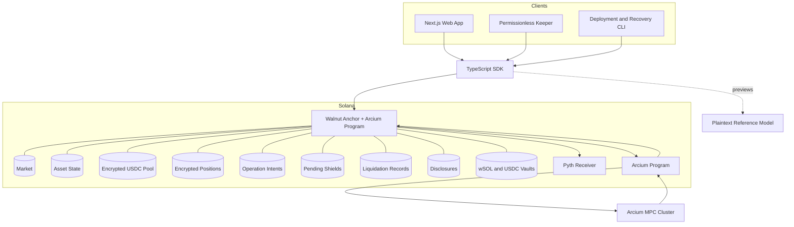

# Walnut-Solana architecture

Status: baseline (Task 1.4). Source of truth: `.kiro/specs/walnut-solana/design.md`. Account layouts below are the design's proposed layouts. The encrypted-state format (`EncGroup`) and the Position layout are pending ADR-0003 (the Task 2 Arcium feasibility gate).

## Encryption mechanism

Walnut uses **Arcium MPC**, not FHE. Encrypted inputs and state are Arcium ciphertexts. Computations are written as Arcis circuits in `encrypted-ixs/`, queued by the Walnut program, executed by an Arcium MPC cluster, and returned to the Walnut program through an authenticated callback.

Two ciphertext ownership modes are used:

- `Enc<Shared>`: encrypted under a shared secret between the MXE and a client x25519 key. The client can decrypt it locally. Used for owner-readable data such as the preferred Position layout, Receipts, and Disclosures (sealed to the auditor key).
- `Enc<Mxe>`: encrypted to the MXE cluster only. No individual can decrypt it. Used for aggregate Pool State and Recovery Claim payloads. It is also the fallback for Position state if ADR-0003 rejects the `Enc<Shared>` layout.

## Components



| Component              | Path                       | Role                                                                                                    |
| ---------------------- | -------------------------- | ------------------------------------------------------------------------------------------------------- |
| Walnut program         | `programs/walnut`          | Anchor program. Validates accounts, manages Intents, Locks, generations, custody, and Arcium callbacks. |
| Encrypted instructions | `encrypted-ixs`            | Arcis circuits for every encrypted state transition.                                                    |
| SDK                    | `packages/sdk`             | Builds every instruction, encrypts inputs, derives Viewing Keys, tracks outcomes. Browser and Node.     |
| Reference model        | `packages/reference-model` | Plaintext model of all accounting, used for previews and differential tests. Never used for settlement. |
| Keeper                 | `keeper`                   | Self-hosted Docker service for permissionless maintenance. Holds no admin authority or user keys.       |
| Web App                | `web`                      | Next.js App Router frontend. Derives and holds the Viewing Key in memory.                               |
| Network profiles       | `config/networks`          | Public per-network configuration: program ID, Arcium cluster, mints, vaults, Pyth feeds, RPC.           |
| Tests and scripts      | `tests`, `scripts`         | Integration, transaction-size, and deployment tooling.                                                  |

Rust, Solana, Anchor, and Arcium commands run in Linux or WSL2. Pinned versions are in `toolchain.versions`; see [WSL2_SETUP.md](WSL2_SETUP.md).

## Trust model

- Solana orders and finalizes Walnut instructions.
- Arcium executes circuits using dishonest-majority, detect-and-abort MPC. Privacy requires at least one honest cluster member under Arcium's documented model. A malicious or unavailable member can stop progress but cannot silently forge a valid result.
- Integrity depends on correct circuit code, Arcium's authenticated output, and Walnut's callback verification.
- Pyth supplies signed prices. Walnut is responsible for freshness, confidence, bounds, and anomaly handling.
- Upgrade and risk multisigs are trusted until upgrades are frozen.
- The frontend is inside the key-security boundary because it derives and handles the Viewing Key.

Threats are analysed in [THREAT_MODEL.md](THREAT_MODEL.md).

## Accounts

Public versus encrypted fields for every account are tabulated in [PRIVACY_MODEL.md](PRIVACY_MODEL.md#account-field-tables). This section describes purpose and relationships.

| Account                     | Owner of ciphertext     | Created by                          | Purpose                                                                                  |
| --------------------------- | ----------------------- | ----------------------------------- | ---------------------------------------------------------------------------------------- |
| Market                      | none                    | `initialize_market`                 | Authorities, vaults, public counts and count caps, active Asset State.                   |
| Asset State                 | none                    | `initialize_market`                 | Risk parameters, accounting Borrow Index, rate epoch, utilization band, caps, pauses.    |
| Pool State                  | `Enc<Mxe>`              | `initialize_market`                 | Encrypted USDC Cash, total Supply Shares, total Debt Shares, Reserves.                   |
| wSOL and USDC vaults        | none                    | `initialize_market`                 | SPL token accounts with PDA authority. Balances are public.                              |
| Position                    | `Enc<Shared>`\*         | `init_position` (owner-signed)      | One user's encrypted balances plus public lifecycle fields.                              |
| Recovery Position           | `Enc<Mxe>`\*            | `initialize_market`                 | Protocol-owned Position that receives collateral allocated during Absorb.                |
| Operation Intent            | none                    | Every queue instruction             | Captured dependencies, commitments, expiry, and terminal status of one computation.      |
| Pending Shield              | none                    | `shield`                            | Records a deposit until encrypted credit or refund.                                      |
| Liquidation Record          | none                    | `open_liquidation` (permissionless) | Lifecycle of one freeze epoch of one Position.                                           |
| Recovery Claim              | `Enc<Mxe>`              | `absorb` queue instruction          | Binds recovered collateral to supplier loss and Reserve replenishment still owed.        |
| Pending Recovery Settlement | none                    | `settle_recovery_claim` queue       | Escrows a buyer's public USDC offer while the claim check runs.                          |
| Disclosure                  | `Enc<Shared>` (auditor) | Owner-signed disclosure queue       | Snapshot of owner-selected fields re-encrypted to an auditor key, with binding metadata. |

\* Pending ADR-0003. The Recovery Position's ciphertext mode will be chosen in ADR-0003 together with the user Position layout.

### Market initialization and layouts (Task 4.1)

Code: `programs/walnut/src/market/` (`state.rs` layouts, `validation.rs` pure checks, `mod.rs` seeds), `programs/walnut/src/instructions/initialize_market.rs` (accounts and handler), `PoolState` in `programs/walnut/src/state/accounts.rs`, and the `init_pool_state` circuit in `encrypted-ixs/src/lib.rs`. Offsets are asserted by unit tests next to each struct.

| Account           | Seeds                           | Size (bytes) | Notes                                                                                     |
| ----------------- | ------------------------------- | ------------ | ----------------------------------------------------------------------------------------- |
| Market            | `["market"]` (singleton)        | 668          | Authorities, mints, vaults, linked accounts, public counts and count caps, 120 reserved.  |
| Asset State       | `["asset_state", market]`       | 319          | Generations, Borrow Index (WAD), band, risk/rate params, caps, pauses, timelock.          |
| Pool State        | `["pool_state", market]`        | 260          | `Coordination` (generation + Lock), status, `accounted_borrow_index`, `Enc<Mxe>` payload. |
| Vault authority   | `["vault_authority", market]`   | 41           | Owns both vaults and signs vault transfers.                                               |
| wSOL / USDC vault | `["vault", market, mint]`       | 165          | Classic SPL Token accounts, authority = vault authority.                                  |
| Recovery Position | `["recovery_position", market]` | 99           | Production `Position` with `owner` = Market PDA. Encrypted fields arrive with Task 5.     |

`initialize_market` checks, in order and before any write: the signer is the program upgrade authority (an immutable program cannot initialize, matching Arcium's MXE rule), risk/treasury/guardian keys are non-zero, both mints are classic SPL Token mints, wSOL is the native mint, USDC is a different 6-decimal mint, and every account is still zeroed. Token-2022 is out of scope: `Program<Token>` and `Account<Mint>` reject it. All accounts use `init_if_needed` so a second call reaches the freshness check and fails with `MarketAlreadyInitialized` (6028); every address is a Walnut PDA, so nobody can pre-create one. Error codes 6026 to 6040 are appended in `errors.rs`.

Risk and rate parameters start at `RiskParams::LAUNCH_DEFAULT` and `RateParams::LAUNCH_DEFAULT`, caps and count caps come from the instruction arguments, pauses start clear, and the timelock delay starts at 48 hours.

The Pool starts `Initializing` with an all-zero payload, because only the MXE can encrypt to itself. The admin queues `queue_pool_state_init`; the `init_pool_state` callback stores the `Enc<Mxe, PoolSecret>` zero payload, sets `Active`, and bumps the Pool generation to 1. Later callbacks are no-ops and later queues fail with `PoolStateNotInitializing`.

Extension points for Tasks 4.2 to 4.5:

- **Roles (4.2):** `Market.admin`, `pending_admin` (all zero = none), `upgrade_authority`, `risk_authority`, `treasury_authority`, `guardian_authority`, `treasury_usdc_account`.
- **Pauses (4.3):** `AssetState.pauses` with `flags`, `guardian_flags`, `guardian_expiry_slot`; bit constants in `market::pause_flags` follow Requirement 4.7.
- **Timelocked config (4.4):** `AssetState.generation` (the Asset State generation Intents capture), `risk`, `rates`, `timelock.delay_seconds`, `timelock.next_proposal_id`.
- **Caps and counts (4.5):** `AssetState.caps`, `Market.position_count`, `debt_position_count`, `unsettled_recovery_claim_count`, `position_count_cap`, `debt_position_count_cap`.
- **New fields:** take them from the front of the `reserved` tail of Market or Asset State and shrink `reserved` by the same size, so sizes and offsets stay fixed.

### Roles (Task 4.2)

Code: `programs/walnut/src/market/roles.rs` (pure rules and tests) and `programs/walnut/src/instructions/roles.rs` (accounts, handlers, events). Task 4.2 adds no Market fields; it uses the role keys written by `initialize_market`.

Every privileged instruction calls `market::authorize(market, role, signer)`. A signer holds a role only when it equals that role's stored key; a zero key never matches, and no role stands in for another. The admin is the governance root that changes roles, but it does not pass `authorize` for the risk, treasury, guardian, or upgrade roles.

| Instruction                   | Required signer | Effect                                                        | Event                    |
| ----------------------------- | --------------- | ------------------------------------------------------------- | ------------------------ |
| `propose_admin(new_admin)`    | admin           | Sets `pending_admin`; a later proposal overwrites it.         | `AdminTransferProposed`  |
| `accept_admin()`              | pending admin   | `admin = pending_admin`, `pending_admin` cleared.             | `AdminTransferAccepted`  |
| `cancel_admin_transfer()`     | admin           | Clears `pending_admin` (fails with `NoPendingAdmin` if none). | `AdminTransferCancelled` |
| `set_risk_authority(new)`     | admin           | Sets `risk_authority`.                                        | `RoleAuthorityChanged`   |
| `set_treasury_authority(new)` | admin           | Sets `treasury_authority`.                                    | `RoleAuthorityChanged`   |
| `set_guardian_authority(new)` | admin           | Sets `guardian_authority`.                                    | `RoleAuthorityChanged`   |
| `set_upgrade_authority(new)`  | admin           | Records `upgrade_authority`; the loader must already name it. | `RoleAuthorityChanged`   |

Every event carries the Market, the old key, the new key, and the slot; `RoleAuthorityChanged` also carries the role and the signer.

Key rules: a new role key must be non-zero, must not be one of the Market's own accounts (Market PDA, vault authority PDA, Asset State, Pool State, Recovery Position, both vaults, the program id), and must differ from its current value. The upgrade, risk, treasury, and guardian authorities must be four different keys (Requirement 4.4); `initialize_market` now checks this too. The admin may share a key with one of them, as it does with the upgrade authority right after initialization.

Multisigs: roles are plain `Pubkey`s and may be Squads vault PDAs, which are off-curve and sign through CPI. The instructions use Anchor's `Signer`, so no on-curve key is required. Mainnet should make the admin, upgrade, and risk keys Squads multisigs.

Upgrade authority: the real authority lives in the BPF upgradeable loader. To rotate it, change it in the loader first (for example from the current Squads multisig), then call `set_upgrade_authority(new)`; it fails with `UpgradeAuthorityMismatch` unless the program-data account names `new`. A frozen (immutable) program cannot be recorded; a later task can add that transition if needed.

Timelock: the design does not place role changes behind the Task 4.4 timelock, so they apply immediately (rationale in [Timelocked configuration](#timelocked-configuration-task-44)). `market::apply_role_change(market, market_key, kind, new_key)` is the validated, unauthorized transition; a timelocked execute instruction would authorize its own proposal and then call it. Error codes 6041 to 6051 are appended in `errors.rs`.

### Pause controls (Task 4.3)

Code: `programs/walnut/src/market/pause.rs` (pure rules and tests) and `programs/walnut/src/instructions/pause.rs` (accounts, handlers, event). The 12-byte `AssetState.pauses` from Task 4.1 is enough, so no layout changed: `flags` holds durable governance pauses, and `guardian_flags` holds guardian pauses that block only while the slot is below `guardian_expiry_slot`.

The ten `pause_flags` bits follow Requirement 4.7 and fall into four classes:

| Class           | Bits                                                | Mask              |
| --------------- | --------------------------------------------------- | ----------------- |
| Risk-increasing | `SUPPLY`, `BORROW`, `WITHDRAW_COLLATERAL`, `SHIELD` | `RISK_INCREASING` |
| Withdrawal      | `WITHDRAW_SUPPLY`, `UNSHIELD`                       | `WITHDRAWAL`      |
| Settlement      | `LIQUIDATION_START`, `LIQUIDATION_COMPLETE`         | `SETTLEMENT`      |
| Rescue          | `REPAY`, `ADD_COLLATERAL`                           | `NEVER_PAUSABLE`  |

Rescue bits exist so the ten controls stay distinct, but no instruction may set them (`PauseNotAllowed`) and the check ignores them. Repay, collateral addition, callbacks, Intent abandonment, Pending Shield retry and refund, and Pending Recovery Settlement refund map to no bit, so no pause state can block them (Requirement 4.8).

Operation mapping (`market::pause_category(OperationKind)` and `action_pause_category(Action)`): Shield → `SHIELD`; Unshield → `UNSHIELD`; Supply → `SUPPLY`; WithdrawSupply and reserve withdrawal → `WITHDRAW_SUPPLY`; Borrow → `BORROW`; collateral withdrawal → `WITHDRAW_COLLATERAL`; Health and `open_liquidation` → `LIQUIDATION_START`; Liquidation, `absorb`, and `settle_recovery_claim` → `LIQUIDATION_COMPLETE`. Probe, PositionInit, Viewing Key rotation, and `update_utilization_band` are not pausable. Every future queue instruction calls `market::ensure_not_paused(&asset_state.pauses, category, slot)` (or `ensure_action_allowed`) in queue step 1; callbacks never call it.

| Instruction                         | Signer   | Effect                                      |
| ----------------------------------- | -------- | ------------------------------------------- |
| `guardian_pause(flags, duration)`   | guardian | Sets guardian bits until `slot + duration`. |
| `set_pause(flags, paused)`          | risk     | Sets or clears durable bits.                |
| `renew_guardian_pause(expiry_slot)` | risk     | Moves the active guardian expiry later.     |
| `clear_guardian_pause()`            | risk     | Resets guardian bits and expiry to zero.    |

Guardian rules (Requirement 4.9): `1 <= duration <= GUARDIAN_MAX_PAUSE_SLOTS` (216,000 slots, about 24 hours). While a guardian pause is active, another guardian pause adds bits and keeps the expiry. After a guardian pause expires on its own, the guardian must wait `GUARDIAN_PAUSE_COOLDOWN_SLOTS` (9,000 slots, about one hour) past the expiry, so chained pauses cannot become permanent. Only governance (the risk authority) renews, clears, or makes a pause durable; the admin is not an implicit pauser.

Every change emits `PauseUpdated` with the change kind, actor, requested mask, old and new `flags`, `guardian_flags`, and `guardian_expiry_slot`, and the slot. Pauses apply immediately (Requirement 4.5 allows immediate emergency pauses, and the design does not timelock unpausing) and do not bump the Asset State generation, so queued work still completes. The `apply_*` functions in `market::pause` are the validated, unauthorized transitions that a Task 4.4 timelocked execute could call. Error codes 6052 to 6058 are appended in `errors.rs`.

### Timelocked configuration (Task 4.4)

Code: `programs/walnut/src/market/config.rs` (account, bounds, pure transitions, tests) and `programs/walnut/src/instructions/config.rs` (accounts, handlers, events). Market and Asset State layouts are unchanged: proposals live in their own PDAs, and the existing `AssetState.timelock` (`delay_seconds`, `next_proposal_id`) and `AssetState.generation` fields are used as reserved in Task 4.1.

`ConfigProposal` = `PDA["config_proposal", market, id (u64 LE)]`, 372 bytes: layout version, bump, `status` (`Pending`, `Executed`, `Cancelled`), `group` (`Risk`, `Rates`, `Caps`, `TimelockDelay`, and the Task 4.5 `CountCaps`), market, id, proposer, `proposed_at`, `earliest_execute_at`, `expires_at`, `proposal_generation`, `old_values` and `new_values` (fixed 72-byte `ConfigValues` snapshots of all four groups), `resolved_at`, `resolved_by`, `executed_generation`, `old_count_caps` and `new_count_caps` (Task 4.5), and 32 reserved bytes. Snapshots are used instead of a Borsh enum because an enum's encoded length depends on the variant and would move later offsets. Offsets are asserted in `config.rs`.

| Instruction                              | Signer                     | Effect                                                                         | Event                   |
| ---------------------------------------- | -------------------------- | ------------------------------------------------------------------------------ | ----------------------- |
| `propose_config_change(id, ConfigValue)` | risk authority (+ payer)   | Validates against the current config, creates the proposal, increments the id. | `ConfigChangeProposed`  |
| `execute_config_change(id)`              | anyone                     | After the delay, before the grace window ends: writes the group, generation+1. | `ConfigChangeExecuted`  |
| `cancel_config_change(id)`               | risk authority or guardian | Marks a pending proposal `Cancelled`.                                          | `ConfigChangeCancelled` |

Rules:

- `id` must equal `next_proposal_id`. `earliest_execute_at = proposed_at + delay`. Execution needs `now >= max(earliest_execute_at, proposed_at + current delay)` and `now < expires_at`, where `expires_at = earliest_execute_at + 14 days` (`EXECUTION_GRACE_SECONDS`) is fixed at proposal time; after that a proposal can only be cancelled. A later delay raise therefore cannot reopen an expired proposal (Task 4.6 fix), and because the delay is at most 14 days a raised delay still leaves at least one day to execute.
- Execution requires the changed group to still hold `old_values` for that group (`ConfigProposalBaseChanged`), so two proposals built on the same risk group cannot silently revert each other. A change to another group does not block it.
- Bounds, movement, and the cross-bound are checked at proposal time and again at execution against the then-current config. Proposing and cancelling never change configuration or the generation.
- Execution increments `AssetState.generation` exactly once. Every Intent captures that generation, and the Task 3.3 callback marks it `Stale` with no financial write when it differs. The design does not mark any configuration change as compatible with pending work, so every executed change stales every Intent queued before it. Test: `market::config::tests::executed_change_stales_a_pending_intent_without_moving_value`.

Bounds (basis points unless noted). Every launch default from Task 4.1 is inside them, so no default changed.

| Field                       | Min    | Max     | Max change per execution | Launch |
| --------------------------- | ------ | ------- | ------------------------ | ------ |
| `ltv_bps`                   | 1,000  | 8,000   | 500                      | 5,000  |
| `liquidation_threshold_bps` | 1,000  | 8,500   | 500                      | 6,500  |
| `liquidation_bonus_bps`     | 100    | 1,500   | 200                      | 500    |
| `target_health_factor_bps`  | 10,100 | 15,000  | 1,000                    | 11,000 |
| `close_factor_bps`          | 1,000  | 10,000  | 2,500                    | 5,000  |
| `reserve_factor_bps`        | 0      | 5,000   | 1,000                    | 1,000  |
| `oracle_max_age_seconds`    | 5 s    | 300 s   | 60 s                     | 60 s   |
| `oracle_max_confidence_bps` | 10     | 500     | 100                      | 200    |
| `decision_expiry_slots`     | 10     | 1,500   | 150                      | 150    |
| `base_rate_bps`             | 0      | 2,000   | 200                      | 0      |
| `slope1_bps`                | 0      | 5,000   | 400                      | 400    |
| `slope2_bps`                | 0      | 50,000  | 5,000                    | 7,500  |
| `optimal_utilization_bps`   | 5,000  | 9,500   | 1,000                    | 8,000  |
| `band_max_age_slots`        | 150    | 216,000 | 9,000                    | 9,000  |
| `timelock.delay_seconds`    | 24 h   | 14 days | any (inside the range)   | 48 h   |

Also `ltv < liquidation_threshold` and `slope1 <= slope2`. Cap bounds and the cap raise limit are Task 4.5 rules; see [Caps and lifecycle counts](#caps-and-lifecycle-counts-task-45). Task 4.5 also adds a fifth group, `CountCaps`, stored in the Market, and two 16-byte proposal fields (`old_count_caps` at 308, `new_count_caps` at 324) taken from the reserved tail, which shrinks to 32 bytes. The proposal size stays 372 bytes, and `execute_config_change` now takes the Market as writable.

Cross-bound (Requirement 4.13), exact integer bps arithmetic with margin `m = 100` bps: `L × (1 + bonus) <= 0.99` and `T >= L × (1 + bonus) + 0.01`. With the bounds above the largest `L × (1 + bonus)` is `0.85 × 1.15 = 0.9775` and the smallest `T` is 1.01, so every in-bounds configuration satisfies it; the check still runs so that a later bound change cannot break it silently.

Role changes stay immediate. Requirement 4.5 timelocks adverse risk changes and upgrades. A role setter changes no risk parameter, cap, or code: whoever holds the risk role still needs this timelock for every parameter change, and the cancellation role can stop it. Upgrades are timelocked at the loader's authority (the Squads multisig, Task 17.3); `set_upgrade_authority` only records what the loader already names. The residual risk is a compromised admin replacing both the risk authority and the guardian; users then still get the full delay to exit, and the admin should itself be a Squads multisig with a time lock (Task 17.3).

Rate changes: once Borrow Index accrual exists (Task 7), executing a `Rates` change must accrue the index at the old rate first, so new rates are not applied to elapsed time. Error codes 6059 to 6070 are appended in `errors.rs`.

### Caps and lifecycle counts (Task 4.5)

Code: `programs/walnut/src/market/caps.rs` (pure rules and tests), `programs/walnut/src/instructions/caps.rs` (`decrease_caps`), the `CountCaps` group in `market/config.rs`, and the localnet test `tests/market-limits.ts`.

Layout changes, all inside fixed sizes: `Market.debt_position_reservations` (u64 at 540) is taken from the reserved tail (now 120 bytes at 548; Market stays 668 bytes). `Position.has_debt` (bool at 98) is appended after `bump` (Position grows from 98 to 99 bytes; no Position other than the Recovery Position exists yet). `ConfigProposal` gains the count-cap fields described above.

Where each cap is checked:

| Cap                       | Compared value                                              | Where                                            | Over the cap                                   |
| ------------------------- | ----------------------------------------------------------- | ------------------------------------------------ | ---------------------------------------------- |
| `supply_cap_usdc`         | Encrypted supplier equity after the proposed supply         | Supply circuit                                   | Circuit approves zero                          |
| `total_debt_cap_usdc`     | Encrypted total debt after the borrow, at the risk index    | Borrow circuit                                   | Circuit approves zero                          |
| `position_debt_cap_usdc`  | Encrypted Position debt after the borrow, at the risk index | Borrow circuit                                   | Circuit approves zero                          |
| `position_count_cap`      | `position_count + 1`                                        | Program, when the Position PDA is created        | `PositionCountCapReached` (no Lock exists yet) |
| `debt_position_count_cap` | `debt_position_count + debt_position_reservations`          | Program, Borrow queue of a Position without debt | Borrow resolves to zero without queueing       |

A value passes when `value <= cap`. `check_supply_cap`, `check_total_debt_cap`, `check_position_debt_cap`, `supply_cap_outcome`, and `borrow_cap_outcome` are the plaintext reference the circuits must match. The queue instruction passes the public caps and the projected risk Borrow Index to the circuit and commits them in `inputs_commitment`; every cap change bumps the Asset State generation, so a computation against old caps resolves `Stale`.

Passive interest: accrual is not an action and never reads a cap, so it cannot fail because of one. `cap_scope` gives a cap check only to Supply, Borrow, and Position creation; Repay, liquidation, Absorb, withdrawals, callbacks, and recovery check none. If interest has moved a value above its cap, `before + amount > cap` holds for every amount, so each new risk-increasing action approves zero. A zero approval classifies `Zero` at the callback and releases the Lock without an error.

Debt-Position count:

1. Borrow queue on a Position with `has_debt == false` calls `reserve_debt_slot`. If `debt_position_count + debt_position_reservations < debt_position_count_cap` one slot is reserved; otherwise the result is `Unavailable` and the borrow resolves to zero without queueing.
2. Every terminal path of that Intent (`Applied`, `Zero`, `Stale`, `Expired`, `Failed`, abandonment) calls `settle_debt_intent` exactly once. It releases the slot and, only for `Applied`, applies the revealed zero/nonzero transition. `DebtTransition` can only be built from `CallbackDecision::Applied`, so counts never move on client input or a non-applied outcome.
3. The transition must agree with the public `has_debt` and the action: zero to nonzero only for Borrow, nonzero to zero only for Repay, liquidation, and Absorb. A contradiction fails with `DebtTransitionMismatch` and changes nothing. Overflow and underflow fail with `LifecycleCountOutOfRange`.

The Position is Locked by its Intent, so `has_debt` cannot change between queue and settlement, and "Borrow on a Position without debt" identifies exactly the Intents holding a slot. The Recovery Position is protocol-owned and not counted.

Cap changes:

- **Raises** (any USDC cap or count cap) go only through `propose_config_change` with a `Caps` or `CountCaps` value, because extra room for new risk is an adverse risk change under Requirement 4.5.
- **Decreases** apply immediately through `decrease_caps(ConfigValue)`, signed by the risk authority. Every field must be at or below its current value and at least one must be lower; anything else fails with `CapChangeNotDecrease`. The guardian cannot call it: its emergency tool is the expiring pause, and a cap decrease does not expire. A decrease bumps the Asset State generation once and emits `CapsDecreased`; a pending proposal for the same group then fails with `ConfigProposalBaseChanged`. A cap below the current count or debt only blocks new risk.
- **Bounds** (checked at initialization, proposal, execution, and decrease): `position_debt_cap_usdc <= total_debt_cap_usdc <= supply_cap_usdc <= 1,000,000,000 USDC` and `debt_position_count_cap <= position_count_cap <= 1,000,000`.
- **Raise limit:** one change may raise a cap to at most `max(2 × old, old + floor)`, with floor 100,000 USDC for USDC caps and 100 for count caps.

Events: `CapsDecreased` (emitted now), `PositionCountChanged` and `DebtPositionCountChanged` (defined now, emitted by the Position-initialization and debt callbacks in Tasks 5 and 8 to 10). Error codes 6083 to 6086 are appended in `errors.rs`, after the Task 6 oracle codes.

### Governance test checkpoint (Task 4.6)

Code: `programs/walnut/src/market/governance_tests.rs` (test-only). It drives the real pure transitions of Tasks 4.1 to 4.5 with an independent reference model written from Requirement 4. Signers: admin, pending admin, upgrade, risk, treasury, guardian, an attacker key, a spare key, and an off-curve multisig PDA; role-key candidates add the zero key and the Market PDA. The action alphabet is `propose_admin`, `accept_admin`, `cancel_admin_transfer`, `set_role` (risk, treasury, guardian), `set_upgrade_authority`, `guardian_pause`, `set_pause`, `renew_guardian_pause`, `clear_guardian_pause`, `propose`, `execute`, `cancel`, `decrease_caps`, `on_position_initialized`, `reserve_debt_slot`, `settle_debt_intent` (applied, contradictory, and non-applied outcomes), and time and slot advances, including jumps to `ready - 1`, `ready`, `expires_at - 1`, `expires_at`, the guardian expiry, and the cooldown end.

| Invariant (checked after every step)                                                                                                                                                                                                                                     | Tests                                                                                                                                                                                                                                                                                                                |
| ------------------------------------------------------------------------------------------------------------------------------------------------------------------------------------------------------------------------------------------------------------------------ | -------------------------------------------------------------------------------------------------------------------------------------------------------------------------------------------------------------------------------------------------------------------------------------------------------------------- |
| Unauthorized access: only the exact role holder succeeds; anyone else gets the role's error and nothing changes. No role stands in for another; an inactive Market authorizes nobody.                                                                                    | `unauthorized_signers_change_nothing_for_every_privileged_action`, `inactive_market_rejects_every_privileged_action`, both `prop_governance_model_*`                                                                                                                                                                 |
| Timelock bypass: a governed value changes only by executing a pending proposal at `now >= max(earliest_execute_at, proposed_at + current delay)` and `now < expires_at`, or moves down through `decrease_caps`. Final, reused, and base-changed proposals never execute. | `execute_at_earliest_but_not_one_second_before`, `execute_in_last_grace_second_but_not_at_expiry`, `expired_proposal_stays_expired_after_a_delay_raise`, `raising_delay_delays_and_lowering_never_shortens`, `final_reused_and_base_changed_proposals_never_execute`, `cap_decrease_then_raise_needs_the_full_delay` |
| Pause expiry: an expired guardian pause never blocks; a guardian-only pause lasts at most `GUARDIAN_MAX_PAUSE_SLOTS` and the next one starts at least `GUARDIAN_PAUSE_COOLDOWN_SLOTS` after it ended; rescue actions are never blocked.                                  | `guardian_pause_blocks_before_its_expiry_slot_and_not_at_it`, `guardian_repause_waits_exactly_until_the_cooldown_end`, `rescue_actions_are_never_blocked_by_any_pause_state`, `prop_guardian_only_pauses_never_exceed_max_or_skip_cooldown`                                                                          |
| Generation invalidation: each execution and each cap decrease bumps the Asset State generation exactly once and an Intent captured before it classifies `Stale(AssetGeneration)` with no value moved; nothing else bumps it.                                             | `only_executions_and_cap_decreases_bump_the_generation`, both `prop_governance_model_*`                                                                                                                                                                                                                              |
| Cap boundaries: `value == cap` passes, `cap + 1` resolves to zero (never an error); counts stop exactly at their caps; `debt_position_count` equals the Positions with `has_debt`; bound ordering always holds.                                                          | `cap_checks_pass_at_the_cap_and_resolve_to_zero_one_above`, `count_caps_stop_exactly_at_the_cap`, `cap_bounds_accept_exact_edges_and_reject_one_past`, both `prop_governance_model_*`                                                                                                                                |
| Cross-bound: `L × (1 + bonus) <= 0.99` and `T >= L × (1 + bonus) + 0.01` in exact bps.                                                                                                                                                                                   | `cross_bound_holds_for_every_in_bounds_liquidation_config`, `cross_bound_check_catches_widened_bounds`, `cross_bound_exact_edges`                                                                                                                                                                                    |

`prop_governance_model_random_sequences` runs 1,000 sequences of 80 random steps. `prop_governance_model_exhaustive_short_sequences` primes a Market (two Positions, one with debt; a risk proposal and a delay raise pending; an active guardian pause) and runs all 8,000 sequences of three steps from a 20-step edge alphabet. The whole module runs in about 1.5 s in a debug build.

Findings:

- **Fixed:** `execute` recomputed the deadline as `ready + 14 days` from the current delay, so raising the delay after a proposal had expired made it executable again. It now uses the stored `expires_at`. Regression: `expired_proposal_stays_expired_after_a_delay_raise`; the exhaustive model also caught it.
- With the current bounds the cross-bound is implied by the field bounds (`0.85 × 1.15 = 0.9775 <= 0.99`, and `T >= 1.01 >= 0.9875`). The check stays as defence in depth; `cross_bound_check_catches_widened_bounds` shows it rejects exactly the violating configurations once the bounds are widened.
- By design (single guardian expiry): while governance has renewed a guardian pause, the guardian can add bits to it, and they last until the renewed expiry. Governance can clear them at any time.
- The treasury role has no privileged action yet (reserve withdrawal comes later).

Localnet files `tests/market-{init,limits,pause,roles,timelock}.ts` run alphabetically in one mocha process. Each installs the roles it needs in `before` through the provider wallet, and leaves the provider wallet as admin with no pending admin, no pause, and no pending proposal (`market-roles.ts` also restores the risk, treasury, and guardian keys it started with). `market-init.ts` checks the launch generation, caps, and risk key only on the run that creates the Market.

### Position encrypted payload (preferred layout)

```rust
struct PositionSecret {
    free_sol: u64,
    free_usdc: u64,
    collateral_sol: u64,
    supply_shares_usdc: u128,
    debt_shares_usdc: u128,
}
```

One structure per Position avoids independently encrypted groups reusing a shared key/nonce sequence. If Task 2 shows this layout cannot persist safely and efficiently, all financial work stops until ADR-0003 selects the fallback.

### Pool encrypted payload

```rust
struct PoolSecret {
    cash_usdc: u128,
    total_supply_shares: u128,
    total_debt_shares: u128,
    reserves_usdc: u128,
}
```

### Generations and Locks

```rust
struct Lock {
    active: bool,
    computation_offset: u64,
    operation_intent: Pubkey,
    expiry_slot: u64,
}
```

A generation increments whenever accepted state changes or an operation is abandoned. Walnut cannot prove that an old computation has stopped running after its Lock expires. The enforced invariant is: **only one generation is current, and only a callback bound to that generation may commit.**

On-chain, `Position` and `PoolState` each embed a fixed-layout `Coordination` field group: `generation: u64` (8 bytes, little-endian) followed by the `Lock` (49 bytes: `active` 1, `computation_offset` 8, `operation_intent` 32, `expiry_slot` 8), 57 bytes in total. Borsh lays the group out byte-for-byte like two adjacent fields, so it matches the struct above. Later tasks append their own fields after it and never reorder it. The byte layout is asserted by unit tests in `programs/walnut/src/state/`.

One implementation of the transition rules lives in `programs/walnut/src/state/coordination.rs`. The Operation Intent lifecycle handlers and the Anchor instructions both call it.

- **Acquire** is atomic across every affected account. If any account is already locked, or the same account is passed twice, no Lock is taken and the instruction fails.
- **Release** clears only the Locks whose Operation Intent and computation offset both match the caller. A non-matching release changes nothing and returns zero. A callback that applies state bumps each matching generation by one and then releases. Callbacks that apply nothing (`Zero`, `Stale`, `Expired`, `Failed`) release without bumping.
- **Abandon** requires every matching Lock to be past `expiry_slot`. It bumps every still-matching generation before it clears the Locks, and it changes nothing if any bump would overflow.
- **Late callbacks.** After abandonment the Locks are cleared and the generations have moved on, so a callback that captured the old generation fails the writer check. The Intent is also terminal, so the callback is a no-op.

The adapter copies the `Coordination` fields out, runs the shared rules, and writes them back only on success, so a failed operation leaves every account unchanged. Property tests in `programs/walnut/src/operation/ordering.rs` run every ordering of queue, callback, failure, abandonment, duplicate, late, and wrong-owner events through both paths.

### Operation Intent PDA

Each queued computation owns one Operation Intent account (418 bytes: 8 discriminator, 410 data). The pure-Rust status machine from Task 2.1 is the same struct, so one implementation serves tests and the program. Field offsets are documented and asserted in `programs/walnut/src/operation/intent.rs`.

- **Address.** `PDA["operation_intent", owner, sequence u64 LE]`. The sequence comes from the owner's `OperationCounter` PDA (`["operation_counter", owner]`, 49 bytes). The queue instruction must pass exactly `next_sequence`, and the counter advances by one with checked arithmetic. A replayed or skipped sequence is rejected, and the operation kind is not a seed, so one sequence can never serve two operations (`operation/seeds.rs`).
- **Commitments.** `accounts_commitment` and `inputs_commitment` are SHA-256 over a length-prefixed, little-endian serialization that starts with a domain tag and version byte. Account order and role, owner, mint, authority, writability, and generation are all hashed. The byte format is in the module docs of `operation/commitment.rs` and pinned by golden vectors.
- **Timing.** Creation requires `queued_slot < decision_expiry_slot <= lock_expiry_slot`, so abandonment can never open while a callback may still apply a decision. `Applied` and `Zero` need a slot at or before Decision Expiry. `Expired` needs a slot after it. `Abandoned` needs a slot after Lock expiry.
- **Transition ownership.** `Applied`, `Zero`, `Failed`, `Stale`, and `Expired` are driven only by the verified Arcium callback. `Abandoned` is the only permissionless transition. A terminal Intent rejects every further transition. See `operation/ownership.rs` for the table and error codes.
- **Reclaim.** The Intent records `payer` and `reclaim_authority`, which must be equal because Arcium only lets the original payer claim. `claimComputationRent` is allowed after any terminal status. `reclaimExpiredComputationFee` is allowed only after `Expired` or `Abandoned`. Neither is allowed while `Queued`. The Arcium instructions are built by the SDK (Task 3.4).

### Callback verification and decisions

`programs/walnut/src/operation/callback.rs` holds the pure-Rust helpers that production callbacks call. The instruction runs Arcium `verify_output` itself and passes the result in as `output_authenticated`. `classify_callback` reads the Intent and the callback context and returns one decision. It checks in this order:

1. Output authenticated, else `LeaveQueued`.
2. Intent key and operation kind match the callback, else error.
3. Intent is `Queued`, else `Ignore`.
4. Computation offset matches, else error.
5. Recomputed `accounts_commitment` and `inputs_commitment` match, else error. The callback hashes the generations the Intent captured, not the current ones.
6. A static failure report resolves `Failed`.
7. Captured generations, accounting index and timestamp, and rate epoch match the current values, else `Stale`.
8. Slot is at or before Decision Expiry, else `Expired`.
9. Zero approval resolves `Zero`, nonzero resolves `Applied`.

| Decision                               | Intent status | Generations                   | Locks owned by the Intent |
| -------------------------------------- | ------------- | ----------------------------- | ------------------------- |
| `Applied`                              | `Applied`     | bumped                        | released                  |
| `Zero`, `Stale`, `Expired`, `Failed`   | same name     | unchanged                     | released                  |
| Timeout abandon (`abandon_timeout`)    | `Abandoned`   | bumped before the Locks clear | released                  |
| `Ignore` (terminal Intent)             | unchanged     | unchanged                     | unchanged                 |
| `LeaveQueued` (unauthenticated output) | `Queued`      | unchanged                     | still held                |

Errors (steps 2, 4, 5) revert the callback transaction and leave the Intent `Queued`. A commitment mismatch is rejected rather than marked `Stale`, so a public signed output paired with the wrong accounts cannot cancel a live operation. `Stale` is checked before `Expired`, as in the design. `apply_decision` runs the Task 3.2 transition check for the verified-callback actor before each lifecycle handler, so `Applied` after Decision Expiry is refused. The commitment hash stays pure-Rust SHA-256. `CommitmentHasher` is the seam for swapping in the `sol_sha256` syscall once a dependency change is approved.

### Framework checkpoint: invariants and how they are tested

`programs/walnut/src/operation/checkpoint.rs` (Task 3.5, test-only) drives the real queue, callback, failure, expiry, abandonment and retry code over a small model world, next to an independent reference state machine. The framework holds no financial state, so the model adds a plain-integer ledger (one balance per protected account plus a vault). The ledger changes only in `commit_value_effect`, which the driver calls exactly when the framework returns `Applied`. After every action the harness checks that the real system and the reference model agree on the outcome, every Intent status, every generation and Lock owner, the sequence counter, the clock and the whole ledger, then checks these invariants:

- **Financial neutrality.** The ledger changes only on a transition to `Applied`, by exactly the modelled amount. `Zero`, `Stale`, `Expired`, `Failed`, `Abandoned`, `LeaveQueued`, ignored, rejected and failed-queue steps leave it identical. Total value is conserved. `Applied` happens at most once per Intent.
- **Lock safety.** Every active Lock belongs to one `Queued` Intent whose footprint contains the account. A `Queued` Intent holds its whole footprint. No terminal Intent holds a Lock.
- **Generation safety.** Generations never decrease. They move by exactly one, and only on `Applied`, `Abandoned`, or an external write to that account.
- **Terminal immutability.** An Intent leaves `Queued` once. Only the targeted Intent changes.
- **Sequence counter.** One sequence per queued Intent, strictly increasing, never reused. A failed queue consumes none. Offsets and keys are fresh.
- **Late callback.** A terminal Intent never passes `callback_may_write`, so an `Abandoned` Intent's late callback cannot write.
- **Retry safety.** A retry is a new Intent with a fresh sequence, offset and key. The original stays terminal and is never `Applied`. The retry can itself be `Applied`.
- **Liveness.** From any reachable state, abandoning every expired Intent unlocks every account and a new queue succeeds.

The tests are:

- `prop_exhaustive_core_lifecycle_sequences_up_to_length_5` and `prop_exhaustive_adversarial_callback_sequences_up_to_length_5`: every sequence of up to 5 actions (111,110 each) over two 10-action alphabets with two accounts.
- `prop_random_sequences_full_alphabet_three_accounts`: 20,000 deterministic random sequences of up to 40 actions over the full alphabet with three accounts.
- `checkpoint_applied_moves_exactly_the_modelled_value_once`, `checkpoint_every_non_applied_terminal_outcome_moves_no_value`, `checkpoint_rejected_and_unauthenticated_callbacks_change_nothing` and `checkpoint_failed_queues_change_nothing`: financial neutrality.
- `checkpoint_late_callback_after_abandonment_cannot_write`, `checkpoint_external_generation_change_makes_the_callback_stale` and `checkpoint_concurrent_queue_on_a_locked_account_is_rejected`: Lock and generation safety.
- `checkpoint_retry_after_each_non_applied_outcome_applies_exactly_once` and `checkpoint_retry_requires_a_terminal_non_applied_intent`: retry.
- `checkpoint_sequence_counter_is_strictly_increasing_and_never_reused`: sequence counter.
- `checkpoint_expired_locks_never_leave_an_account_permanently_locked`: liveness.
- `checkpoint_injected_value_faults_are_caught`: a driver that commits value on a non-`Applied` outcome fails the neutrality check, so the check is not vacuous.

## Computation lifecycle

### Queue

1. Validate signer, accounts, pauses, caps, and oracle data where required.
2. Accrue the accounting Borrow Index if the operation reads or mutates Pool accounting.
3. Project the risk Borrow Index to Decision Expiry when health or caps are checked.
4. Create the Operation Intent with `accounts_commitment` and `inputs_commitment`.
5. Acquire all encrypted-balance and custody writer Locks atomically.
6. Capture generations, indexes, rate epoch, oracle generation and publish times, and Decision Expiry.
7. Queue the Arcium computation with success and static-failure callbacks.

`accounts_commitment` hashes a domain-separated serialization of every ordered account with its role, expected owner, mint, authority, writability, and generation. `inputs_commitment` hashes the operation kind and every immutable input: ciphertext metadata, requested amounts, destinations, feed observations, indexes, key epochs, and operation-specific PDAs.

### Success callback

1. Verify callback context and Arcium-signed output.
2. Require Intent status `Queued` and matching computation offset.
3. Recompute and compare both commitments.
4. Compare every captured generation, the accounting index, and the rate epoch.
5. If a dependency changed, mark `Stale`. If Decision Expiry passed, mark `Expired`. No financial write in either case.
6. Otherwise apply all encrypted and public writes atomically, increment written generations, mark `Applied` or `Zero`, and clear only matching Locks.

A callback for an already terminal Intent returns success without writing. Invalid or unauthenticated output changes nothing. The exact check order and decision table are in [Callback verification and decisions](#callback-verification-and-decisions).

### Failure callback

An authenticated static failure marks the Intent `Failed` and clears only matching Locks.

### Abandonment

After Lock expiry, anyone may abandon a still-`Queued` Intent. Abandonment marks it `Abandoned`, increments every still-matching protected generation, clears only Locks owned by that Intent, and leaves funds in their recorded recoverable location. A late callback then cannot write.

### Callback envelope

Callbacks use only pre-created accounts and never create or resize accounts. ADR-0003 records serialized size and compute for every queue and callback transaction (initialization, shield, unshield, supply, withdrawal, borrow, repay, health, reserve withdrawal, utilization band, partial liquidation, Absorb, recovery settlement, disclosure, key rotation). Any transaction over the 1,150-byte engineering ceiling is redesigned or split. The size gate cannot be waived.

## Flows

### Shield and unshield

- **Shield:** transfer the public amount into the vault, create a Pending Shield in `Deposited`, lock the Position, queue the encrypted credit. The callback credits only the matching active attempt and marks `Credited`. Retry and refund are available only when no attempt is queued. Credit and refund are mutually exclusive.
- **Unshield:** the user requests a public amount. The circuit checks encrypted free balance and returns the approved amount (zero if insufficient). The callback transfers that amount from the vault. SOL is delivered as wSOL; unwrapping to native SOL is a separate owner-signed transaction.

### Supply, borrow, repay

Each Pool-mutating computation locks the Pool and the Position, checkpoints interest at the accounting index, then applies the operation's formula. Borrow and collateral withdrawal also require health at the projected risk index through Decision Expiry. Debt existence transitions (zero to nonzero and back) are revealed as a boolean so the program can update `has_debt` and `debt_position_count`; amounts are not revealed.

### Utilization band

`update_utilization_band` is a read-only optimistic computation. It does not lock the Pool. It reveals only a coarse band index, written only if the Pool generation, accounting index, and rate epoch still match. The borrow rate uses the upper edge of the band.

### Health, freeze, liquidation

1. Anyone queues a Health Intent. It does not lock the Position and fails if a writer Lock is active.
2. The circuit reveals only `unhealthy`. The callback freezes the Position if generation and expiry still match, incrementing `freeze_epoch`.
3. `open_liquidation` creates a Liquidation Record keyed by Position and `freeze_epoch`.
4. A liquidator submits an encrypted maximum repayment from their own Free USDC. The computation locks borrower, liquidator, and Pool, rechecks health with fresh prices, and applies the formulaic partial liquidation.
5. After `frozen_since_slot + recovery_delay`, `absorb` may move residual debt and bounded collateral into a Recovery Claim and the Recovery Position.

Owner rescue (repay, add collateral) remains available while frozen once no writer Lock is active. An expired liquidation writer can be abandoned first.

### Selective disclosure and key rotation

- **Disclosure:** the owner selects fields; the circuit re-encrypts them to the auditor's x25519 key into a pre-created Disclosure account with binding metadata.
- **Key rotation:** owner-signed. The callback re-encrypts the Position to the new Viewing Key and increments `viewing_key_epoch` atomically.

## Oracle

Price-sensitive operations read Pyth `PriceUpdateV2` accounts for SOL/USD and USDC/USD, verifying receiver ownership and feed IDs. Defaults: maximum age 60 s (bounded 5–300 s), maximum confidence 2% of price (bounded 0.1–10%). Prices are normalized with checked u128 arithmetic. Spot-versus-EMA deviation and last-good-price checks can trigger anomaly mode, which increments the oracle generation and blocks new risk-increasing and liquidation actions while repay and collateral addition stay open.

If posting a price update and queueing the computation do not fit in one transaction, the SDK posts the update first and then queues against the verified account.

## Keeper

The keeper is permissionless and self-hosted. Jobs: advance rate epochs, accrue the Borrow Index when the Pool is unlocked, discover debt Positions, schedule health checks, open Liquidation Records, advertise liquidation opportunities, abandon expired Intents, reclaim keeper-paid rent and fees, monitor Recovery Claims, and export metrics. It never finances liquidations and never holds admin authority or Viewing Keys. Multiple keepers race safely through Intent and generation checks. See [OPERATIONS.md](OPERATIONS.md#keeper).

## Web App and key handling

The Viewing Key is derived client-side from a wallet signature over:

```text
walnut-solana viewing key v1 |
program=<PROGRAM_ID> |
network=<NETWORK> |
position=<POSITION_PDA> |
epoch=<VIEWING_KEY_EPOCH>
```

The signature and derived secret stay in browser memory and never appear in a transaction. While a key is unlocked, the app loads no third-party scripts, enforces a strict CSP, strips transaction data and ciphertexts from error reports, and offers a lock action. Every form shows fees and the action's public and encrypted fields before signing.
