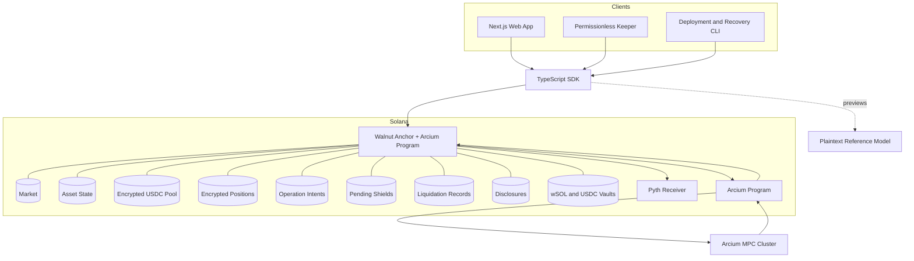

# Walnut-Solana architecture

Status: baseline (Task 1.4). Source of truth: `.kiro/specs/walnut-solana/design.md`. Account layouts below are the design's proposed layouts. The encrypted-state format (`EncGroup`) and the Position layout are pending ADR-0003 (the Task 2 Arcium feasibility gate).

## Encryption mechanism

Walnut uses **Arcium MPC**, not FHE. Encrypted inputs and state are Arcium ciphertexts. Computations are written as Arcis circuits in `encrypted-ixs/`, queued by the Walnut program, executed by an Arcium MPC cluster, and returned to the Walnut program through an authenticated callback.

Two ciphertext ownership modes are used:

- `Enc<Shared>`: encrypted under a shared secret between the MXE and a client x25519 key. The client can decrypt it locally. Used for owner-readable data such as the preferred Position layout, Receipts, and Disclosures (sealed to the auditor key).
- `Enc<Mxe>`: encrypted to the MXE cluster only. No individual can decrypt it. Used for aggregate Pool State and Recovery Claim payloads. It is also the fallback for Position state if ADR-0003 rejects the `Enc<Shared>` layout.

## Components



| Component              | Path                       | Role                                                                                                    |
| ---------------------- | -------------------------- | ------------------------------------------------------------------------------------------------------- |
| Walnut program         | `programs/walnut`          | Anchor program. Validates accounts, manages Intents, Locks, generations, custody, and Arcium callbacks. |
| Encrypted instructions | `encrypted-ixs`            | Arcis circuits for every encrypted state transition.                                                    |
| SDK                    | `packages/sdk`             | Builds every instruction, encrypts inputs, derives Viewing Keys, tracks outcomes. Browser and Node.     |
| Reference model        | `packages/reference-model` | Plaintext model of all accounting, used for previews and differential tests. Never used for settlement. |
| Keeper                 | `keeper`                   | Self-hosted Docker service for permissionless maintenance. Holds no admin authority or user keys.       |
| Web App                | `web`                      | Next.js App Router frontend. Derives and holds the Viewing Key in memory.                               |
| Network profiles       | `config/networks`          | Public per-network configuration: program ID, Arcium cluster, mints, vaults, Pyth feeds, RPC.           |
| Tests and scripts      | `tests`, `scripts`         | Integration, transaction-size, and deployment tooling.                                                  |

Rust, Solana, Anchor, and Arcium commands run in Linux or WSL2. Pinned versions are in `toolchain.versions`; see [WSL2_SETUP.md](WSL2_SETUP.md).

## Trust model

- Solana orders and finalizes Walnut instructions.
- Arcium executes circuits using dishonest-majority, detect-and-abort MPC. Privacy requires at least one honest cluster member under Arcium's documented model. A malicious or unavailable member can stop progress but cannot silently forge a valid result.
- Integrity depends on correct circuit code, Arcium's authenticated output, and Walnut's callback verification.
- Pyth supplies signed prices. Walnut is responsible for freshness, confidence, bounds, and anomaly handling.
- Upgrade and risk multisigs are trusted until upgrades are frozen.
- The frontend is inside the key-security boundary because it derives and handles the Viewing Key.

Threats are analysed in [THREAT_MODEL.md](THREAT_MODEL.md).

## Accounts

Public versus encrypted fields for every account are tabulated in [PRIVACY_MODEL.md](PRIVACY_MODEL.md#account-field-tables). This section describes purpose and relationships.

| Account                     | Owner of ciphertext     | Created by                          | Purpose                                                                                  |
| --------------------------- | ----------------------- | ----------------------------------- | ---------------------------------------------------------------------------------------- |
| Market                      | none                    | `initialize`                        | Authorities, vaults, public counts and count caps, active Asset State.                   |
| Asset State                 | none                    | `initialize`                        | Risk parameters, accounting Borrow Index, rate epoch, utilization band, caps, pauses.    |
| Pool State                  | `Enc<Mxe>`              | `initialize`                        | Encrypted USDC Cash, total Supply Shares, total Debt Shares, Reserves.                   |
| wSOL and USDC vaults        | none                    | `initialize`                        | SPL token accounts with PDA authority. Balances are public.                              |
| Position                    | `Enc<Shared>`\*         | `init_position` (owner-signed)      | One user's encrypted balances plus public lifecycle fields.                              |
| Recovery Position           | `Enc<Mxe>`\*            | `initialize`                        | Protocol-owned Position that receives collateral allocated during Absorb.                |
| Operation Intent            | none                    | Every queue instruction             | Captured dependencies, commitments, expiry, and terminal status of one computation.      |
| Pending Shield              | none                    | `shield`                            | Records a deposit until encrypted credit or refund.                                      |
| Liquidation Record          | none                    | `open_liquidation` (permissionless) | Lifecycle of one freeze epoch of one Position.                                           |
| Recovery Claim              | `Enc<Mxe>`              | `absorb` queue instruction          | Binds recovered collateral to supplier loss and Reserve replenishment still owed.        |
| Pending Recovery Settlement | none                    | `settle_recovery_claim` queue       | Escrows a buyer's public USDC offer while the claim check runs.                          |
| Disclosure                  | `Enc<Shared>` (auditor) | Owner-signed disclosure queue       | Snapshot of owner-selected fields re-encrypted to an auditor key, with binding metadata. |

\* Pending ADR-0003. The Recovery Position's ciphertext mode will be chosen in ADR-0003 together with the user Position layout.

### Position encrypted payload (preferred layout)

```rust
struct PositionSecret {
    free_sol: u64,
    free_usdc: u64,
    collateral_sol: u64,
    supply_shares_usdc: u128,
    debt_shares_usdc: u128,
}
```

One structure per Position avoids independently encrypted groups reusing a shared key/nonce sequence. If Task 2 shows this layout cannot persist safely and efficiently, all financial work stops until ADR-0003 selects the fallback.

### Pool encrypted payload

```rust
struct PoolSecret {
    cash_usdc: u128,
    total_supply_shares: u128,
    total_debt_shares: u128,
    reserves_usdc: u128,
}
```

### Generations and Locks

```rust
struct Lock {
    active: bool,
    computation_offset: u64,
    operation_intent: Pubkey,
    expiry_slot: u64,
}
```

A generation increments whenever accepted state changes or an operation is abandoned. Walnut cannot prove that an old computation has stopped running after its Lock expires. The enforced invariant is: **only one generation is current, and only a callback bound to that generation may commit.**

On-chain, `Position` and `PoolState` each embed a fixed-layout `Coordination` field group: `generation: u64` (8 bytes, little-endian) followed by the `Lock` (49 bytes: `active` 1, `computation_offset` 8, `operation_intent` 32, `expiry_slot` 8), 57 bytes in total. Borsh lays the group out byte-for-byte like two adjacent fields, so it matches the struct above. Later tasks append their own fields after it and never reorder it. The byte layout is asserted by unit tests in `programs/walnut/src/state/`.

One implementation of the transition rules lives in `programs/walnut/src/state/coordination.rs`. The Operation Intent lifecycle handlers and the Anchor instructions both call it.

- **Acquire** is atomic across every affected account. If any account is already locked, or the same account is passed twice, no Lock is taken and the instruction fails.
- **Release** clears only the Locks whose Operation Intent and computation offset both match the caller. A non-matching release changes nothing and returns zero. A callback that applies state bumps each matching generation by one and then releases. Callbacks that apply nothing (`Zero`, `Stale`, `Expired`, `Failed`) release without bumping.
- **Abandon** requires every matching Lock to be past `expiry_slot`. It bumps every still-matching generation before it clears the Locks, and it changes nothing if any bump would overflow.
- **Late callbacks.** After abandonment the Locks are cleared and the generations have moved on, so a callback that captured the old generation fails the writer check. The Intent is also terminal, so the callback is a no-op.

The adapter copies the `Coordination` fields out, runs the shared rules, and writes them back only on success, so a failed operation leaves every account unchanged. Property tests in `programs/walnut/src/operation/ordering.rs` run every ordering of queue, callback, failure, abandonment, duplicate, late, and wrong-owner events through both paths.

### Operation Intent PDA

Each queued computation owns one Operation Intent account (418 bytes: 8 discriminator, 410 data). The pure-Rust status machine from Task 2.1 is the same struct, so one implementation serves tests and the program. Field offsets are documented and asserted in `programs/walnut/src/operation/intent.rs`.

- **Address.** `PDA["operation_intent", owner, sequence u64 LE]`. The sequence comes from the owner's `OperationCounter` PDA (`["operation_counter", owner]`, 49 bytes). The queue instruction must pass exactly `next_sequence`, and the counter advances by one with checked arithmetic. A replayed or skipped sequence is rejected, and the operation kind is not a seed, so one sequence can never serve two operations (`operation/seeds.rs`).
- **Commitments.** `accounts_commitment` and `inputs_commitment` are SHA-256 over a length-prefixed, little-endian serialization that starts with a domain tag and version byte. Account order and role, owner, mint, authority, writability, and generation are all hashed. The byte format is in the module docs of `operation/commitment.rs` and pinned by golden vectors.
- **Timing.** Creation requires `queued_slot < decision_expiry_slot <= lock_expiry_slot`, so abandonment can never open while a callback may still apply a decision. `Applied` and `Zero` need a slot at or before Decision Expiry. `Expired` needs a slot after it. `Abandoned` needs a slot after Lock expiry.
- **Transition ownership.** `Applied`, `Zero`, `Failed`, `Stale`, and `Expired` are driven only by the verified Arcium callback. `Abandoned` is the only permissionless transition. A terminal Intent rejects every further transition. See `operation/ownership.rs` for the table and error codes.
- **Reclaim.** The Intent records `payer` and `reclaim_authority`, which must be equal because Arcium only lets the original payer claim. `claimComputationRent` is allowed after any terminal status. `reclaimExpiredComputationFee` is allowed only after `Expired` or `Abandoned`. Neither is allowed while `Queued`. The Arcium instructions are built by the SDK (Task 3.4).

## Computation lifecycle

### Queue

1. Validate signer, accounts, pauses, caps, and oracle data where required.
2. Accrue the accounting Borrow Index if the operation reads or mutates Pool accounting.
3. Project the risk Borrow Index to Decision Expiry when health or caps are checked.
4. Create the Operation Intent with `accounts_commitment` and `inputs_commitment`.
5. Acquire all encrypted-balance and custody writer Locks atomically.
6. Capture generations, indexes, rate epoch, oracle generation and publish times, and Decision Expiry.
7. Queue the Arcium computation with success and static-failure callbacks.

`accounts_commitment` hashes a domain-separated serialization of every ordered account with its role, expected owner, mint, authority, writability, and generation. `inputs_commitment` hashes the operation kind and every immutable input: ciphertext metadata, requested amounts, destinations, feed observations, indexes, key epochs, and operation-specific PDAs.

### Success callback

1. Verify callback context and Arcium-signed output.
2. Require Intent status `Queued` and matching computation offset.
3. Recompute and compare both commitments.
4. Compare every captured generation, the accounting index, and the rate epoch.
5. If a dependency changed, mark `Stale`. If Decision Expiry passed, mark `Expired`. No financial write in either case.
6. Otherwise apply all encrypted and public writes atomically, increment written generations, mark `Applied` or `Zero`, and clear only matching Locks.

A callback for an already terminal Intent returns success without writing. Invalid or unauthenticated output changes nothing.

### Failure callback

An authenticated static failure marks the Intent `Failed` and clears only matching Locks.

### Abandonment

After Lock expiry, anyone may abandon a still-`Queued` Intent. Abandonment marks it `Abandoned`, increments every still-matching protected generation, clears only Locks owned by that Intent, and leaves funds in their recorded recoverable location. A late callback then cannot write.

### Callback envelope

Callbacks use only pre-created accounts and never create or resize accounts. ADR-0003 records serialized size and compute for every queue and callback transaction (initialization, shield, unshield, supply, withdrawal, borrow, repay, health, reserve withdrawal, utilization band, partial liquidation, Absorb, recovery settlement, disclosure, key rotation). Any transaction over the 1,150-byte engineering ceiling is redesigned or split. The size gate cannot be waived.

## Flows

### Shield and unshield

- **Shield:** transfer the public amount into the vault, create a Pending Shield in `Deposited`, lock the Position, queue the encrypted credit. The callback credits only the matching active attempt and marks `Credited`. Retry and refund are available only when no attempt is queued. Credit and refund are mutually exclusive.
- **Unshield:** the user requests a public amount. The circuit checks encrypted free balance and returns the approved amount (zero if insufficient). The callback transfers that amount from the vault. SOL is delivered as wSOL; unwrapping to native SOL is a separate owner-signed transaction.

### Supply, borrow, repay

Each Pool-mutating computation locks the Pool and the Position, checkpoints interest at the accounting index, then applies the operation's formula. Borrow and collateral withdrawal also require health at the projected risk index through Decision Expiry. Debt existence transitions (zero to nonzero and back) are revealed as a boolean so the program can update `has_debt` and `debt_position_count`; amounts are not revealed.

### Utilization band

`update_utilization_band` is a read-only optimistic computation. It does not lock the Pool. It reveals only a coarse band index, written only if the Pool generation, accounting index, and rate epoch still match. The borrow rate uses the upper edge of the band.

### Health, freeze, liquidation

1. Anyone queues a Health Intent. It does not lock the Position and fails if a writer Lock is active.
2. The circuit reveals only `unhealthy`. The callback freezes the Position if generation and expiry still match, incrementing `freeze_epoch`.
3. `open_liquidation` creates a Liquidation Record keyed by Position and `freeze_epoch`.
4. A liquidator submits an encrypted maximum repayment from their own Free USDC. The computation locks borrower, liquidator, and Pool, rechecks health with fresh prices, and applies the formulaic partial liquidation.
5. After `frozen_since_slot + recovery_delay`, `absorb` may move residual debt and bounded collateral into a Recovery Claim and the Recovery Position.

Owner rescue (repay, add collateral) remains available while frozen once no writer Lock is active. An expired liquidation writer can be abandoned first.

### Selective disclosure and key rotation

- **Disclosure:** the owner selects fields; the circuit re-encrypts them to the auditor's x25519 key into a pre-created Disclosure account with binding metadata.
- **Key rotation:** owner-signed. The callback re-encrypts the Position to the new Viewing Key and increments `viewing_key_epoch` atomically.

## Oracle

Price-sensitive operations read Pyth `PriceUpdateV2` accounts for SOL/USD and USDC/USD, verifying receiver ownership and feed IDs. Defaults: maximum age 60 s (bounded 5–300 s), maximum confidence 2% of price (bounded 0.1–10%). Prices are normalized with checked u128 arithmetic. Spot-versus-EMA deviation and last-good-price checks can trigger anomaly mode, which increments the oracle generation and blocks new risk-increasing and liquidation actions while repay and collateral addition stay open.

If posting a price update and queueing the computation do not fit in one transaction, the SDK posts the update first and then queues against the verified account.

## Keeper

The keeper is permissionless and self-hosted. Jobs: advance rate epochs, accrue the Borrow Index when the Pool is unlocked, discover debt Positions, schedule health checks, open Liquidation Records, advertise liquidation opportunities, abandon expired Intents, reclaim keeper-paid rent and fees, monitor Recovery Claims, and export metrics. It never finances liquidations and never holds admin authority or Viewing Keys. Multiple keepers race safely through Intent and generation checks. See [OPERATIONS.md](OPERATIONS.md#keeper).

## Web App and key handling

The Viewing Key is derived client-side from a wallet signature over:

```text
walnut-solana viewing key v1 |
program=<PROGRAM_ID> |
network=<NETWORK> |
position=<POSITION_PDA> |
epoch=<VIEWING_KEY_EPOCH>
```

The signature and derived secret stay in browser memory and never appear in a transaction. While a key is unlocked, the app loads no third-party scripts, enforces a strict CSP, strips transaction data and ciphertexts from error reports, and offers a lock action. Every form shows fees and the action's public and encrypted fields before signing.
