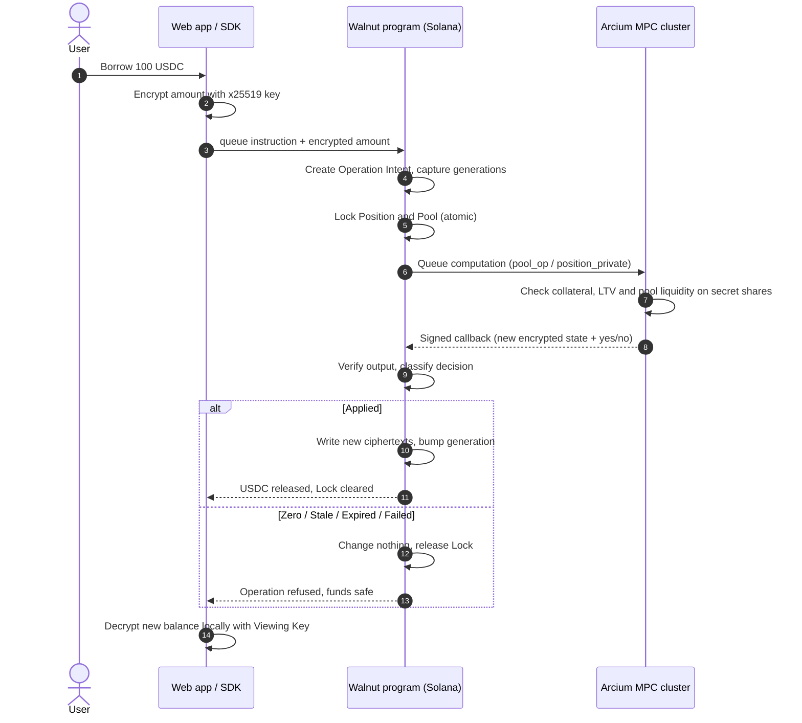
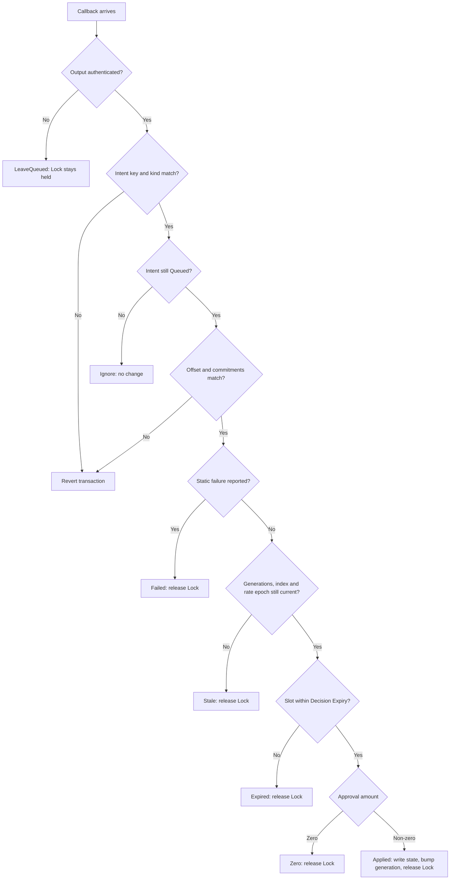
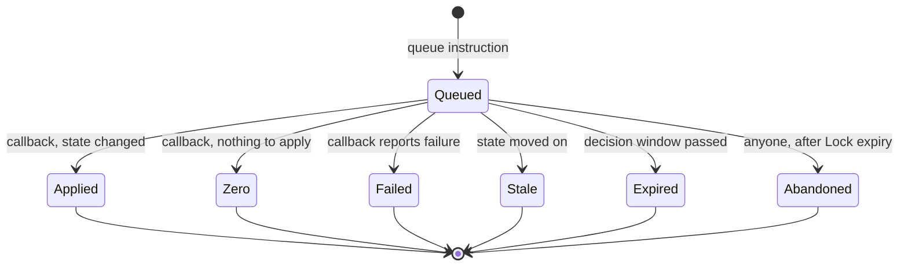
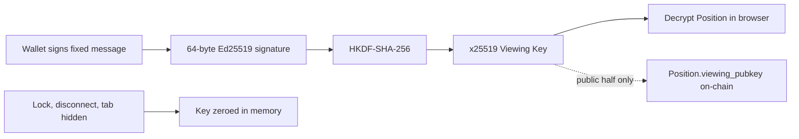
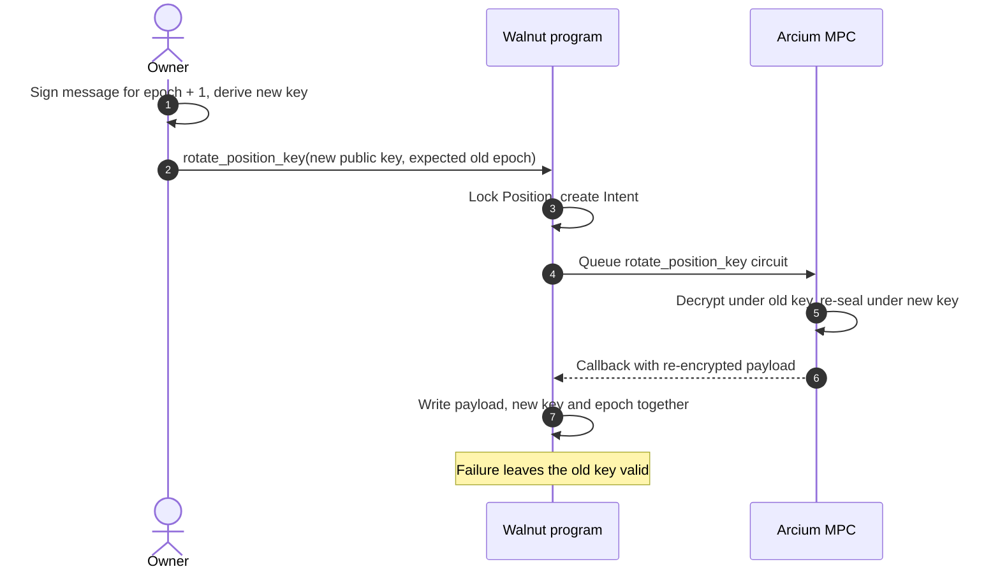
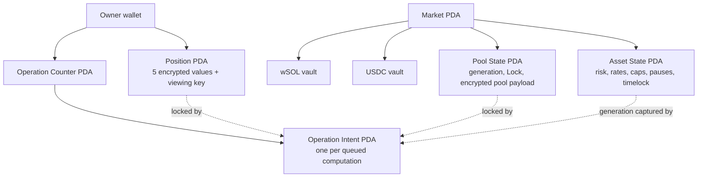
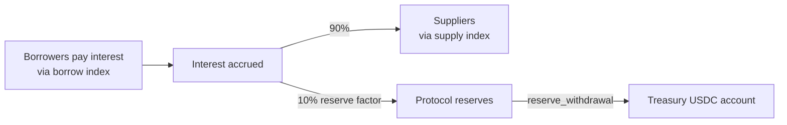

# Walnut diagrams

Visual reference for how Walnut works. The system overview and the confidential liquidation flow live in the [README](../README.md#11-architecture). This page adds the flows that were not drawn there. Details and field layouts are in [ARCHITECTURE.md](ARCHITECTURE.md).

Contents: [1. Life of a private operation](#1-life-of-a-private-operation) · [2. Callback decision flow](#2-callback-decision-flow) · [3. Operation Intent states](#3-operation-intent-states) · [4. Viewing Key derivation and rotation](#4-viewing-key-derivation-and-rotation) · [5. Account map](#5-account-map) · [6. Reserve and supply revenue flow](#6-interest-and-reserve-flow)

---

## 1. Life of a private operation

Every confidential action (shield, borrow, repay, supply, withdraw) follows the same path. Example: a private borrow.

---

## 2. Callback decision flow

The program checks the Arcium callback in a fixed order before it touches any state.

---

## 3. Operation Intent states

Each queued computation owns one Operation Intent. Only the verified Arcium callback can move it forward, except abandonment, which anyone can trigger after the Lock expires.

A late callback after `Abandoned` is a no-op: the Locks are cleared, generations have moved on and the Intent is terminal.

---

## 4. Viewing Key derivation and rotation

Your Viewing Key is derived from your wallet signature. It is never sent anywhere.

Rotation re-encrypts the position to a new key without revealing any value:

---

## 5. Account map

---

## 6. Interest and reserve flow

How borrower interest splits between suppliers and the protocol (launch reserve factor 10%).

